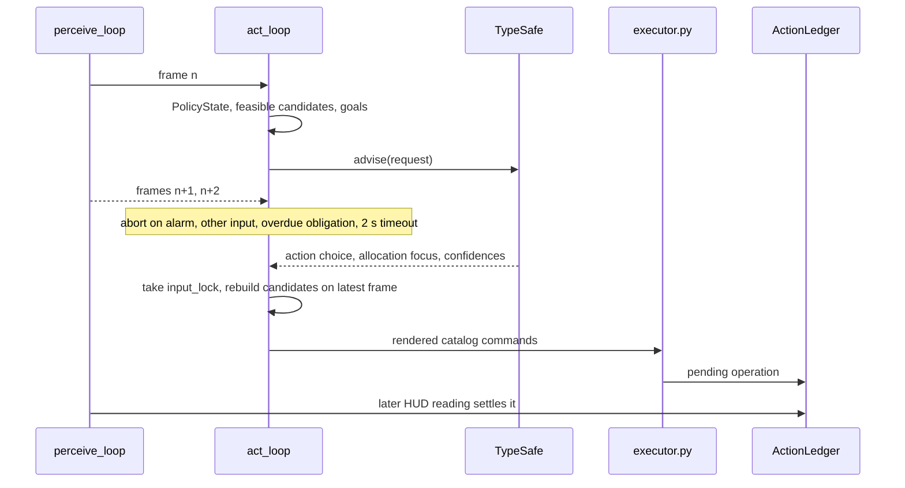
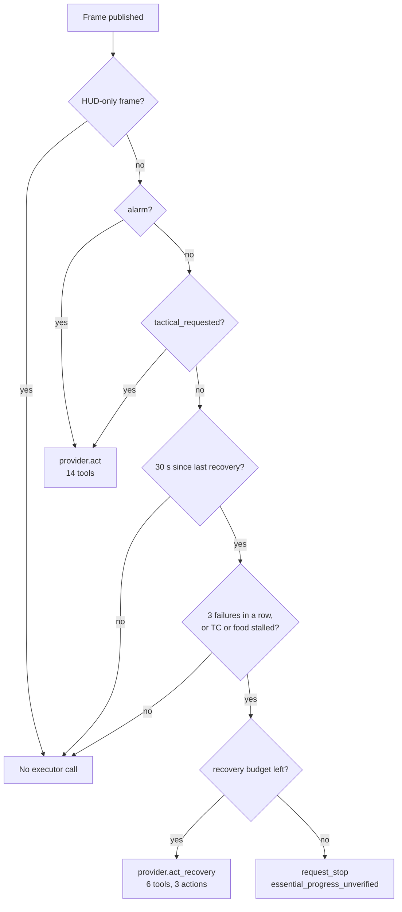

# Decision loops

The gameplay agent decides with three roles on three asyncio clocks that read the same immutable perception frames. TypeSafe System One picks routine economy, age-up and basic military actions from a catalog of currently feasible actions. An LLM strategist sets goals and the villager allocation in the background, and an LLM executor acts only on an alarm, a tactical handoff, or a recovery trigger.

## Roles and clocks

| Role | Code | Model | Runs | Produces |
|---|---|---|---|---|
| Policy | `apps/agent/src/policy/`, `apps/agent/src/providers/typesafe_policy.py` | `AOE2_TYPESAFE_MODEL`, default `jev-1.13.0` | Act loop, at most one request started per 0.5 s | One catalog action id and an allocation focus |
| Strategist | `apps/agent/src/providers/strategist.py`, `apps/agent/src/strategist_phase.py`, `apps/agent/src/strategist_brief.py` | `AOE2_STRATEGIST_MODEL` | Background task launched from the deliberate loop | Goals and a villager allocation |
| Executor | `apps/agent/src/providers/executor_provider.py` | `AOE2_MODEL` | Deliberate loop, on alarm, handoff or recovery | Tool calls executed through `executor.py` |

`game_loop` in `apps/agent/src/game_loop.py` owns what a game needs once. It creates the per-game `ActionLedger` and binds it, starts the wire and OCR warm-ups, runs the macOS checks (permissions, keyboard layout, game profile, open menu, zoom), builds the `LoopContext`, and points the executor's refresh callbacks at the frame pipe. It then issues the opening ground commands (a zoom scroll on Windows, `,` to select the scout, `g` for auto scout) and `_run_clocks` starts four tasks: `perceive_loop`, `act_loop`, `deliberate_loop` and a time-budget watcher. The first task to return ends the game, and the rest are cancelled. `_close_out` marks unresolved ledger commitments uncertain, writes `game_metrics_final`, and logs the game end to the goal log.

`LoopContext` (`apps/agent/src/loops/context.py`) holds everything the clocks share: the `FramePipe` that perception publishes to, the `input_lock`, the `tactical_requested` event, the `stop` event, the `AgentController`, the goal manager and the ledger. `request_stop(reason)` keeps the first reason given, such as `timeout`, `essential_progress_unverified`, `detector_unavailable` or `error`. `max_iterations` counts perception frames. How frames are produced is in [perception](perception.md).

## One routine decision

A newer frame alone never invalidates advice. The choice is applied if it is still in the feasible set computed from the frame that is current when the actor takes the input lock.

## The actor loop

`act_loop` (`apps/agent/src/loops/act.py`) waits for a frame newer than the last one it consumed and starts a policy request at most every 0.5 s; an alarm frame skips that wait. `act_once` then does the following.

1. It skips the frame when `frame.alarm` is set or another loop holds the input lock.
2. `policy_request` builds a frozen `PolicyRequest`: the `PolicyState` for the frame, the feasible candidates, the active goals, the source tick and capture time, the input and goal revisions, and the ledger's last five failures.
3. If the controller already has an overdue obligation, it skips the model call.
4. `_await_advice` calls the advisor and polls every 0.1 s until `AOE2_POLICY_TIMEOUT` (2.0 s). It gives up early on shutdown, an alarm, an input revision that moved (`intervening_execution`), or an obligation that became overdue. A `PolicyAdvisorError` or any other exception becomes `provider_error:<type>`.
5. Under the input lock it re-reads the latest frame. An alarm, an invalid spatial view on a non-HUD frame, or an input revision that differs from the ledger's ends the attempt as `superseded`.
6. It rebuilds `PolicyState` and candidates from that frame and calls `_choose_action`.
7. `tactical_handoff` sets `tactical_requested` and executes nothing. Any other candidate renders its commands, which go through `models.validate_actions` and `ctx.actuator.execute`. If execution failed and the executor recorded no ledger outcome, the actor records a `failed` outcome itself.

`state_for_frame` (`apps/agent/src/policy/request.py`) uses the `PolicyState` that perception attached to the frame (`ledger_policy_state`, observed facts plus unsettled commitments) and adds the visible classes and spatial validity. Spatial evidence older than 5 s (`POLICY_SPATIAL_AGE_SECONDS`) counts as invalid.

## The feasible action catalog

`apps/agent/src/policy/catalog.py` defines 33 `ActionSpec` entries: `wait`, three age advances, 12 buildings, `queue_villager`, six military units, five technologies, four `assign_<resource>` actions and `tactical_handoff`. Each spec has a cost, a minimum age, required buildings, menu and key bindings, and a `unique` flag. `feasible_candidates` keeps the specs for which `eligible` (`apps/agent/src/policy/candidates.py`) is true.

| Kind | Eligible only when |
|---|---|
| Any | Not pending or suppressed in the ledger; age reached; required buildings confirmed; every cost resource read from the HUD and stock minus reservations covers the price. Unknown age blocks research and anything past Dark Age |
| Build | Spatial view valid; same class not pending; idle villager or visible villager; unique buildings once; house only when cap minus population minus pending units is 2 or less (cap under 200); lumber camp needs a visible tree, mining camp a visible gold or stone mine |
| Research | Not researched, pending or paid. An age advance must be the current age's and needs 2 of its buildings, from the `AGE_UPS` table in the catalog: Feudal from mill, lumber camp, mining camp, barracks; Castle from archery range, stable, blacksmith, market; Imperial from siege workshop, monastery, university, castle |
| Train | Population known and below cap counting pending units; `queue_villager` stops at 2 pending villagers |
| Assign | Spatial view valid; idle villager present; no assignment pending; no gold or stone in Dark Age; a matching resource class visible |
| `tactical_handoff` | An own military unit is visible |
| `wait` | Always |

`candidate_for` renders a spec as one executor action: `build` with menu and key, `research` with the tech name, `queue_villager` or `train_unit`, or `assign_idle` with the resource. What those actions do is in [actions and execution](actions-and-execution.md).

## TypeSafe advice

`PolicyAdvisor` in `apps/agent/src/providers/policy.py` is the protocol the actor awaits (`advise`, `aclose`); `PolicyAdvisorError` marks an expected service failure. `TypeSafePolicyAdvisor` sends one `system_one` request whose state holds the observed game, computed signals (food crisis, stalls, pending assignment, population blocked), active goals and recent failures. It asks `allocation_focus` every time and `gameplay_action` when more than one candidate exists. The returned `PolicyAdvice` is tied to the request's source tick and capture time. Request shape, retries and the model are in [LLM providers](llm-providers.md).

## Applying or rejecting advice

`_choose_action` decides in this order and logs `policy_advice_outcome` with the status, reason, source and execution ticks, state age and latency. When advice arrived, the event also carries TypeSafe's own pick and confidence, its top three actions by probability, and its allocation focus (`advised`, `advised_confidence`, `advised_ranking`, `allocation_focus`).

| Condition | Status | Reason |
|---|---|---|
| An obligation is overdue | `fallback` | `obligation_overdue` (the controller's candidate runs) |
| The advisor timed out | `timed_out` | `provider_timeout` |
| Any other advisor failure | `fallback` | the failure reason |
| Advice from another frame | `rejected` | `source_frame_mismatch` |
| Input revision moved | `rejected` | `input_revision_changed` |
| Goals or allocation changed | `rejected` | `goal_revision_changed` |
| Age changed | `rejected` | `age_changed` |
| Chosen id not among the latest candidates | `rejected` | `candidate_unavailable` |
| Action confidence below `AOE2_POLICY_MIN_CONFIDENCE` (0.65), and the fallback would choose `wait` | `applied` | `fallback_had_nothing` (TypeSafe's pick runs) |
| Action confidence below `AOE2_POLICY_MIN_CONFIDENCE` (0.65) | `rejected` | `low_confidence` |
| Otherwise | `applied` | `eligible_on_latest_frame` |

Once the revision and age checks pass, an allocation focus with confidence at or above 0.65 is applied even when the action is then rejected. Every non-applied row runs `select_fallback` over the same candidates. An overdue obligation is never TypeSafe's to decline.

## Obligations and the deterministic fallback

`AgentController` (`apps/agent/src/policy/controller.py`) tracks two obligations: an idle worker (served by `assign_*` or `build_farm`) and Town Center production (`queue_villager`). It notes when each becomes observable; once one has waited 5 s and its action is feasible, `overdue` returns that candidate and it pre-empts TypeSafe before the request, during the wait and at selection. The idle-worker action is the resource furthest below its allocation share, or a farm when food is wanted and no food source is visible. `record_attempt` restarts the clock.

`select_fallback` (`apps/agent/src/policy/fallback.py`) takes the first feasible match:

1. Stall fixes: `queue_villager` when the Town Center stalled with nothing queued; `assign_food`, `build_farm` or `build_mill` when food stalled.
2. The highest-priority unmet goal: `villagers` prefers `queue_villager`, `build_house`, `assign_food`; `food_workers` prefers `assign_food`, `build_farm`, `build_mill`, `assign_wood`; `age` follows the age path.
3. An idle villager goes to the allocation's most-wanted resource.
4. A house when housing is needed.
5. The age path: the next advance, then two buildings for that age (mill and lumber camp in Dark Age, blacksmith and market in Feudal, siege workshop and monastery in Castle).
6. `queue_villager` while fewer than 30 (Dark Age) or 35 (Feudal Age) villagers are ordered, without a cap later.
7. Barracks, archery range, stable; then the age's units; then double-bit axe, horse collar, gold mining, loom, wheelbarrow.
8. `wait`.

The fallback never chooses `tactical_handoff`.

## Goals and allocation

`GoalManager` (`apps/agent/src/goals.py`) holds the active and completed `Goal` objects (name, `local` or `global`, metric, target, priority 1 to 10, progress), the current `Allocation` and a `revision`. The game starts with `get_default_goals`: queue villagers to 10 (priority 9), 3 food workers (8), Feudal Age (4). `set_goals` keeps the progress of goals that share a name, and the revision increments when the goal set, the allocation or the emergency goals change. The actor rejects in-flight advice whose request carried an older revision.

Perception calls `evaluate_progress` with the HUD fields it actually read, so an unread metric keeps its last progress. Metrics are `population`, `villagers`, `<resource>_workers`, a resource stock, or `age`; the strategist's response schema accepts only these names (`GoalMetric`). A goal completes at progress 1.0 and fails when it passes `deadline_turns`.

An `Allocation` is a target villager count per resource. Before the strategist answers, `seeded(age)` applies:

| Age | Food | Wood | Gold | Stone |
|---|---|---|---|---|
| Dark | 3 | 2 | 0 | 0 |
| Feudal | 2 | 2 | 1 | 0 |
| Castle | 2 | 1 | 2 | 1 |
| Imperial | 1 | 1 | 2 | 1 |

The strategist's allocation and a confident TypeSafe focus (the seeded mix plus one on the focused resource) both write `GoalManager.allocation`; the latest write wins. `for_state` drops targets for resources the agent does not gather in the current age (`gatherable_kinds`: only food and wood in the Dark Age) and uses the seeded mix when nothing is left. It overrides the result when food is under 60: food 2 and wood 1 if wood is under 80, otherwise food only. In Feudal Age with gold under 200 it adds one gold slot. `next_kind` returns the resource furthest below its share.

`maybe_launch_strategist` runs on every deliberate tick with a `StrategistView` of the frame (alarm flag, entity summary, HUD readings, known-buildings line and the [strategist brief](prompts-and-context.md#strategist-input)) and never starts a second call while one is in flight. `StrategistProvider.should_run` only answers; the run itself stamps its start time, alarm time and the age it planned for.

| Condition | Strategist runs |
|---|---|
| No run has started | At once |
| The agent's age differs from the age the last run planned for | At once |
| Alarm | At once, at most once per 10 s |
| The last run failed, or no active goal is left | 5 s after the last run started |
| Otherwise | `AOE2_STRATEGIST_PERIOD` (25 s) after the last run started |

A run that fails before any plan exists returns the default goals. One that fails later raises, `_run_strategist_async` logs `strategist_failed`, and the current goals stand. `GoalLogger` appends goal creation, progress, completion, strategist updates and the game end to `logs/goals.log`.

## Alarms

Perception calls `GoalManager.check_alarm` on each spatial frame. A candidate is an entity in one of 21 `THREAT_CLASSES` detected at confidence 0.45 or higher, and only units the ownership classifier marks `ENEMY` count. Three or more raise the alarm: the frame is published with `alarm=True` and a priority-10 "Defend base" goal is injected once. The actor skips alarm frames and abandons in-flight advice, the deliberate loop hands control to the executor, and the strategist may run early.

## The deliberate loop

`deliberate_loop` (`apps/agent/src/loops/deliberate.py`) takes each frame newer than the last one, launches the strategist when due, and on non-HUD frames picks at most one trigger.

A stall is 30 s without progress in the ledger's food income or villager count. The TC stall counts only with no villager pending, and the food stall only with no assignment pending. `RecoveryBudget` allows three recovery cycles while neither progress timestamp moves, and resets when one does.

`deliberate_once` builds the executor context with `build_llm_context` (see [prompts and context](prompts-and-context.md)), prefixes the trigger and the ledger's recent failures, and calls `act` or `act_recovery` with a `ToolExecutionGate`. The gate takes the input lock for one tool at a time and drops the rest of a response once the input revision moves, so the actor keeps running while the model thinks. `record_llm_turn` books the turn, goal progress and reward. Executor output that arrives as a plain action list is logged as `unexecuted_deliberate_actions_rejected` and never executed.
