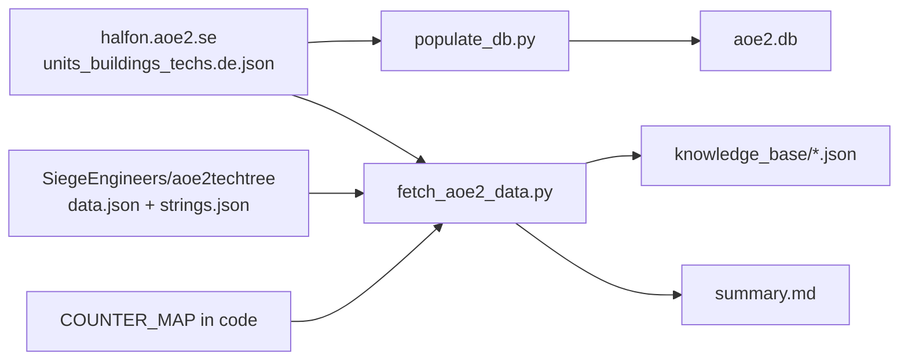

# Game knowledge

`packages/data` is a standalone workspace package, named `data`, that holds AoE2 reference data: a SQLite database of unit and building stats (`aoe2.db`), a folder of JSON exports with a Markdown summary (`knowledge_base/`), and the scripts that build both from public sources. The agent does not use it. `apps/agent` does not depend on `data`, and no module in `apps/`, `packages/`, `scripts/` or `tests/` imports it, so nothing from the database or `summary.md` reaches a prompt.

## Where runtime game facts live

The facts the running agent acts on are written into its prompts and code:

| Fact | Location |
|---|---|
| Hotkeys, build menus, per-age build order and checklists | `apps/agent/src/prompts/hotkeys.md`, `prompts/ages/*.md` (see [prompts and context](prompts-and-context.md)) |
| Cost, age, prerequisite buildings and key binding of every named action | `apps/agent/src/policy/catalog.py` (`SPECS`, see [decision loops](decision-loops.md)) |
| Placement, the order ledger and refusal rules | `apps/agent/src/executor.py` (see [actions and execution](actions-and-execution.md)) |
| Strategist objective and game facts; the situation and age-up gap it plans from | `apps/agent/src/prompts/strategist.md`, `apps/agent/src/strategist_brief.py` |
| Age-up building requirements | `apps/agent/src/policy/catalog.py` (`AGE_UPS`) |

## Package contents

| Path (under `packages/data/src/`) | What it is |
|---|---|
| `aoe2.db` | SQLite database, shipped as package data |
| `game_knowledge.py` | `GameKnowledge` (schema, loader, queries) and the `get_db()` singleton |
| `populate_db.py` | Rebuilds `aoe2.db` from halfon |
| `fetch_aoe2_data.py` | Writes the `knowledge_base/` JSON files and `summary.md` |
| `_halfon_schema.py` | Pydantic models for the halfon payload (`HalfonResponse`, `HalfonEntity`, `HalfonCost`) |
| `_narrow.py` | `as_int`, `as_str`, `as_dict` narrowing helpers |
| `knowledge_base/` | `units.json`, `buildings.json`, `civs.json`, `techs.json`, `counters.json`, `summary.md` |

`pyproject.toml` declares no dependencies and ships `aoe2.db` and `knowledge_base/**/*` with the package. The import name is `data` (`package-dir = { "data" = "src" }`).

## Two separate builds

The database and the JSON folder come from two scripts that share only the halfon download and its schema. Neither reads the other's output.



```bash
uv run --package data python -m data.populate_db      # delete and rebuild aoe2.db
uv run --package data python -m data.fetch_aoe2_data  # rewrite knowledge_base/
```

Both download at run time with a 30 s timeout. `populate_db` deletes the existing `aoe2.db` first and exits with status 1 if the halfon fetch fails. `fetch_aoe2_data` logs a failed source and writes empty files for it.

### Database build

`GameKnowledge.populate_from_halfon` validates the payload with `HalfonResponse.model_validate_json`. halfon returns units and buildings in one `units_buildings` map, so `_is_building` classifies each entry by the first rule that matches:

1. The id is in `KNOWN_BUILDING_IDS` (25 hardcoded buildings).
2. The class is in `BUILDING_CLASSES` (3, 11, 20, 21, 30, 51).
3. Hit points above 500 and attack 0.
4. Garrison capacity above 0 and hit points above 200.
5. The name contains a building keyword (`tower`, `castle`, `mill`, `farm` and others).

Rows are written with `INSERT OR REPLACE`. `_infer_age` sets the `age` column from `KNOWN_UNIT_IDS`, then an explicit age in the payload, then name keywords for Imperial, Castle and Feudal units, then gold cost (above 50 is Castle, above 30 is Feudal), and otherwise Dark. After the import, `_populate_essential_units` (Villager, Scout Cavalry, Sheep) and `_populate_essential_buildings` (House, Town Center, Mill, Lumber Camp, Mining Camp, Barracks) add hardcoded rows with `INSERT OR IGNORE`, so they fill gaps without overwriting halfon data.

Opening a `GameKnowledge` runs `CREATE TABLE IF NOT EXISTS` for every table, so connecting to an empty file produces the full schema.

### JSON build

`fetch_aoe2_data.main` drops halfon entries with no display name, an `OLD-` prefix, or zero hit points. It classifies with a different rule from the database build: halfon `type == 80`, a building class, or a longer keyword list that adds civ-specific buildings (`krepost`, `donjon`, `folwark`, `caravanserai`, `feitoria` and others). Units get a `class` label from `UNIT_TYPE_MAP` and a `total_cost`; buildings get a `category` of military, defensive, economic or other.

Civilizations and technologies come from aoe2techtree: each civ has `name`, `key`, up to 10 `bonuses` parsed from the help text, and the first 500 characters of that text; each tech has id, names, cost, research time and a description cut to 300 characters. `counters.json` is `COUNTER_MAP` written as-is: 10 unit types, each with `strong_vs`, `weak_vs` and `notes`. `summary.md` is generated text: the counter matrix from `COUNTER_MAP`, fixed strategic principles, three build orders, age-up costs and the record counts.

## Schema

| Table | Columns | Rows in the shipped `aoe2.db` |
|---|---|---|
| `units` | `id` PK, `name`, `localized_name`, `hit_points`, `attack`, `melee_armor`, `pierce_armor`, `range`, `cost_food`, `cost_wood`, `cost_gold`, `cost_stone`, `train_time`, `age`, `type`, `class`, `line_of_sight` | 1291 |
| `buildings` | `id` PK, `name`, `localized_name`, `hit_points`, `cost_wood`, `cost_stone`, `build_time`, `age`, `type`, `garrison_capacity` | 1189 |
| `technologies` | `id` PK, `name`, `localized_name`, four costs, `research_time`, `age`, `building_id`, `effect_description` | 0 |
| `counters` | `unit_id`, `countered_by_id` (both reference `units.id`), `effectiveness`; PK on the pair | 0 |

Indexes cover `units(age)`, `units(type)`, `buildings(age)` and `technologies(age)`. No code writes to `technologies` or `counters`. The `buildings` table has no food or gold cost columns. Row counts are from querying the committed file; the JSON exports hold 1102 units, 670 buildings, 50 civilizations, 181 technologies and 10 counter entries, because the two builds filter and classify differently.

## Queries

| Method | Returns |
|---|---|
| `get_affordable_units(resources, age, limit=10)` | Units from the current age or earlier whose four costs fit in `resources`, highest attack first |
| `get_affordable_buildings(resources, age, limit=10)` | Buildings from the current age or earlier whose wood and stone costs fit, highest hit points first |
| `get_unit_by_name(name)` | First unit whose `localized_name` or `name` contains `name` |
| `get_counter_info(unit_name)` | A counter string from a 7-entry dict in the method; it does not read the `counters` table |
| `get_context_for_state(age, resources, detected_entities)` | Markdown with up to 15 detected entities and the top 5 affordable units and buildings |
| `get_early_game_priorities()` | A fixed five-line Dark Age text |

`get_db()` returns one shared `GameKnowledge` on the default path. `populate_db.main` calls the affordability queries, `get_context_for_state` and `get_early_game_priorities` to print samples after a rebuild; they have no other callers.

## Knowledge seed folder

`apps/agent/knowledge/seed/` holds research notes frozen on 2026-08-17. Its `README.md` states it is not loaded as runtime policy, and no code references the folder.

| File | Content |
|---|---|
| `findings.md` | Run-review findings indexed by tag (`F-n`, `T-n`, `V-4`) with the constants they justified |
| `prompt_rules.md` | The strategy rules encoded in the prompts and in `get_early_game_priorities` |
| `baseline.tsv` | Composite and component scores, turn count and git SHA for experiments `exp_0001` to `exp_0014` |
| `archive/` | Nine memory files written by `MemoryChain`, plus a README comparing them with the rules later written into code |
