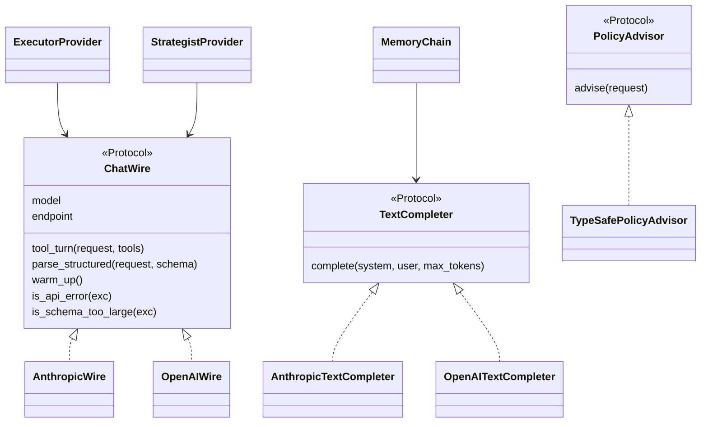
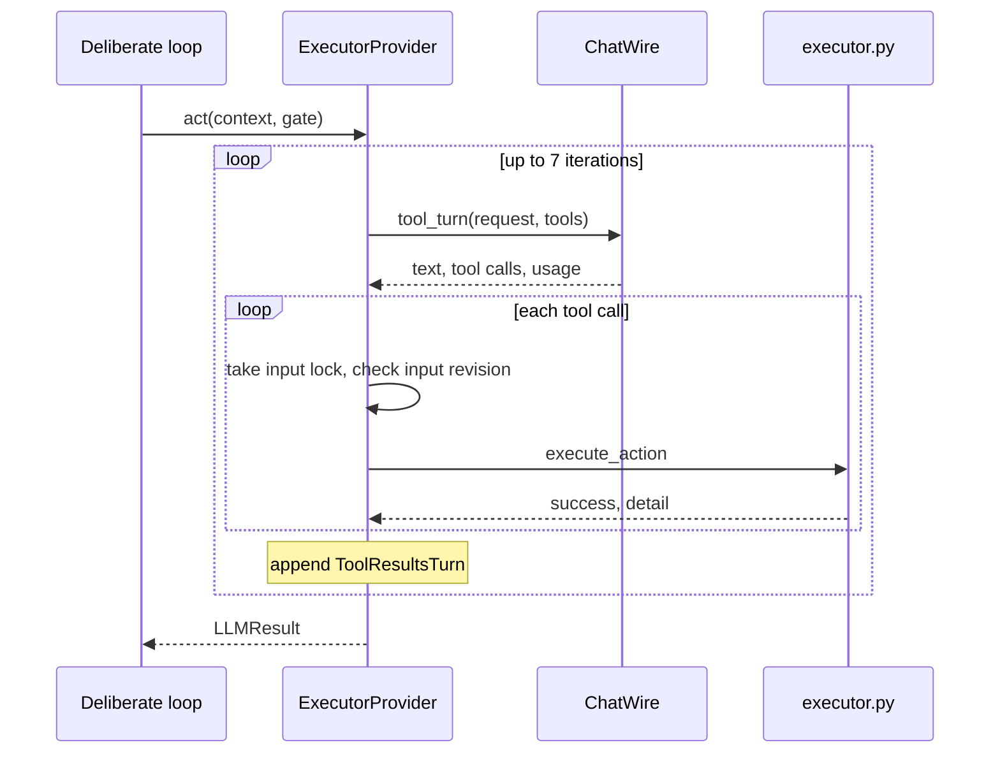

# LLM providers

The agent calls three model services. The executor and the strategist hold game logic and reach their model through a `ChatWire`, which owns every vendor detail. The routine policy uses a TypeSafe client that has its own interface and does not go through a wire.

## Provider, wire, vendor

All of it lives in `apps/agent/src/providers/`. `base.py` defines the vendor-neutral types, `wire_anthropic.py` and `wire_openai.py` implement them, and `wire_factory.py` (`make_wire`, `make_text_completer`) is the only place a wire is chosen by name.

## Wire contract

A provider builds a `ChatRequest` (system blocks, turns, `max_tokens`, `temperature`, `effort`) and calls one of two methods. `tool_turn` runs one iteration of a tool loop and returns a `ToolTurnResult` with text, tool calls and `TokenUsage`. `parse_structured` runs one call constrained to a Pydantic schema and returns the parsed model plus usage.

Turns are `UserTurn`, `AssistantTurn` and `ToolResultsTurn`. Tool schemas are written once, in Anthropic's shape, in `action_tools.py`; the OpenAI wire converts them with `to_openai_tools` into strict function definitions where every property is required and optional ones are nullable. Both wires serialise a tool result with the same `tool_outcome_json`, so the model reads identical JSON (`success`, `detail`, optional `entities`) whichever vendor serves it.

| | `AnthropicWire` | `OpenAIWire` |
|---|---|---|
| API | Messages: `messages.create`, `messages.parse` | Chat Completions: `chat.completions.create`, `.parse` |
| System prompt | One text block per `SystemBlock` | Blocks joined into one system message |
| Tool results | One user message of `tool_result` blocks | One `tool` message per outcome |
| More tools wanted | `stop_reason == "tool_use"` | `finish_reason == "tool_calls"` |
| Effort | `output_config.effort` on both calls | `reasoning_effort` on `parse_structured`; `tool_turn` always sends `"none"` |
| Token cap field | `max_tokens` | `max_completion_tokens` |
| Refusal | `stop_reason == "refusal"` | `message.refusal` |
| Usage | Input excludes cached tokens; cache read and write reported | `prompt_tokens` minus `cached_tokens`; cache write is 0 |
| `is_schema_too_large` | True for any `BadRequestError` | Always False |

Both wires raise `ModelRefusedError` on a refusal and rely on the SDK's own retry of 429 and 5xx responses (`max_retries`, 3 for the executor, 2 for the strategist). The OpenAI wire keeps a tool call whose argument JSON does not parse, with empty arguments, because an unanswered `tool_call_id` makes the next request invalid.

## Wire selection and model defaults

`AOE2_LLM_WIRE` is parsed by `config._parse_wire` in `apps/agent/src/config.py`. Unset or blank means `openai`. Case and surrounding whitespace are ignored. Any other name raises `ValueError` while `config` is being imported, so the process stops before a game starts.

| Wire | Class | Endpoint |
|---|---|---|
| `openai` | `OpenAIWire` | The OpenAI SDK default |
| `zen` | `OpenAIWire` | `https://opencode.ai/zen/v1` (`ZEN_BASE_URL`) |
| `anthropic` | `AnthropicWire` | The Anthropic SDK default |

`AOE2_LLM_BASE_URL` overrides the endpoint for `openai` and `zen`; the Anthropic wire takes no base URL. `AOE2_LLM_API_KEY` is the credential for whichever wire is selected. The `--wire` flag of `aoe2-agent` swaps the executor's adapter only: model names and the strategist still follow `AOE2_LLM_WIRE`.

Model defaults follow the wire (`config._MODELS_BY_WIRE`), and an env override wins per role. An exported but empty override counts as unset.

| Wire | Executor (`AOE2_MODEL`) | Strategist (`AOE2_STRATEGIST_MODEL`) | Memory (`AOE2_MEMORY_MODEL`) |
|---|---|---|---|
| `openai`, `zen` | `gpt-5.6-luna` | `gpt-5.6-terra` | `gpt-5.6-luna` |
| `anthropic` | `claude-haiku-4-5` | `claude-sonnet-5` | `claude-haiku-4-5` |

The full env var table is in the [agent overview](overview.md).

## Request settings

| Setting | Value | Notes |
|---|---|---|
| `max_tokens` | 1536 executor, 2048 strategist | `Config.max_tokens`, `StrategistProvider._MAX_TOKENS`. The strategist's limit counts reasoning, and a cut-off answer is a failed run |
| Temperature | `AOE2_TEMPERATURE`, unset by default | Unset means the field is omitted and the model applies its own default |
| Effort | `AOE2_EXECUTOR_EFFORT`: `low`, `medium`, `high`; default `low` | Any other value falls back to `low`. The strategist does not set effort and gets the `ChatRequest` default, `low` |
| Tool iterations | 7 per deliberate turn | `Config.max_tool_iterations` |
| Seed | `AOE2_SEED` parses into `config.seed` | Neither wire sends a seed, and no agent module reads the field |

Because the OpenAI wire sends `reasoning_effort="none"` on `tool_turn`, `AOE2_EXECUTOR_EFFORT` changes tool-loop behaviour only on the Anthropic wire.

## Executor provider

`ExecutorProvider` (`executor_provider.py`) assembles the system prompt, runs the tool loop, executes each returned tool through `apps/agent/src/executor.py`, and converts any failure into a safe result.

| Method | What it runs | Caller |
|---|---|---|
| `act` | Tool loop over all 14 tools in `_ACTION_TOOLS` | Deliberate loop, alarm and handoff triggers |
| `act_recovery` | Tool loop over the 6 `_RECOVERY_TOOLS`, at most 3 tool actions | Deliberate loop, recovery trigger |
| `plan` | One `parse_structured` call for an `LLMResponse`; executes nothing | `tests/test_executor_provider.py` |
| `get_actions` | Routes by context text between the tool loop and a single structured call | `tests/test_executor_provider.py` |

The loop ends when the wire returns no tool calls, after 7 iterations, at the tool-action cap, or when the input revision has moved since the frame the model saw. The `ToolExecutionGate` holds the input lock only while one tool executes, never across model latency, so the act loop can take input between model turns; when it does, the remaining tool calls are dropped and `deliberate_tool_superseded` is logged.

The provider refuses some calls before they reach the executor. `press` accepts only `h`, `.`, `,`, `space`, `home`, `g`, `b`, `t` and the Ctrl go-to combinations; any other key returns a failed tool result telling the model to use a named action. Tool semantics are in [actions and execution](actions-and-execution.md).

A tool result carries up to 20 detected entities (`id`, `class`, `center`) after `build`, `send_villager`, `send_all_idle`, and after a `press` with `rescan` set.

`_respond` wraps every call path. An exception becomes an `LLMResult` holding one 1000 ms `wait` action and `error=True`; `wire.is_api_error` decides whether the log event is `llm_api_error` or `llm_error`. `record_llm_turn` in `turn_phases.py` counts those turns into `llm_error_rate` and logs `executor_outage` on the third consecutive one.

On the structured path, `get_actions` retries on the tool loop when `wire.is_schema_too_large` is true, and a response with zero actions gets one follow-up request before it is returned.

## Strategist provider

`StrategistProvider.generate_goals` (`strategist.py`) makes one `parse_structured` call per run. The request is text only: the system block is `prompts/strategist.md` and the user turn is rendered from HUD readings, the entity summary, the strategist brief and current goals (see [prompts and context](prompts-and-context.md)).

The schema is `StrategistResponse`: `reasoning`, a list of `StrategistGoal` (`name`, `type`, `metric` from the closed `GoalMetric` set of 11 names the goal manager can measure, `target` as a string, `priority` 1 to 10) and an `allocation` of type `VillagerTargets` with four fixed integer fields. Numeric target strings are converted to `int` or `float`. An all-zero allocation maps to `None`, which leaves the per-age default mix in place.

A successful call logs `strategist_response` with the first 300 characters of the reasoning, each goal as `P<priority> name [metric -> target]`, and the allocation. If the call raises for any reason, the provider logs `strategist_error`. Before any run has succeeded it then returns `get_default_goals`, three Dark Age goals; after that it re-raises, so the caller keeps the goals it has. When the strategist runs is covered in [decision loops](decision-loops.md).

## TypeSafe policy client

`TypeSafePolicyAdvisor` (`typesafe_policy.py`) implements the `PolicyAdvisor` protocol from `policy.py`. It wraps `typesafe_sdk.AsyncTypeSafeClient` and makes one `system_one` call per request with a JSON state and up to two `Choice` questions.

| Question | Asked when | Options |
|---|---|---|
| `allocation_focus` | Always | `balanced`, `food`, `wood`, `gold`, `stone` |
| `gameplay_action` | More than one candidate is feasible | The candidate ids, each described with its immediate cost |

The answer comes back as a `PolicyAdvice` with a choice, a confidence and a probability map for each question, plus token counts. With a single candidate the advisor skips the action question and returns that candidate at confidence 1.0.

The client is built with `RetryPolicy(max_retries=0)` and a timeout of `AOE2_POLICY_TIMEOUT` (2.0 s). The model is `AOE2_TYPESAFE_MODEL`, default `jev-1.13.0`. A `TypeSafeError`, a missing answer, or a choice outside the offered set raises `PolicyAdvisorError`. `TYPESAFE_API_KEY` is required: the constructor raises without it and `main.py` exits before building anything. How the act loop applies, rejects or replaces advice, including the `AOE2_POLICY_MIN_CONFIDENCE` threshold of 0.65, is in [decision loops](decision-loops.md).

## Prompt caching

The executor marks both of its system blocks `cacheable`. The Anthropic wire turns that into a `cache_control` breakpoint on each, and adds a moving breakpoint on the last content block of the conversation so iterations 2 to N of a tool loop read the prefix back from cache. OpenAI-compatible endpoints cache on prefix automatically and ignore the flag; `OpenAIWire._render_system` keeps the stable core block ahead of the age block so the prefix stays identical within an age.

## Warm-up

Both SDKs defer a large import tree until the first call. `game_loop._start_warm_ups` runs the executor wire's `warm_up()` in a thread at game start, which touches `client.messages` or `client.chat`, and logs `wire_warmed` with the time it took.

## Cost accounting

`pricing.py` (`cost_usd`, `price_for`) is the single price table, in US dollars per million tokens. Cache reads are priced at 0.1x input and cache writes at 1.25x input.

| Model | Input | Output |
|---|---|---|
| `claude-opus-5`, `claude-opus-4-7` | 5.00 | 25.00 |
| `claude-sonnet-5`, `claude-sonnet-4-6` | 3.00 | 15.00 |
| `claude-haiku-4-5`, `claude-haiku-4-5-20251001` | 1.00 | 5.00 |
| `gpt-5.6-luna` | 0.20 | 1.20 |
| `gpt-5.6-terra` | 2.00 | 12.00 |
| `kimi-k2.7-code` | 0.95 | 4.00 |

The table is keyed by exact model name. A model that is missing from it costs $0.00 and logs `pricing_unknown_model`, which includes any dated snapshot name not listed. A gateway that resells a model is priced at the first-party rate, so check the `endpoint` field before trusting a figure from `zen`.

| Event | Emitted by | Contents |
|---|---|---|
| `api_cost` | `ExecutorProvider._log_api_cost`, after each call path | Model, endpoint, the four cumulative token counts, `cumulative_cost_usd` for the game |
| `strategist_usage` | `StrategistProvider._call_api`, per call | Model, input and output tokens, `cost_usd` for that call |

`apps/arena/src/invoke.py` prices each synthetic turn with the same `cost_usd`. TypeSafe calls are not priced; `PolicyAdvice` carries their token counts.

## Text completer

Memory extraction and prompt mutation need one blocking prompt-in, text-out call with no tools. They use `TextCompleter` (`text_wire.py`), built by `make_text_completer` under the same wire selection rules and running on the memory model. Callers are `MemoryChain` in `apps/agent/src/memory_chain.py` and `PromptMutator` in `apps/autoresearch/src/prompt_mutator.py` (see [mutation and memory](../autoresearch/mutation-and-memory.md)).
