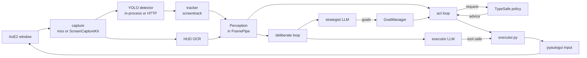

# Gameplay agent

The gameplay agent plays Age of Empires II: Definitive Edition from the screen. It captures the game window, turns the pixels into text with a YOLO detector and local OCR, and drives the game with mouse and keyboard input. Three roles decide what to do, and none of them is ever sent a screenshot: a strategist LLM sets goals, a TypeSafe policy picks routine actions, and an executor LLM handles combat and recovery through guarded tools.

## Roles

| Role | Code | Default model | When it runs | Output |
|---|---|---|---|---|
| Strategist | `apps/agent/src/providers/strategist.py` (`StrategistProvider`) | `gpt-5.6-terra` (`claude-sonnet-5` on the `anthropic` wire) | In the background from the deliberate loop: on the first frame, then every `AOE2_STRATEGIST_PERIOD` (25 s), at once when the age changes or an alarm starts, and 5 s after a failed run or once every goal is met | Goals and a villager allocation |
| Policy | `apps/agent/src/providers/typesafe_policy.py` (`TypeSafePolicyAdvisor`) | `jev-1.13.0` | From the act loop, on each published frame, at most one request every 0.5 s | One action from the feasible catalog, plus an allocation focus |
| Executor | `apps/agent/src/providers/executor_provider.py` (`ExecutorProvider`) | `gpt-5.6-luna` (`claude-haiku-4-5` on the `anthropic` wire) | From the deliberate loop, on an alarm, a tactical handoff, or a recovery trigger | Tool calls, each executed and checked before the next |

Every role reads text built from the HUD readings, the tracked entity list, the goals and the action ledger. The wires, request settings and cost accounting are in [LLM providers](./llm-providers.md); the prompt text and context assembly are in [prompts and context](./prompts-and-context.md).

## Three loops

`game_loop._run_clocks` in `apps/agent/src/game_loop.py` starts four asyncio tasks on one event loop: the perceive, act and deliberate loops, and a timer for the optional time budget. The first task to return ends the game, and the others are cancelled. The loops share a `LoopContext` (`apps/agent/src/loops/context.py`) and pass observations through a `FramePipe` of immutable `Perception` objects (`apps/agent/src/loops/snapshot.py`).

Both the act loop and the executor's tool calls take the same input lock, so only one of them drives the mouse and keyboard at a time.

The perceive loop (`apps/agent/src/loops/perceive.py`, frame source in `apps/agent/src/loops/source.py`) captures a frame every `AOE2_PERCEIVE_INTERVAL` seconds. Detection and HUD reads run on their own lanes, so a slow detector call does not hold up capture. Detections pass through the ownership classifier and the tracker before the frame is published, and the loop raises the alarm when it sees enemy military. It is the only writer of `memory.game_state`. Details are in [perception](./perception.md) and [tracking](./tracking.md).

The act loop (`apps/agent/src/loops/act.py`) builds a request from the latest frame's feasible candidates and asks the policy once, with a `AOE2_POLICY_TIMEOUT` deadline. It then takes the input lock, rechecks the answer against the newest frame, and executes one named action. A timeout, an error, low confidence or a changed fact sends it to the deterministic `select_fallback` in `apps/agent/src/policy/fallback.py`. It stands aside while an alarm is up.

The deliberate loop (`apps/agent/src/loops/deliberate.py`) launches the strategist as a background task and runs the executor's tool loop when there is an alarm, when the policy chose `tactical_handoff`, or when recovery is due (three failed actions in a row, or a stalled Town Center or food economy, at most once per 30 s). After three recovery cycles without progress it stops the game with `essential_progress_unverified`. Triggers and arbitration are covered in [decision loops](./decision-loops.md), and action semantics in [actions and execution](./actions-and-execution.md).

## Deployment topologies

`window._default_backend` picks the platform from `sys.platform`: `MacBackend` on macOS, `WindowsBackend` when `pygetwindow` imports, otherwise `NullBackend`, which assumes the game is focused and has no window rectangle.

| | Windows VM | Native macOS |
|---|---|---|
| Game and agent | Both in a Windows VM | Both on the Mac; the agent runs from Terminal.app |
| Window | Found by title `Age of Empires II: Definitive Edition` (`window.py`) | Found in the Quartz window list (`window_macos.py`) |
| Game area | 3024x1672 | 3024x1898, full screen on a 3024x1964 Retina panel minus the strip under the menu bar |
| Capture | `mss` region grab | ScreenCaptureKit stream, falling back to Quartz window capture (`screen_macos.py`) |
| Detection | HTTP to `aoe2-server` on the macOS host (`AOE2_DETECTION_HOST`) | In-process ONNX Runtime with the CoreML provider, or a local `aoe2-server` |
| Input | `pyautogui` | `pyautogui`, with keys remapped to the active keyboard layout (`keyboard_macos.py`) and frame pixels divided by the Retina scale |
| Game profile | Optional | Required (`AOE2_GAME_PROFILE`) |

A game profile (`apps/agent/src/game_profile.py`, `GameProfile`) records the lobby: Magyars on a declared map, a locked-team 4v4 with the agent as blue player 1, the capture size, and three verification flags for the roster, hotkeys and ownership colours. On macOS it also sets `command_button`, `zoom_steps` and `modifier_map`, because the Mac game can order units with the left button and bind Cmd where Windows uses Ctrl. The map name is any non-empty string and changes nothing at runtime; the detector reads a mostly green map, such as Highland, best. Examples are in `apps/agent/profiles/`. `platform_problem` stops a run whose profile names the wrong platform, and a recorded experiment counts only when all three flags are verified.

Setup for both topologies is in the [deployment runbook](../runbooks/deployment.md); the detector itself is in [detector](../detection/detector.md).

## Repository layout

The repo is a uv workspace for Python and a bun workspace for the two frontends. `uv sync` installs every Python member editable into `.venv/`; `bun install` at the root installs both frontends.

| Path | Package | Entry point | Contents |
|---|---|---|---|
| `apps/agent` | `gameplay-agent` (`gameplay_agent`) | `aoe2-agent`, `just agent` | Loops, policy catalog, providers, executor, prompts, scenario runner, example profiles |
| `apps/detection-server` | `detection-server` | `aoe2-server`, `just server` | FastAPI YOLO server: `GET /health`, `POST /detect`, `POST /detect/sahi` |
| `apps/arena` | `arena` | `aoe2-arena`, `just arena-race` | Synthetic arena CLI: `race`, `smoke`, `rank` ([arena](../arena/overview.md)) |
| `apps/api` | `arena-web` | `aoe2-arena-web`, `just arena-web-dev` | FastAPI and SSE backend for replay and fork ([web](../web/architecture.md)) |
| `apps/autoresearch` | `autoresearch` | `aoe2-autoresearch`, `just experiment` | Prompt optimization loop and the recorded game runner ([autoresearch](../autoresearch/overview.md)) |
| `apps/dashboard` | `arena-web-ui` (bun) | `just arena-ui-dev` | Vite and React run viewer |
| `apps/landing` | `aoe2-llm-arena-web` (bun) | `just landing-dev` | Astro docs site |
| `packages/core` | `core` | | Shared types such as `Event`, `WorldState`, `DetectedEntity`; no I/O |
| `packages/data` | `data` | | Game-knowledge SQLite database and accessors; no app imports it at runtime ([game knowledge](./game-knowledge.md)) |
| `packages/detection` | `detection` | `just train`, `just export-onnx` | YOLO inference, training, labeling, sprite extraction; weights in `src/inference/models/`, release metadata in `registry/` |
| `packages/evaluation` | `evaluation` | | Event broker, DuckDB persister, synthetic world sim |

Apps depend on packages; `arena`, `arena-web` and `autoresearch` also depend on `gameplay-agent`. The native tracker comes from the separate `screentrack` repo as a release wheel, pinned in the root `pyproject.toml` for macOS arm64, Linux x86_64 and Windows AMD64. Elsewhere in the root: `tests/` (`just test`), `scripts/` (probes, calibration, benchmarks), `docker-compose.yml` and `infra/` for the arena stack, and `experiments/results.tsv`, the ledger of recorded games.

## Configuration

`apps/agent/src/config.py` builds a global `config` when it is imported. Just before that, `env_file.load_env_file` applies the nearest `.env` found in `apps/agent/src/` or any parent directory, which in a checkout is the repo root `.env` unless an `apps/agent/.env` exists. A variable already exported in the shell wins over the file. `just` also loads the root `.env` (`set dotenv-load`).

| Variable | Default | Effect |
|---|---|---|
| `AOE2_LLM_API_KEY` | empty | Credential for the selected wire. Required: `main.py` exits with `missing_api_key` without it |
| `AOE2_LLM_WIRE` | `openai` | `openai`, `zen` or `anthropic`; any other value raises `ValueError` on import |
| `AOE2_LLM_BASE_URL` | empty | Endpoint override for the OpenAI-shaped wires |
| `AOE2_MODEL` | per wire, `gpt-5.6-luna` | Executor model |
| `AOE2_STRATEGIST_MODEL` | per wire, `gpt-5.6-terra` | Strategist model |
| `AOE2_MEMORY_MODEL` | per wire, `gpt-5.6-luna` | Memory extraction and prompt mutation |
| `AOE2_EXECUTOR_EFFORT` | `low` | `low`, `medium` or `high`; anything else becomes `low` |
| `AOE2_TEMPERATURE` | unset | Unset means the field is not sent |
| `AOE2_SEED` | unset | Parsed into `config.seed`; no agent module reads it |
| `AOE2_STRATEGIST_PERIOD` | `25` | Seconds between strategist runs; an age change or an alarm runs it sooner |
| `TYPESAFE_API_KEY` | empty | TypeSafe credential. Required: `main.py` exits with `missing_api_key` without it |
| `AOE2_TYPESAFE_MODEL` | `jev-1.13.0` | Policy model |
| `AOE2_POLICY_TIMEOUT` | `2.0` | Seconds the act loop waits for advice |
| `AOE2_POLICY_MIN_CONFIDENCE` | `0.65` | Below this, advice is rejected and the fallback chooses |
| `AOE2_DETECTION_HOST` | empty | Detection server URL, for example `http://192.168.64.1:8420`; empty runs the detector in-process |
| `AOE2_DETECTION_MODEL` | `aoe2_yolo_v12_nms736` | Bundled weights the in-process detector loads; a server serves whatever its `--model` names |
| `AOE2_TRACKER` | `native` | `native` (screentrack), `python` or `shadow`; read in `apps/agent/src/tracking.py` |
| `AOE2_OCR_BACKEND` | `rapidocr` | `rapidocr`, `tesseract` or `template`. A calibration with digit templates reads with them first and uses this backend for fields they miss |
| `AOE2_CAPTURE_METHOD` | `auto` | `auto`, `stream`, `window` or `mss`; `auto` is `stream` on macOS and `mss` elsewhere |
| `AOE2_PERCEIVE_INTERVAL` | `0.1` | Seconds between captures |
| `AOE2_GAME_PROFILE` | unset | Path to a game profile JSON |
| `AOE2_SAVE_SCREENSHOTS` | `true` | Keep every tenth published detection frame under `logs/screenshots/` |

The LLM variables are covered in depth in [LLM providers](./llm-providers.md). `Config` also holds fixed values with no variable: `max_tokens` 1536, `max_tool_iterations` 7, `action_delay` 0.05 s, `screenshot_quality` 85, `detection_imgsz` 1280 (a static ONNX graph uses its own input shape instead), and `log_dir` `logs`.

`aoe2-agent` takes three flags:

| Flag | Effect |
|---|---|
| `--wire NAME` | Executor adapter for this run; model names still follow `AOE2_LLM_WIRE` |
| `--iterations N` | Stop after N perception frames |
| `--overlay` | Draw detections and HUD reading regions over the game (Tkinter) |

## Startup and run output

`main.main` parses the flags and calls `configure_logging(config.log_dir)`, which opens the run's JSON-lines file. `main_async` checks both keys, builds the `ExecutorProvider` on the selected wire and the `TypeSafePolicyAdvisor`, and awaits `game_loop`, which does the following once per game:

1. Starts the action ledger and warm-up threads that import the wire SDK and, with the `rapidocr` backend, load the OCR engine.
2. On macOS, checks the Screen Recording and Accessibility permissions and that the keyboard layout can type every agent key without Option.
3. Loads `AOE2_GAME_PROFILE` and checks it against the platform.
4. Builds the `LoopContext`: detector (`detection_phase.init_detector`), tracker, optional overlay, default goals, frame source and actuator.
5. On macOS, brings the game to the front once, refuses to start if a menu dims the screen, and sets the profile's modifier map and absolute zoom.
6. Sends the opening commands (a zoom-in scroll except on macOS, then `,` and `g` to send the scout exploring) and starts the loops.
7. When the loops end, settles unverified ledger entries, flushes queued screenshots, and logs `game_metrics_final`.

| Path under `logs/` | Written by | Contents |
|---|---|---|
| `runs/<UTC start>.jsonl` | `logging_setup.configure_logging` | Every structlog event as one JSON line; the console shows the same events |
| `goals.log` | `goal_logger.GoalLogger` | Goals created, strategist updates, game end |
| `screenshots/<UTC stamp>_<capture id>.jpg` | `GameSource._save_sample` | Every tenth published detection frame, when `AOE2_SAVE_SCREENSHOTS` is on |
| `action_screenshots/action_<operation>_<status>.jpg` | `loops.perceive.save_action_evidence` | The frame behind each failed or uncertain action |

`logs/` is gitignored. The recorded game runner (`just experiment`) also appends a row to `experiments/results.tsv` and writes a trace under `apps/autoresearch/experiments/traces/`.

## When a dependency is missing

| Missing or failing | What the agent does | Log event |
|---|---|---|
| `AOE2_LLM_API_KEY` or `TYPESAFE_API_KEY` | Exits with status 1 before the game loop | `missing_api_key` |
| `detection` package not importable | Runs with no detector; every frame has an empty entity list | `detection_not_available` |
| Detector construction raises | Same, with no detector | `detector_init_failed` |
| Configured weights absent, in-process | Loads the newest bundled `aoe2_yolo_v*` weights instead; with none at all, the detector returns mock detections | `detector_initialized mode=mock` |
| Detection server unreachable | Marks the server down and rechecks `/health` every 30 s; meanwhile uses local weights if present, else returns no entities | `remote_detection_failed`, `remote_detection_unavailable_empty_result` |
| `screentrack` not installed | Uses the Python tracker | `tracker_native_unavailable` |
| ScreenCaptureKit stream fails under `auto` | Switches to Quartz window capture for the rest of the run | `capture_fell_back` |
| No HUD calibration for the capture size | Locates the resource bar from the frame; if that fails, HUD readings stay empty | `ocr_autodetect`, `ocr_no_calibration_autodetect_failed` |
| Policy times out, errors or is unsure | The catalog fallback picks the action | `policy_advice_outcome` with status `timed_out`, `fallback` or `rejected` |
| Strategist call fails | Before the first successful run, sets the three default Dark Age goals (`get_default_goals`); after it, keeps the current goals. Either way it retries 5 s later | `strategist_error`, then `strategist_failed` once a plan exists |
| Overlay cannot open | Runs without it | `overlay_init_failed` |
| macOS permission, keyboard layout, profile, menu or focus check fails | Ends the game before the loops start, with that reason | `macos_permission_missing`, `keyboard_layout_cannot_type`, `game_profile_unusable`, `game_menu_open`, `game_not_in_front` |
| Game window gone or unfocusable | Ends the game (`game_not_found`, or `lost_focus` after 15 failed focus attempts 1 s apart) | `game_not_found`, `focus_lost_giving_up` |

The recorded game runner builds its detector with `init_required_detector`, which has no local fallback and refuses mock weights, so a detection outage there ends the game with `detector_unavailable`.
