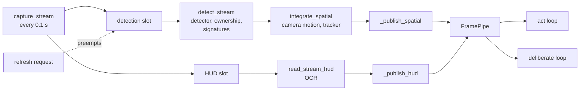
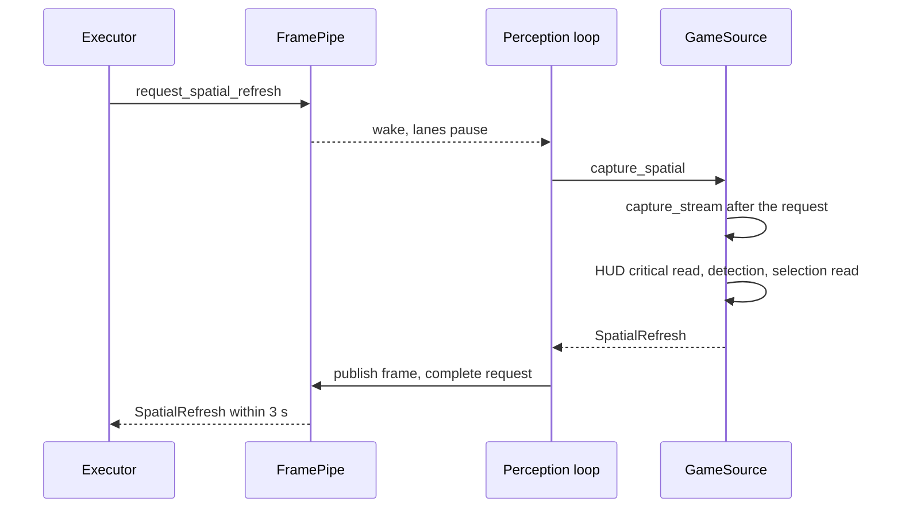

# Perception

The perception loop turns the game window into `Perception` frames that the act and deliberate loops read. It captures native pixels on a fixed cadence, hands the newest capture to a detector lane and a HUD lane, links detections across frames with the [tracker](tracking.md), and publishes each result through one `FramePipe`. In a real game it is the only writer of `memory.game_state` and of the executor's entity cache.

## Capture

`window.py` finds the game and reports its geometry in frame pixels. The backend is chosen on first use.

| Platform | Backend | Finds the game by | Input scale |
|---|---|---|---|
| Windows | `WindowsBackend` (pygetwindow) | Title `Age of Empires II: Definitive Edition` | 1 |
| macOS | `MacBackend` (`window_macos.py`) | Running app whose name contains `age of empires`, then its row in the Quartz window list | Display scale, 2 on Retina |

On macOS the geometry drops the black band the game leaves under the menu bar on a notched display, and carries the Quartz window number that capture needs. `to_input_point` converts a frame position into pyautogui units by adding the window origin and dividing by the scale.

`capture.py` puts every grabber behind `FrameGrabber.grab(geometry, monitor, after=None)`. `AOE2_CAPTURE_METHOD` picks one; a method the platform lacks raises `ValueError`.

| Method | Grabber | Behaviour |
|---|---|---|
| `auto` (default) | `FallbackGrabber(StreamGrabber, WindowGrabber)` on macOS, `MssGrabber` elsewhere | On macOS the stream is used until it fails once, then window capture for the rest of the run |
| `stream` | `StreamGrabber` (`screen_macos.py`) | ScreenCaptureKit stream of the game window at 30 fps; each grab takes the newest frame. When the newest frame is older than 0.25 s (paused game, open menu), the grab takes one Quartz capture instead. With `after`, it waits up to 0.2 s for a frame drawn after that instant |
| `window` | `WindowGrabber` | One Quartz window capture per call, at full Retina resolution |
| `mss` | `MssGrabber` | One `mss` region grab per call; Windows only |

`screen.capture_native` wraps a grab in a `NativeCapture`: immutable RGB bytes, size, `captured_at` (monotonic), window rect, and the cursor position relative to the window. Detection, OCR, ownership and camera analysis all read NumPy views of the same bytes. The JPEG (quality 85) is encoded once per detection and reused for the HTTP detector, evidence and samples. On macOS a missing game window raises instead of capturing the desktop; on Windows the grab falls back to the whole monitor.

Before the loops start on macOS, `game_loop._prepare_macos_game` takes three captures 0.4 s apart and ends the run with `menu_open` if all are dimmed. `game_screen.popup_open` calls a frame dimmed when the resource bar's mean brightness is under 40 and the bottom panel's is under 90. `preflight.py` runs the same check as its `no_popup` item.

## Perception loop

`perceive_loop` (`apps/agent/src/loops/perceive.py`) first waits for a focused game window: a missing window ends the run as `game_not_found`, and 15 consecutive focus failures 1 s apart end it as `lost_focus`. With the real game behind it (`GameSource` in `loops/source.py`) it then runs `_stream_perceive_loop`, three lanes that never wait on each other.



| Lane | Target | Rule |
|---|---|---|
| Capture | `AOE2_PERCEIVE_INTERVAL` start to start, default 0.1 s | One capture task at a time |
| Detection | A capture at least 0.2 s after the last one chosen (`_DETECTION_INTERVAL`) | One detector call in flight; a later qualifying capture replaces the pending one |
| HUD | A capture at least 0.5 s after the last one chosen (`_HUD_INTERVAL`) | One OCR read in flight; same single pending slot |

Each slot holds one capture, so a slow lane skips frames and never queues them. Neither worker lane starts while a refresh request is pending. `max_iterations` counts captures. On shutdown the loop waits up to 12 s for an in-flight detector call, because it may be running in a thread that cancelling the coroutine would not stop.

Any other `FrameSource` (the scenario runner's `_ScriptedSource`, test fakes) gets a sequential loop: a HUD-only pass, then a full `capture` with HUD and detection together, then a wait of `perceive_interval` that `FramePipe.request_now` cuts short.

## Detection and ownership

`GameSource._detect_with_screenshot` holds an inference lock, so one `GameSource` runs one detector call at a time. An in-process detector (`takes_pixels`) gets the pixels; the HTTP detector gets the JPEG. A `DetectionBusyError` from the server discards that frame. The detector comes from `detection_phase.init_detector`: the remote server at `AOE2_DETECTION_HOST` when set, otherwise the local model named by `AOE2_DETECTION_MODEL` (default `aoe2_yolo_v12_nms736`). If initialisation fails the agent plays without detections. Detector IDs are per call, so identity across frames comes only from the tracker. The model and server are covered in [detector](../detection/detector.md) and [serving and evaluation](../detection/serving-and-evaluation.md).

`DetectorScale` (`detector_scale.py`) keeps objects at the size the detector was trained on. It takes the widths of whole, confident (at least 0.5) Town Centers as a share of the frame's long side, keeps the last 9, and once it has 3 compares their median with the VM reference of 392.2/3024. Above 1.15x it shrinks the frame by the inverse ratio, rounded to 0.05, onto a same-size grey canvas and scales the boxes back with `restore`. Below 0.9x it logs `objects_smaller_than_detector_training` and changes nothing, since enlarging would crop the view.

After the detector returns, a worker thread builds the 320x180 grey camera-analysis image and the tracker's appearance signatures. `summarize_frame` then classifies ownership with `classify_entities_pixels` (`packages/detection/src/inference/ownership.py`) for threat classes and gate buildings. It samples a strip above each box and the top 30% of the box. With a game profile whose roster and ownership are both verified, the dominant player colour (at least 4% of pixels and twice the runner-up) maps to that player's relationship. Otherwise at least 4% blue-dominant pixels means `own` and anything else is `unknown`. Results are keyed by detector ID and moved onto track IDs when the frame is published.

`integrate_spatial` publishes a worker result only if it still fits the view. It discards the result when the ledger's camera command revision moved after the capture (`camera_input`) or when the tracker has already accepted a later capture (`older_capture`). It then estimates camera motion, runs the tracker, and builds the text entity summary. A pan or reset bumps the ledger's `camera_revision` and clears `spatial_valid` until this frame is published. Both steps are described in [tracking](tracking.md).

## HUD reading

`read_hud_pixels` in `providers/strategist.py` reads the resource bar with `resource_ocr.py`; no image goes to a model.

1. Calibration: a hand-tuned `resource_ocr_assets/calibration.<W>x<H>.yaml` wins (3024x1672, 3024x1898 and 3024x1964 ship); otherwise `autodetect_calibration_pixels` finds the bar with RapidOCR. With neither, the reading is empty.
2. Backend: template matching first when glyphs exist for that resolution under `templates/<W>x<H>/` or `AOE2_OCR_BACKEND=template`; otherwise `AOE2_OCR_BACKEND` (`rapidocr` by default, `tesseract` optional).
3. Escalation: a routine read that misses population or more than one resource reruns on the OCR backend and fills only the missing fields.
4. Validation: a frame with fewer than 3 of food, wood, gold and stone is dropped (`ocr_frame_discarded`).
5. Age: read inline by the OCR backends; on the template path, only on ticks that are a multiple of 5 (`_AGE_OCR_INTERVAL`). While an age advance researches, the age field shows the next age's name over a red progress bar, so `age_up_in_progress` skips the read when at least 30% of a strip just left of the calibrated age box is red. A reading without an age leaves the ledger's last age in place (`executor.observe_age`).

The result is a `ResourceReadings` dict holding only the keys that were read: `food`, `wood`, `gold`, `stone`, `population` (as `"n/m"`), `age`, `idle_present`, `idle_count`, the four `*_workers` counts and `villagers`. Idle presence comes from the badge colour beside population; the count is read only when the badge is lit, by matching the digit against `templates/hud_digits/`. Post-input reads run in `critical` mode, which skips age and the escalation. `read_selected_unit_pixels` reads the selected unit's name with RapidOCR when a refresh asks for it, and `selection_class` maps the label to the closest known name (a villager role, a catalog building or `town_center`) when `difflib` scores it at 0.8 or more. Villager roles become `villager`; an unmatched label passes through unchanged and matches no expected selection. `python -m gameplay_agent.resource_ocr --selftest` checks the OCR machinery on synthetic digits.

## Entity snapshots

Every published entity is an `EntitySnapshot` (`entity_snapshot.py`). `snapshot_entities` normalises detector objects and serialised dicts at one boundary; a box with non-finite values or zero size becomes `None`.

| Field | Meaning |
|---|---|
| `id` | Track ID, `track_N` |
| `class_name` | Smoothed label from the tracker |
| `raw_class_name` | The detector's label on this frame |
| `class_agreement` | Share of the tracker's label vote, `None` before two observations |
| `bbox`, `center`, `confidence` | This frame's detector box |
| `capture_id`, `camera_revision`, `captured_at` | The capture the box came from |

`build_entity_summary` (`entity_utils.py`) writes the first 20 entities as `id: class [owner] at (x,y) [conf%]` lines for the prompt. `villager_roles.infer_jobs` tags a villager with a resource kind when it stands within 140 px of that resource or its drop-off camp, and `turn_phases` turns the counts into a "Villagers by job" line (see [prompts and context](prompts-and-context.md)).

## The published frame

`Perception` (`loops/snapshot.py`) is a frozen dataclass shared by reference; HUD readings are copied into a read-only mapping and entities into snapshots on construction. Besides the screenshot, size, window rect, entities, summary, HUD readings, ownership tuples, the policy `world` state and the `alarm` flag, it carries identifiers that keep the two halves apart.

| Field | Set by |
|---|---|
| `capture_id` | Every native capture, increasing per `GameSource` |
| `spatial_capture_id`, `hud_capture_id` | The captures behind the boxes and behind the HUD reading |
| `spatial_captured_at`, `hud_captured_at` | Their capture times; `captured_at` is the later of the two |
| `spatial_version`, `hud_version` | Count of spatial and HUD publications |
| `publication_version` | Every `put`; readers wait on it with `after_version` |
| `input_revision`, `camera_revision`, `economic_revision`, `selection_revision` | The `ActionLedger` counters when the capture was taken |
| `spatial_valid`, `hud_only` | Whether the boxes may be used at the current camera revision; whether the last publication was HUD only |

`_publish_spatial` drops a frame that is not `spatial_valid` or whose camera revision differs from the ledger's, and asks for an immediate capture. Otherwise it syncs game state from the frame's HUD reading if that reading is newer, runs the goal manager's alarm check, records buildings not classified as ally or enemy, replaces the executor's entity cache (`set_detected_entities`, `set_ground_frame`) and calls `FramePipe.put_spatial`. `_publish_hud` drops a reading taken before the latest economic input or one with no fields, syncs game state, and calls `put_hud`.

The pipe merges the halves so neither makes the other look fresh. `put_hud` keeps the last boxes, screenshot and spatial identifiers, ignores a reading older than the current one, and keeps `spatial_valid` only if the camera revision has not changed. `put_spatial` keeps the last HUD reading and its economy fields unless the economic revision changed, in which case the frame goes out without them.

The age limits on spatial evidence live in `entity_snapshot.py`:

| Constant | Value | Used by |
|---|---|---|
| `MAX_SPATIAL_AGE_SECONDS` | 1.0 s | Executor: oldest box a click may use |
| `STATIC_SPATIAL_AGE_SECONDS` | 2.0 s | Executor: oldest box for a click on something that does not move, at the current camera revision |
| `POLICY_SPATIAL_AGE_SECONDS` | 5.0 s | Policy request: oldest view for offering spatial actions |

## Refresh after input

An action whose next click depends on the result of its last input asks perception for a view captured after that input. `game_loop` registers three variants of `frame_refresh` with the executor: a full refresh (rescan), `selection_only` (HUD and selected unit, no detection) and `skip_selection` (HUD and detection, used for placements). Only one request can be pending.



`frame_refresh` reports failure when no result came within 3 s, or the result was captured before the request or is not `spatial_valid`. A refresh that runs detection waits for the inference lock, so it starts after any detector call already in flight. The selected unit it reads goes onto the ledger with the input revision it belongs to. How actions use refreshes is in [actions and execution](actions-and-execution.md).

## Diagnostics

| Event | When |
|---|---|
| `fresh_detection_published` | Each published detection: count, motion kind, age, camera and association milliseconds |
| `spatial_worker_latency` | Each detector call: encode, detector, analysis, appearance and ownership milliseconds |
| `spatial_result_discarded` | A detection dropped as `busy`, `camera_input` or `older_capture` |
| `hud_observation_published`, `hud_result_discarded` | HUD lane results |
| `spatial_refresh_latency`, `frame_refresh_completed`, `frame_refresh_timed_out`, `frame_refresh_rejected` | Requested refreshes |
| `perception_discarded` | `_publish_spatial` refused a frame |
| `perception_stream_summary` | At shutdown: captures, publications, discards by reason, camera pans and resets |

Screenshots go through `DiagnosticWriter`, a background queue of at most 24 writes that never blocks perception. When it is full, sampled frames are dropped before action evidence. Every 10th published detection is saved to `logs/screenshots/` while `AOE2_SAVE_SCREENSHOTS` is true (the default), and the frame behind each failed or uncertain action goes to `logs/action_screenshots/action_<id>_<status>.jpg`. `turn_timing.LatencyRecorder` records `capture`, `ocr` and `detect` phases for the sequential loop; the streaming loop reports through the events above. `aoe2-agent --overlay` draws boxes and OCR fields in a click-through window over the game; it is Windows only and is hidden during each capture.

## Capture and replay tools

| Module | Purpose |
|---|---|
| `gameplay_agent.capture_sequence` | Saves native PNGs and `sequence.jsonl` (capture times, window rect, cursor, provisional camera motion) without touching game input. `--output`, `--count` (50), `--interval` (0.2 s), optional `--input-events` JSONL of timestamped camera jumps or zooms |
| `gameplay_agent.sequence_replay` | Scores cached detections and tracker output against reviewed `labels.jsonl` for a captured sequence. `--infer` writes the detection cache once with local weights; `--attempts` scores reviewed clicks. Uses the tracker `AOE2_TRACKER` selects |
| `gameplay_agent.capture_dataset` | Captures lossless, session-scoped frames of the exact game window into `packages/detection/src/real_screenshots/quality_sessions` for detector evaluation (see [labeling](../detection/labeling.md)) |

```bash
uv run python -m gameplay_agent.capture_sequence --output logs/sequence-01 --count 50 --interval 0.2
uv run python -m gameplay_agent.sequence_replay --sequence logs/sequence-01 \
  --detections logs/sequence-01/raw.jsonl --labels logs/sequence-01/labels.jsonl --infer
```
