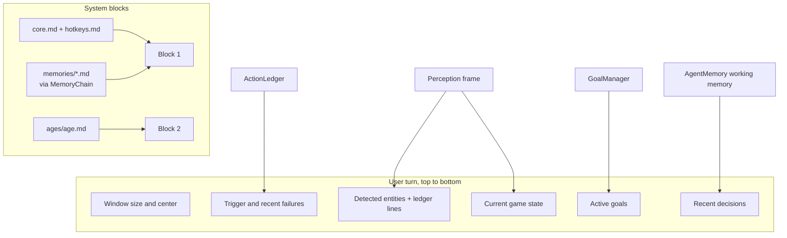
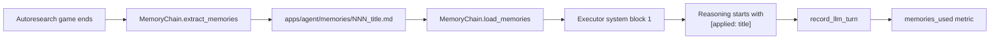

# Prompts and context

Three model roles read text each turn: the executor (deliberate controller), the strategist and the TypeSafe routine policy. The executor and the strategist load their system prompts from Markdown files in `apps/agent/src/prompts/`; the policy gets a JSON state built in code. Cross-game memories, when any exist on disk, are appended to the executor's system prompt. How each role is called over the wire is in [LLM providers](llm-providers.md); when each one runs is in [decision loops](decision-loops.md).

## Prompt files

| File | Read by | Content |
|---|---|---|
| `core.md` | Executor | Role and triggers (combat alarm, tactical handoff, bounded recovery), what counts as observed state, tool boundaries, the `[applied: ...]` telemetry rule, when to report `victory` or `defeat` |
| `hotkeys.md` | Executor | Reference for the shipped hotkey profile: navigation, Town Center, economy techs, the Q/W/V build menus, unit commands, production buildings, stances |
| `ages/dark.md`, `feudal.md`, `castle.md`, `imperial.md` | Executor | Per-age headline split (Dark 100% economy, Feudal 85/15, Castle 50/50, Imperial "win the game"), checklists, build-menu limits, action templates, the Feudal-to-Castle gate |
| `strategist.md` | Strategist | The objective (advance through the ages as fast as the economy allows while the Town Center keeps producing and population never caps; defend first under attack), how the policy uses goals, a few game facts, goal types (`local`, `global`) and the allowed metric names, the villager `allocation` target and the JSON output shape. It sets no build order or fixed priorities |

`core.md` treats the context as the source of truth: an unknown reading stays unknown, the observed age is authoritative, and a successful keypress is not proof of a purchase. It tells the model to use named catalog tools (`build`, `research`, `queue_villager`, `train_unit`, `assign_idle`) for economic actions and to call one tool at a time. Code backs the named-tool rule: `ExecutorProvider._execute_tool_call` refuses a `press` outside a small safe-key set with "raw purchase or ambiguous hotkey refused". Tool behaviour is covered in [actions and execution](actions-and-execution.md).

Autoresearch edits these files between games; see [mutation and memory](../autoresearch/mutation-and-memory.md).

## Executor system prompt

`ExecutorProvider._load_prompts` (`apps/agent/src/providers/executor_provider.py`) reads every file once per provider instance and caches the text. `get_system_prompt(age)` returns two `SystemBlock`s, both marked cacheable:

| Block | Text | Changes |
|---|---|---|
| 1 | `core.md` + `hotkeys.md` + the memory prelude | Never within a game |
| 2 | `ages/<age>.md` | On an age change |

A missing `core.md` falls back to a one-line "You are playing Age of Empires 2" prompt. A missing age file falls back to `dark.md`.

The age key comes from `ExecutorProvider._extract_age`, which takes the first `(Dark|Feudal|Castle|Imperial) Age` match anywhere in the context string. The goals block and the castle-gate line sit above the `## Current Game State` block, so a goal named "Advance to Feudal Age" selects `feudal.md` while the game is still in the Dark Age, and in the Feudal Age the castle-gate line ("the Castle Age needs ...") selects `castle.md` whenever entities were detected.

## Executor user turn

`turn_phases.build_llm_context` assembles the per-turn text from `AgentMemory`, `GoalManager` and the current perception frame. The deliberate loop (`loops/deliberate.py`, `deliberate_once`) prefixes a trigger line, and `ExecutorProvider._build_content` wraps the result in a window-size header and a closing instruction. The request carries no image.



| Section | Source | Content |
|---|---|---|
| Header | `_build_content` | `Game window: WxH pixels`, the center, valid x and y ranges |
| Trigger | `deliberate_once` | `alarm`, `handoff` or `recovery`, plus the ledger's last five failures |
| `## Detected Entities (from YOLO)` | `entity_utils.build_entity_summary` | Up to 20 entities as `id: class [owner] at (x,y) [confidence]` |
| Villagers by job | `_villager_jobs_line` | Approximate job counts inferred from villager-to-resource proximity |
| Known buildings | `known_buildings_line` | Purchase-confirmed classes, pending placements, and sightings flagged "unverified, NOT owned" |
| Feudal-Age buildings | `castle_gate_line` | Feudal only: how many of the Castle prerequisite buildings are confirmed |
| Currently refused | `blocked_actions_line` | What the executor will refuse this turn |
| `## Active Goals` | `GoalManager.get_context_for_llm` | Top 5 by priority, tagged HIGH (8+), MED (5+) or LOW, LOCAL or GLOBAL, with progress; the last 3 completed as `[DONE]` |
| `## Current Game State` | `AgentMemory.get_context_for_llm` | Resources (`?` when unread), population, age, idle villagers, confirmed buildings, pending actions, reserved resources |
| `## Recent Decisions` | `AgentMemory.get_context_for_llm` | Last 3 turns: reasoning cut to 100 characters, up to 5 actions |

The entity section and its ledger lines appear only when the frame has an entity summary. When the frame carries a `PolicyState`, the game-state block is rendered from it (`_format_observed_state`). Without one, it is rendered from `AgentMemory.game_state` with a HOUSED flag, TC idle and under-attack lines, and the OCR cache (`GoalManager.get_resource_context`) is added as `## Resource Status`.

`AgentMemory.game_state` changes only through perception: `apply_hud_readings` for resources, population and idle villagers, and `update_age` for the age read from the HUD. `update_from_observations` is a no-op, so nothing the model reports in its response writes back into the state it is shown. `Turn.verification` feeds a `Result:` line and a "Last N actions had NO EFFECT" warning after `STUCK_LOOP_THRESHOLD` (3) such turns. No caller in `apps/agent/src` sets it, so neither appears in a live game.

### Tool results inside a turn

In the tool loop the model sees each tool's outcome before its next call. Both wires serialise it with `tool_outcome_json` as `{"success", "detail"}`. Composite tools (`build`, `send_villager`, `send_all_idle`) and `press` with `rescan: true` add `entities`, the first 20 detected entities as id, class and center. `queue_villager` returns no entities.

## Strategist input

The strategist gets one system block, the whole of `strategist.md`, with no hotkeys, age file or memories. `StrategistProvider.generate_goals` (`providers/strategist.py`) renders the user turn:

| Part | Source |
|---|---|
| `Turn: N` and, on alarm, a bold "ALARM: Enemy military units detected" banner | The deliberate loop's tick and the frame's alarm flag |
| `## Current Game State` | HUD readings for resources, population and age, each falling back to `AgentMemory.game_state`; under-attack and enemy-located flags |
| `## Detected Entities on Screen` | The same entity summary the executor sees, or "No entities detected" |
| Known buildings | `known_buildings_line` for the frame |
| Strategist brief | `strategist_brief` (`apps/agent/src/strategist_brief.py`), described below |
| `## Current Goals` | `GoalManager.get_goals_summary`: each active goal as `type/name P<priority>: <progress>`, then the last 5 completed |

It closes with "Set 3-5 prioritized goals for what is holding the objective back now". The response schema is described in [LLM providers](llm-providers.md#strategist-provider).

The deliberate loop builds the brief from the frame's `PolicyState` and the ledger's recent failures. It reports facts and recommends nothing:

| Section | Content |
|---|---|
| `## Situation (from the agent's records)` | Villagers with per-resource job counts and idle count, population with units in production, buildings standing, buildings paid for but not yet seen finished, buildings placed but not yet paid, natural food in view, the resources gathered in this age, recent failed actions |
| `## Next age` | The next age's cost against the bank, and how many of its required buildings (from `AGE_UPS` in the catalog) stand, with "requirement met" or how many more are needed |
| `## Actions the agent can take in this age` | Every build, train and research action in the catalog up to the current age, with cost and prerequisite buildings |

An unread count or stock appears as "not read" (an unread idle count as "unknown"), never as 0.

## Routine policy input

`TypeSafePolicyAdvisor` has no prompt file. `policy/request.py` (`policy_request`) builds a `PolicyRequest` from the frame's `PolicyState`, the active goals and the ledger's recent failures, and `typesafe_policy._request_state` turns it into JSON:

| Key | Content |
|---|---|
| `game` | Age, resources, population (current, capacity, villagers observed, ordered and committed), buildings, purchases awaiting completion, research, pending actions, reserved resources, visible classes, villager jobs, idle presence. Unknown values are `null`. |
| `computed_signals` | `food_crisis`, `food_progress_stalled`, `town_center_progress_stalled`, `idle_assignment_pending`, `population_blocked` |
| `active_goals` | Name, metric, target, priority, progress |
| `recent_failures` | The ledger's recent failure strings |

The question instructions live in `_questions`; each feasible candidate is described by its catalog description plus its immediate cost. The candidate set comes from the action catalog in [decision loops](decision-loops.md).

## Cross-game memory

`MemoryChain` (`apps/agent/src/memory_chain.py`) keeps one Markdown file per note in `apps/agent/memories/` (`MEMORIES_DIR`, resolved from the module path). The directory is untracked by git and empty in a fresh checkout. A `memories/` directory at the repo root is not read by any code.

```text
---
type: economy
title: build_house_at_pop_cap_minus_5
game_id: unknown
applies_when: Dark Age AND population >= (pop_cap - 5)
score_impact: negative
created: 2026-04-25T08:58:20+00:00
---

I should build a house the moment population reaches pop_cap minus 5. ...
```

Files are named `NNN_<title>.md`. `type` is one of `strategy`, `economy`, `military`, `detection`, `failure`; `score_impact` is `positive`, `negative` or `neutral`. Files are read with `errors="replace"`, so a stray non-UTF-8 byte cannot break loading.



### Loading

`ExecutorProvider._load_prompts` calls `load_memories(max_tokens=800)` and appends the result to block 1, so the notes are paid for once per game and read from the prompt cache afterwards. `load_memories`:

1. Skips files with an empty body.
2. Orders by `score_impact` (negative, then positive, then neutral) and, within a tier, newest `created` first.
3. Keeps at most 20 (`_MAX_MEMORIES`).
4. Emits a `## Notes to Myself from Previous Games` header, then one bullet per note, `- [title] (when: applies_when) content`, until the text would pass `max_tokens * 4` characters. The `(when: ...)` part is dropped when `applies_when` is empty or `any`.

The header tells the model that a memory rule overrides a conflicting rule in `core.md` or the age prompt, and that the more specific trigger wins between two memories. If `MemoryChain` cannot be imported or loading raises, the provider logs `memory_chain_unavailable` or `memory_load_failed` and runs without notes.

### Attribution

`core.md` asks the model to begin its reasoning with `[applied: title]` when a note drove the action. `turn_phases.record_llm_turn` strips the tag before the reasoning is stored, counts titles found in `AgentMemory.memories_loaded` through `record_memories_applied`, and logs any others as `memories_applied_unknown`. The counts reach the metrics snapshot as `memories_loaded` and `memories_used`, and autoresearch's experiment log records them as `memories_loaded` and `memories_used_count`.

`game_loop` copies `provider.loaded_memory_titles` into `memories_loaded` when the loop starts, while the provider fills that list on its first `get_system_prompt` call. With a fresh provider the copy is empty, so every tag is logged as unknown. The title list also includes notes that the character budget cut from the prompt.

### Extraction

Only the autoresearch game runner writes notes (`apps/autoresearch/src/game_runner.py`), after a game whose score is valid and that had at least one turn. `extract_memories` sends the game result, score components, duration, peak population, highest age and the last 10 turns of working memory to the memory model through the [text completer](llm-providers.md#text-completer), under the `EXTRACTION_SYSTEM` prompt. That prompt asks for zero to three first-person, imperative notes with concrete thresholds and no turn numbers, returned as JSON. Notes with empty content are dropped, and a note whose sanitised title already exists on disk is skipped. The autoresearch side of this loop is in [mutation and memory](../autoresearch/mutation-and-memory.md).

Static game data in `packages/data` is not part of any prompt; see [game knowledge](game-knowledge.md).
