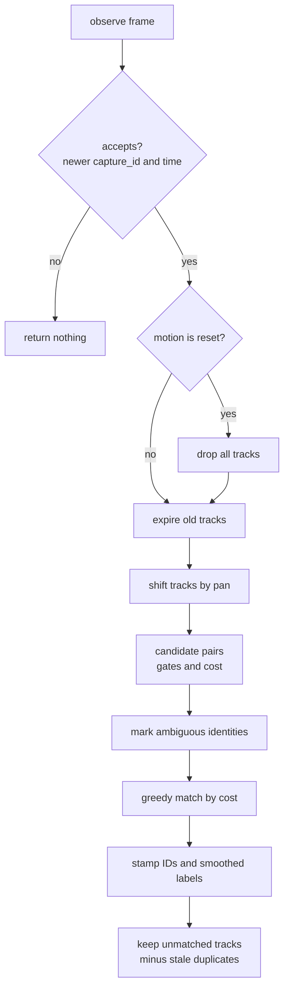

# Tracking

The tracker gives each fresh detector box a stable ID (`track_N`) and a smoothed class label across frames, so an ID the LLM saw on one frame still names the same object on a later one. It runs once per published detection, inside `GameSource.integrate_spatial` (`apps/agent/src/loops/source.py`), after the camera motion estimate. How frames reach it is in [perception](perception.md).

## Backends

`make_tracking` in `apps/agent/src/tracking.py` reads `AOE2_TRACKER` once per `GameSource` and returns a `Tracking`: the backend name, the function that computes appearance signatures, and the tracker.

| `AOE2_TRACKER` | Signatures | Tracker | Agent acts on |
|---|---|---|---|
| `native` (default) | `screentrack.rgb_mean_std`, all boxes in one call | `NativeTemporalEntities` over `screentrack.Tracker` | screentrack |
| `python` | `appearance.prepare_detections` (OpenCV `meanStdDev`) | `TemporalEntities` in `temporal_entities.py` | Python |
| `shadow` | `appearance.prepare_detections` | `ShadowTemporalEntities`: both trackers on the same evidence | Python, logging `tracker_shadow_differs` on every frame where IDs or labels differ |

An unknown value logs `tracker_backend_unknown` and uses `native`. If `screentrack` cannot be imported, `native` and `shadow` fall back to `python` with `tracker_native_unavailable`. A debug build of the native module logs `tracker_native_debug_build`. The chosen backend is logged as `tracker_backend`.

`temporal_entities.py` is the reference implementation. Its own NumPy `prepare_detections` gives the same signatures as `appearance.py`; offline tools (`scripts/bench_temporal.py`, the screentrack fixture export) use it, and the live Python backend uses the OpenCV version.

## screentrack

screentrack is a Rust library with Python bindings, in its own repository (`../screentrack`, `github.com/dobosmarton/screentrack`). The core has no game types: labels are interned to integers, and every tuned value lives in `Config`. The agent installs the `v0.1.0` release wheel (CPython 3.11 abi3) for macOS arm64, Linux x86_64 and Windows AMD64; the URLs are pinned in `uv.lock`.

| Python API | Use |
|---|---|
| `Config.aoe2()` | The AoE2 preset, the only tuned configuration |
| `Tracker(config, unit_labels)` | One per game; the agent passes `camera_motion.MOBILE_CLASSES` as the labels of things that move |
| `Tracker.observe(*, capture_id, captured_at, motion, boxes, labels, confidences, signatures)` | Returns `(track_ids, labels, agreements)` in detection order, or `None` for a frame that is not newer than the last |
| `Tracker.accepts`, `Tracker.reset` | Ordering guard; drop every track while keeping the ID counter and guard |
| `ambiguous_count`, `candidate_ms`, `matching_ms` | Per-frame stats the agent logs |
| `rgb_mean_std(pixels, boxes)` | `(N, 6)` signatures without holding the GIL |

`NativeTemporalEntities` converts snapshots to NumPy arrays, passes motion as `"stable"`, `"reset"` or `("pan", dx, dy)`, and turns NaN agreements into `None`. screentrack's contract is in its `docs/SPEC.md`. Its `fixtures/` hold golden output from the Python tracker at the commit and blob named in `fixtures/manifest.json`; for `v0.1.0` that blob is `c712bf45`, which is also the blob of `temporal_entities.py` in the agent today. A clippy rule bans `f64::hypot` because it differs from Python's `math.hypot`, and the crate carries a port of CPython's version.

In the screentrack repository, `just check` runs what CI runs, `just test` the Rust and Python tests, `just py` builds the release module into its venv, `just bench` the regression benchmark, and `just fixtures` regenerates fixtures from an agent checkout named by `AOE2_AGENT`.

## Per-frame update

Both backends make the same decisions with the same values.



| Rule | Value | screentrack `Config` field |
|---|---|---|
| Unit track lifetime without a box | `max(1.0 s, 3 x gap since the last frame)` | `history_s`, `gap_factor` |
| Static track lifetime (buildings, resources, anything not in `MOBILE_CLASSES`) | At least 5.0 s | `static_memory_s` |
| Movement gate on centre distance | `max(box w, box h, 12) x 0.75 + 65 px/s x elapsed` | `size_factor`, `min_size_px`, `speed_px_per_s` |
| Appearance gate (distance between 6-value RGB mean and std signatures) | 0.55 | `max_appearance_distance` |
| IoU needed when the label changes | 0.5 | `relabel_overlap` |
| IoU needed unless both labels are units | 0.1 | `static_overlap` |
| Penalty added for a label change | 1.0 | `label_penalty` |
| Tie margin between an identity's two cheapest candidates | 0.15 | `ambiguity_margin` |
| IoU that makes an unmatched track a stale duplicate of a same-label fresh one | 0.5 | `stale_overlap` |
| Evidence kept per track | 3 observations within 1.0 s | `max_observations` |
| Label vote half-life; margin to switch label | 0.4 s; 0.25 | `label_half_life_s`, `min_label_margin` |

The cost of a pair is position plus appearance distance plus any label penalty. Position is `1 - IoU` when the boxes overlap and `1 + distance / allowed` when they do not, so only units can continue on a box they do not touch. Candidates are pruned by horizontal centre range before costs are computed.

An identity is ambiguous when its second-cheapest candidate is within 0.15 of its cheapest. Ambiguous tracks and detections are not matched that frame, and neither is any identity whose first choice is ambiguous on the other side; it does not fall back to a second choice. The rest are matched greedily in cost order. An unmatched detection gets the next `track_N`.

The label is a vote over the track's evidence, each observation weighted by `confidence x 2^(-age / 0.4 s)`. The track switches to another label only when that label has at least two observations and leads by at least 0.25 of the total. `class_agreement` is the winning share, or `None` with fewer than two observations.

## Camera motion

`estimate_motion` in `camera_motion.py` compares a 320x180 grey copy of this capture with the last published one and returns `stable`, `pan` with a shift in full pixels, or `reset` with a reason.

It looks only at the terrain area (15% to 76% of the height, 5% to 76% of the width), which leaves out the resource bar, minimap and bottom panel. Boxes of mobile classes from both frames and an 18 px circle around the cursor are masked, padded by 8 px. A mean difference under 0.012 is `stable`. Otherwise the area is split into six regions, and phase correlation runs on each region with at least 60% unmasked pixels and texture (standard deviation) of at least 0.018. The shift is the median, and it is accepted only if at least three regions agree within 2 analysis pixels, the aligned overlap is at least 60%, and the mean residual after alignment is at most 0.115.

`integrate_spatial` forces a reset, without estimating, when the window geometry changed or the executor sent a camera command since the last published detection. A slow frame alone does not reset: the estimate compares it with the last analysed view however old, and lifetimes stretch with the gap. On a pan, surviving track boxes are shifted before matching. Any `pan` or `reset` after the first frame bumps the ledger's `camera_revision`.

## What the tracker may and may not do

The tracker returns exactly one entity per fresh detector box, in detector order, with that frame's box, center and confidence. It changes only the ID, `class_name`, `raw_class_name`, `class_agreement` and the capture stamps. Unmatched tracks stay in memory to be matched later but are never published, so there are no predicted-only boxes. IDs are never reused, and a reset keeps the counter. State changes only when a worker result is published; a result for an older capture is rejected by `accepts`.

A smoothed label or an agreement score does not authorise a click. The executor's checks (`_resolve_coords` and `_verified_villager_target` in `executor.py`) require:

- the ledger's `spatial_valid` flag, cleared by every camera input and every detected pan or reset until a fresh frame is published;
- boxes no older than 1.0 s, or 2.0 s for a target that does not move at the current camera revision;
- for a bound `target_id`: the same capture ID, camera revision and input revision it was bound at, an unchanged class, a `raw_class_name` equal to the expected class, a fresh box and unchanged coordinates;
- for a villager: a raw `villager` label, confidence of at least 0.65 and the current camera revision.

The rest of the click path is in [actions and execution](actions-and-execution.md).

## Tracker benchmark

`scripts/tracker_benchmark` compares five contenders on AoE2 frames with the real detector: `raw` (no tracking), `oracle`, an `iou` matcher, `python` and `screentrack`. Pass or fail rules are fixed in `scripts/tracker_benchmark/gates.toml`. A full run rewrites `docs/tracker-benchmark.md` and writes a JSON result to `docs/tracker-benchmark-results/`.

```bash
just tracker-compare            # runs scripts/tracker_benchmark --data-root ${AOE2_DATA:-.}
just tracker-compare --quick    # fewer scenes, no report written
```

The recipe installs the screentrack checkout at `${SCREENTRACK:-../screentrack}` as an editable package, so that checkout must be the version under test. `scripts/tracker_benchmark/recorded.py` handles recorded matches: `pick` chooses a still and a moving 60 s clip, `prepare` cuts and detects them, `strips` draws review strips, and `verdict` scores a tracker once against reviewed truth. Reviewed unit tracks for matches 1 to 5 are in `docs/tracker-benchmark-results/verified/`.

The latest generated-scene run in `docs/tracker-benchmark.md` (agent commit `57c4f51`, screentrack `6bbd2c5`, the `v0.1.0` commit, arm64) passed every gate. Its JSON is not committed; the JSON files in `docs/tracker-benchmark-results/` come from tracker code that differs from the current `temporal_entities.py`.

| Measure | Python | screentrack | IoU |
|---|---|---|---|
| Differing decisions against Python | | 0 frames | |
| IDs still on the same object after 2 s | 89.0% | 89.0% | 88.8% |
| Total p95 per frame, typical density band | 101.54 ms | 1.99 ms | |
| Total p95 per frame, peak density band | 91.11 ms | 2.37 ms | |
| Camera analysis plus tracker p95 (gate: 20 ms) | 116.2 ms | 17.0 ms | |

The same file reports 0 differing frames between screentrack and Python over ten recorded clips from matches 1 to 5 (2,987 frames), and the held-out verdict on match 5 for the Python tracker at blob `c712bf45`:

| Check | Python | IoU or raw |
|---|---|---|
| Still the same object after 2 s | 95.8% | 93.0% |
| Wrong object | 1 swap | 1 swap (3 allowed) |
| Label accuracy | 99.61% | 99.61% |
| Label flips per 1,000 | 1.4 | 1.4 |

`scripts/bench_temporal.py` times the Python tracker alone on synthetic separated and crowded layouts of 20, 40 and 60 boxes (64x64 at 1920x1080) at 5 Hz and 10 Hz. It runs 30 frames by default and reports warm-up and steady state separately, because ambiguous tracks keep a crowded scene growing for about a second.

```bash
uv run python scripts/bench_temporal.py --frames 30 --json
```
