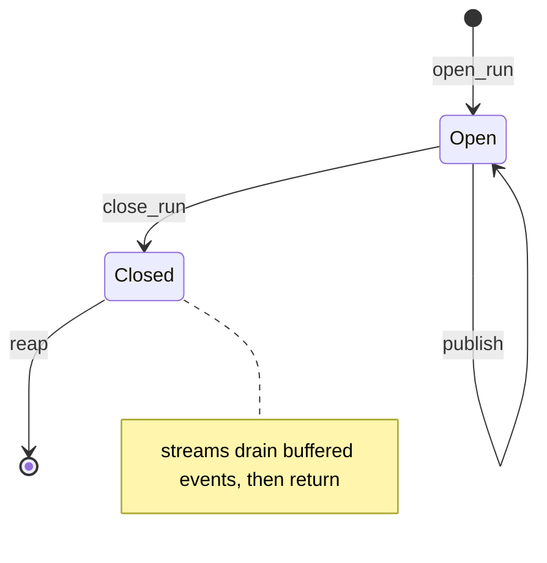
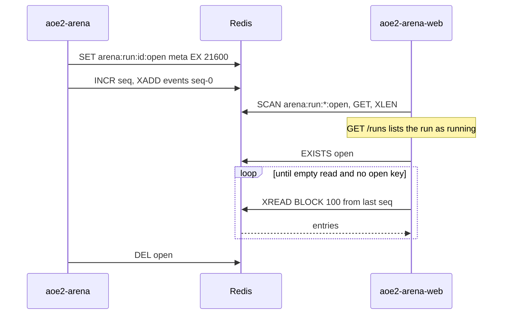

# Event broker

Every arena event travels through an `EventBroker`. Producers publish events for a run, and consumers read them back by sequence number, from the start of the run or from any later point, then keep tailing until the run closes. There are two implementations: `InProcessEventBroker` for a single process and `RedisStreamsBroker` for producers and consumers in different processes. The broker code is in `packages/evaluation/src/` (`event_broker.py`, `redis_broker.py`, `broker_factory.py`). For background on logs, offsets and Redis Streams, see [event brokers and Redis Streams](../appendix/02-event-brokers-and-redis-streams.md).

## Producers and consumers

| Role | Code | Process |
|---|---|---|
| Producer: arena CLI runs | `MultiRunBrokerSink` (`duckdb_persister.py`), fed by `synth_game_loop` | `aoe2-arena` |
| Producer: fork replays | `create_fork` and `_replay` in `apps/api/src/forks.py`, through `BrokerEventSink` | `aoe2-arena-web` |
| Consumer: DuckDB persister | `persist_to_duckdb`, `persist_to_duckdb_via_sink` | Same process as the producer |
| Consumer: live SSE | `_stream_from_broker` behind `GET /events` in `apps/api/src/server.py` | `aoe2-arena-web` |
| Consumer: live run list | `broker.live_runs()` behind `GET /runs` | `aoe2-arena-web` |

The CLI and the web server each call `make_broker()` once: `_run_through_broker` in `apps/arena/src/__main__.py` per command, and the FastAPI `lifespan` at startup. With the in-process backend they hold two unrelated brokers, so the web server cannot see a CLI run until it finishes and its DuckDB file is released. Watching a CLI run live needs the Redis backend on both sides. The HTTP side is described in [web architecture](../web/architecture.md).

## The protocol

`EventBroker` is a `typing.Protocol`; neither implementation inherits from it.

| Method | Call | Does |
|---|---|---|
| `open_run(run_id, meta=None)` | sync | Starts a run. Raises `ValueError` if this process already has it open. `meta` is a `RunMeta(label, started_at)` |
| `publish(run_id, event)` | async | Appends the event and returns its `Seq`. Raises `RuntimeError` if the run is not open here, `ValueError` if `event.run_id` differs from `run_id` |
| `stream(run_id, from_seq=Seq(0))` | async iterator | Yields every `EventEnvelope` with `seq >= from_seq`, then tails later ones. Returns once the run is closed and everything is delivered |
| `close_run(run_id)` | sync | Marks the run finished. Open streams drain and return |
| `reap(run_id)` | sync | Drops all retained state for the run. Raises `ValueError` if it is still open |
| `is_open(run_id)` | sync | True if this process opened the run and has not closed it |
| `is_open_remote(run_id)` | async | True if the run is open in any process |
| `live_runs()` | async | Every open run as a `LiveRun(run_id, label, started_at, n_events)` |

`RunId` and `Seq` are `NewType`s over `str` and `int`. `Seq` is assigned by the broker, starts at 1 for each run and increases by one per publish. It is distinct from `Event.t`, the turn number, which several events in a turn share. An `EventEnvelope` is `(run_id, seq, event)`; the `Event` itself carries no sequence number, and the DuckDB schema has no column for one. The cold reader rebuilds `Seq` from row order (see [event log and replay](event-log-and-replay.md)).

## Run lifecycle

Each producer drives a run through these states in a fixed order:

| Producer | Opens | Closes | Reaps |
|---|---|---|---|
| `MultiRunBrokerSink` (CLI) | On the first event for an unseen `run_id`, with `RunMeta(label, started_at)` | `close_all()`, after waiting for every queued publish | `close_all()`, after every persister has returned |
| `create_fork` (web API) | Before publishing the fork event, with no `RunMeta` | `_replay`, when the game loop ends or fails | `_ReaperRegistry`, 30 minutes after close, checked every 15 minutes |

The CLI label is the file-name prefix of its DuckDB log (`race`, `smoke`, `rank`), and `started_at` is the time the sink was built. A run opened without `RunMeta` has no label in `live_runs()`.

`BrokerEventSink` and `MultiRunBrokerSink` both turn the synchronous `EventSink.emit(event)` into an async publish by scheduling it with `loop.call_soon_threadsafe`. Each emit becomes its own task. Before closing, both callers yield to the loop twice (`await asyncio.sleep(0)` two times) so queued callbacks and their publish tasks run first; `MultiRunBrokerSink` also gathers any publish still pending. A publish that lands after `close_run` raises.

## Implementations

| | `InProcessEventBroker` | `RedisStreamsBroker` |
|---|---|---|
| Storage per run | `deque(maxlen=10_000)` of envelopes | Redis stream `arena:run:<id>:events`, `XADD ... MAXLEN ~ 10000` |
| `Seq` source | `itertools.count(1)` | `INCR arena:run:<id>:seq`, written as stream ID `<seq>-0` |
| Waiting for events | One `asyncio.Event` per waiting stream, set on publish and close | `XREAD BLOCK 100` from the last delivered ID |
| Open across processes | No; `is_open_remote` equals `is_open` | `arena:run:<id>:open` key, `SET ... EX 21600` (6 hours) |
| Dependencies | None | `redis` package and a Redis server |

`make_broker()` builds `RedisStreamsBroker(Redis.from_url(url))`. The broker never closes the client.

### In-process

All state lives in dicts keyed by `RunId`: buffers, the lowest retained `Seq` (`_head_seq`), counters, the open set, `RunMeta`, and waiters. `reap` deletes them. Correctness depends on every caller sharing one asyncio event loop. `publish` runs to completion between a consumer's awaits, so a suspended stream's position can only become invalid while it waits, and `stream` checks for that each time it wakes. Running the broker from a thread pool would break this.

### Redis

Each run has three keys:

| Key | Type | Content |
|---|---|---|
| `arena:run:<id>:open` | string, 6 h TTL | JSON `{"label", "started_at"}` from `RunMeta`, or `1` when opened without one |
| `arena:run:<id>:seq` | integer | Last assigned `Seq` |
| `arena:run:<id>:events` | stream | One entry per event, ID `<seq>-0`, fields `r`, `a`, `t`, `k`, `p` (payload JSON), `ts`, `v` (schema version) |

Stream entries decode through `Event.from_row`, the same function the DuckDB reader uses.

The protocol's lifecycle methods are synchronous, so `open_run`, `close_run` and `reap` only queue their `SET` or `DEL`. The queue is sent, in order, by `flush()`, which runs at the start of `publish`, `is_open_remote` and `live_runs` and at the top of every `stream` iteration. A process that calls none of these after `reap` never sends that `DEL`: the CLI ends right after `close_all()`, so the `:events` and `:seq` keys of every CLI run stay in Redis with no TTL. The [Redis runbook](../runbooks/redis-broker-ops.md#clean-up-leftover-run-keys) has the cleanup.

`stream` returns when an `XREAD` comes back empty and the `:open` key is gone. If the consumer is cancelled or the generator is closed mid-read, it calls `connection_pool.disconnect(inuse_connections=False)`. An `XREAD BLOCK` cancelled mid-flight can leave its connection with an unread reply (redis-py issue #2624), and the next command on that connection would read the stale reply.

**Warning: concurrent publishes to one run can lose events on Redis.** `publish` runs `INCR` and then `XADD` as two round trips. When several publish tasks for the same run are in flight, a higher `Seq` can reach `XADD` first, and Redis then rejects the lower ID with `ResponseError: The ID specified in XADD is equal or smaller than the target stream top item`. Both sinks start one task per emitted event, and `synth_game_loop` emits several events per turn without awaiting in between. Against a local Redis, 40 events emitted four per turn through `MultiRunBrokerSink` left 22 or 23 rows in DuckDB; the in-process broker kept all 40. The contract tests do not catch this because they await each publish before the next. The error surfaces only as an asyncio "Task exception was never retrieved" log line.

## Live-run discovery

`is_open` answers for the calling process only; a publisher uses it to guard its own publishes. `is_open_remote` answers for every process: the web server calls it in `/events` to choose between the live broker stream and the cold DuckDB reader, because it never opened a CLI run itself. `live_runs` lists open runs: the in-process broker reads its open set and buffer lengths, and the Redis broker scans `arena:run:*:open`, decodes each value into `RunMeta` (any unparseable value becomes an empty `RunMeta`), and counts entries with `XLEN`. `/runs` puts these rows first, marked `running`, and hides any cold row with the same `run_id`.

## Backpressure and overflow

Publishers never block and never fail because a consumer is slow. When a run's buffer holds 10,000 events, the next publish evicts the oldest one (in-process) or Redis trims the stream (approximately; `~` lets Redis trim in whole nodes, so the stream can briefly hold somewhat more). A stream whose next `Seq` is below the oldest retained one raises `BrokerOverflowError(run_id, requested_seq, available_from)`. The in-process broker checks on every wake-up; the Redis broker reads `first-entry` from `XINFO STREAM` before every `XREAD`. Both raise the same error for a `from_seq` that is already too old.

The SSE handler catches the error, sends `event: overflow` with `{"available_from": N}`, and ends the response. A client can resume with `GET /events?run_id=...&from_seq=N` and accept the gap. The dashboard's `useEvents` hook listens only for unnamed messages, so it ignores the `overflow` event and treats the closed response as the end of the run. The DuckDB persisters do not catch it, so a persister that falls more than 10,000 events behind fails its task.

## Metrics

Both implementations have a `metrics()` method that returns `BrokerMetricsSnapshot`: `events_published`, `events_streamed`, `streams_dropped` (overflow errors raised) and `runs_open`. It is not part of the protocol: the in-process method is synchronous and the Redis one is async. `GET /metrics` checks the concrete type with `isinstance` and returns 503 when the broker has no metrics surface. The counters belong to the process that serves `/metrics`. With Redis, `runs_open` counts runs that this process opened, so the web server reports its forks and not CLI runs. [Debug a stuck fork](../runbooks/debug-stuck-fork.md) uses these counters.

## Configuration

`make_broker()` in `broker_factory.py` is the only code that reads these variables, and it reads them on every call.

| Variable | Default | Effect |
|---|---|---|
| `ARENA_BROKER_BACKEND` | `inprocess` | Trimmed and lowercased, then `inprocess` or `redis`. An empty or unknown value raises `ValueError` |
| `REDIS_URL` | unset | Connection URL for the Redis backend. Takes priority |
| `REDIS_PASSWORD` | unset | Without `REDIS_URL`, the URL is `redis://:<password>@localhost:6379/0`. With neither, it is `redis://localhost:6379/0` |

The password is placed in the URL without escaping, so a password containing `/`, `#` or `?` makes `Redis.from_url` raise `ValueError`, and one containing `%` is decoded into a different password. `redis` is imported only in the `redis` branch. It is in the workspace `dev` dependency group (installed by `just install`) and in the `broker-redis` extra of the `evaluation` package (`uv sync --all-extras`). The justfile runs `set dotenv-load`, so every recipe sees `REDIS_PASSWORD` from `.env`; `arena-web-dev-redis`, `arena-race-redis` and `arena-rank-redis` also set `ARENA_BROKER_BACKEND=redis`.

## Tests

| File | Covers |
|---|---|
| `tests/test_event_broker.py` | Contract suite, parametrised over `InProcessEventBroker` and a `fakeredis`-backed `RedisStreamsBroker` |
| `tests/test_redis_broker.py` | Redis-only behaviour: entry encoding, trimming and overflow, the `:open` key and its value, reap, cancelled streams |
| `tests/test_redis_broker_cross_process.py` | Publisher in a subprocess, consumer in the parent, against a real Redis at `REDIS_URL`; skipped when Redis is unreachable |
| `tests/test_broker_factory.py` | Backend selection and URL resolution |

## Related

- [ADR 0001: broker-first architecture](../adr/0001-broker-first-architecture.md)
- [ADR 0002: Redis Streams for cross-process](../adr/0002-redis-streams-for-cross-process.md)
- [Switching the broker backend](../runbooks/switching-broker-backend.md)
