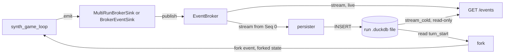

# Event log and replay

An arena run is recorded as an ordered list of typed events, one DuckDB table row per event. The event types are in `packages/core/src/event_log.py`. The DuckDB sink and the read-only reader for finished runs are in `packages/evaluation/src/event_log.py`, which also re-exports the core types. The persisters that copy the [event broker](event-broker.md) stream into DuckDB are in `duckdb_persister.py`, and `fork.py` starts a new run from any recorded turn.

## Events

`Event` is a frozen dataclass:

| Field | Type | Meaning |
|---|---|---|
| `run_id` | `str` | One game loop's run; `synth_game_loop` uses a fresh `uuid4().hex` unless given one |
| `agent_id` | `str` | A fresh `uuid4().hex` per `synth_game_loop` call; the profile name on ranking metrics; empty on fork events |
| `t` | `int` | Turn number. `synth_game_loop` counts from 1 |
| `payload` | `Payload` | One of nine Pydantic models, discriminated by `kind` |
| `ts` | `datetime` | Wall-clock time in UTC |
| `schema_version` | `int` | `SCHEMA_VERSION`, currently 1 |

| `kind` | Fields | Emitted by |
|---|---|---|
| `turn_start` | `turn_num`, `state` (`WorldStateSnapshot` or `None`), `profile_name` | `synth_game_loop`, every turn |
| `llm_prompt` | `state_summary` | `synth_game_loop`, every turn |
| `llm_response` | `actions`, `reasoning`, `cost_usd` | `synth_game_loop`, every turn |
| `action` | `index_in_turn`, `action` | `synth_game_loop`, once per returned action |
| `action_result` | `index_in_turn`, `action_type`, `state_changed` | `synth_game_loop`, after each action |
| `metric` | `name`, `value` | `synth_game_loop` (`cost_usd`, every turn); ranking (see below) |
| `fork` | `parent_run_id`, `parent_t`, `mutation_summary` | `evaluation.fork.fork` |
| `world_mutation` | `before_summary`, `after_summary`, `reason` | `apps/api/src/forks.py`, when a fork applies a mutation |
| `observation` | `entity_count`, `classes` | Defined only; nothing emits it |

One synthetic turn produces `turn_start`, `llm_prompt` and `llm_response`, then an `action` and `action_result` pair for each action, then `metric` `cost_usd` after the world ticks. `turn_start.state` is the world before the turn, and every turn carries it, so a fork can restart from any turn. `profile_name` names the racing profile on every turn, so the last `turn_start` of a run holds both the state at the start of the final turn and the profile. The ranking pipeline writes `ranking_rating_<profile>`, `ranking_ci_lo_<profile>` and `ranking_ci_hi_<profile>` metrics under the run ID `ranking` at `t=0` (see [ranking](ranking.md)).

`WorldStateSnapshot` is a frozen Pydantic copy of the eleven `WorldState` fields (resources, population, cap, age, buildings, villager queue, age-up countdown, turn), with `from_world_state` and `to_world_state` converters. The world model itself is described in [world sim](world-sim.md).

Producers write through the synchronous `EventSink` protocol, `emit(event) -> None`. The implementations are `NullEventSink` (discards), `DuckDBEventSink` (inserts a row), and the two broker sinks, `BrokerEventSink` and `MultiRunBrokerSink`.

## DuckDB schema

`DuckDBEventSink` creates the table on construction if it is missing and inserts one row per `emit`:

```sql
CREATE TABLE IF NOT EXISTS events (
    run_id           VARCHAR,
    agent_id         VARCHAR,
    t                INTEGER,
    kind             VARCHAR,
    payload_json     VARCHAR,   -- payload.model_dump_json()
    ts               TIMESTAMP,
    schema_version   INTEGER
)
```

There is no sequence column and no index. One file can hold many runs, so every query filters on `run_id`. `Event.from_row` turns a `SELECT *` row back into an `Event`; it ignores the `kind` column and validates `payload_json` with a cached `TypeAdapter`, which reads the discriminator inside the JSON. The Redis broker decodes stream entries through the same function.

Per-run cost in a log file, as an example query:

```sql
SELECT run_id, SUM(json_extract(payload_json, '$.value')::DOUBLE) AS cost_usd
FROM events
WHERE kind = 'metric' AND json_extract_string(payload_json, '$.name') = 'cost_usd'
GROUP BY run_id;
```

## Where logs are written

| Writer | Path | Runs per file |
|---|---|---|
| `aoe2-arena race`, `smoke`, `rank` | `logs/arena/<YYYY-MM-DD>/<race\|smoke\|rank>-<HHMMSS>.duckdb` | Every run of the command |
| `POST /forks` | `<logs root>/<YYYY-MM-DD>/fork-<HHMMSSffffff>.duckdb` | One |

Dates and times are UTC. The CLI path is relative to the working directory, and the `just` recipes run from the repository root. The web server reads `logs/arena` relative to its own working directory, or `ARENA_LOGS_ROOT` when set, and takes a run's label from the file name up to the first `-`.

## Persisters

DuckDB lets one process open a file for writing, and a read-only open from another process fails while that writer holds it. The persister is the only writer of a run's file, and every other reader waits until the run has finished.



| | `persist_to_duckdb(broker, run_id, db_path)` | `persist_to_duckdb_via_sink(broker, run_id, sink)` |
|---|---|---|
| Used by | Forks (`create_fork`) | CLI commands, through `MultiRunBrokerSink` |
| Connection | Opens and owns its own | Shares the caller's `DuckDBEventSink` |
| Runs per file | One | All runs of the command |

Both stream the run from `Seq(0)` and return when the broker closes it.

`MultiRunBrokerSink` exists because CLI producers create their run IDs inside `synth_game_loop`, so a run first appears when its first event is emitted. `emit` schedules `_handle_emit` on the event loop, which on the first event for a `run_id` opens the broker run, starts a persister task for it, and then publishes; later events only publish. All persisters share the one `DuckDBEventSink`, and since each insert is synchronous they never write at the same time. `close_all()` yields twice, waits for pending publishes, closes every run, waits for every persister, and reaps each run. The CLI keeps the DuckDB connection open until `close_all()` returns.

While a CLI run is being written, the web server skips its locked file in `GET /runs` and answers 503 from `GET /events` when the run is in none of the readable files and at least one file is locked. With the Redis backend the run is served live from the broker instead (see [web architecture](../web/architecture.md)).

## Reading finished runs

`stream_cold(db_path, run_id)` opens the file read-only, runs `SELECT * FROM events WHERE run_id=? ORDER BY t, rowid`, and yields `EventEnvelope`s numbered 1, 2, 3 in that order. Events in one turn share `t`, and `rowid` keeps them in insert order. The envelopes have the same shape as the broker's, so `GET /events` sends the same SSE lines for a finished run as for a live one. The cold path ignores `from_seq` and always replays the whole run.

## Forking a run

`fork(conn, parent_run_id, parent_t, sink, mutation_fn=None)` in `packages/evaluation/src/fork.py`:

1. Selects the `turn_start` payload for `(parent_run_id, parent_t)` from the parent's DuckDB connection.
2. Raises `ForkError` if there is no such event or it has no `state`.
3. Converts the snapshot to a `WorldState` and applies `mutation_fn` if given.
4. Emits a `fork` event under a fresh `uuid4().hex` run ID, with `t=parent_t`, an empty `agent_id`, and a `mutation_summary` such as `food=200.0→500.0` listing each changed field.
5. Returns `(new_run_id, forked_state)`.

`fork` neither opens the broker run nor plays it out. The caller passes the state and run ID to `synth_game_loop(run_id=new_run_id, ...)`, whose turns start again at `t=1`. The web API does this in `create_fork`: it locates the parent file, captures the `fork` event, opens the broker run, publishes the `fork` event and an optional `world_mutation` event, starts `persist_to_duckdb`, and plays the requested turns with a fixed profile. The request format and the UI are in [run viewer](../web/run-viewer.md); a fork that never finishes is covered in [debug a stuck fork](../runbooks/debug-stuck-fork.md).

## Tests

`tests/test_event_log.py` covers payload and row round trips and the DuckDB sink; `tests/test_duckdb_persister.py`, `tests/test_fork.py` and `tests/test_web_forks.py` cover the persisters, `fork` and the fork endpoint.
