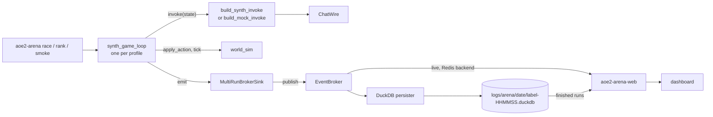

# Synthetic arena

The synthetic arena races prompt and model variants against each other in an in-memory AoE2-lite economy, with no game, VM, screenshots or detector involved. Each variant is a named profile; the arena plays every profile for a fixed number of turns from the same starting state, records every event to a DuckDB file, and prints a comparison. The CLI is the `arena` package in `apps/arena/src/`, installed as the `aoe2-arena` command.

## Commands

`main` in `apps/arena/src/__main__.py` takes one subcommand.

| Command | `just` recipe | Profile file (default) | Model calls | Output |
|---|---|---|---|---|
| `aoe2-arena smoke` | `just arena-smoke` | None: two built-in profiles, `mock-a` and `mock-b`, 10 turns | None | Results table; `smoke-<HHMMSS>.duckdb` |
| `aoe2-arena race [profile.yaml]` | `just arena-race [profile]` | `apps/arena/src/profiles/v1.yaml` | Real, one per turn per profile | Results table; `race-<HHMMSS>.duckdb` |
| `aoe2-arena rank [profile.yaml]` | `just arena-rank [profile]` | `apps/arena/src/profiles/ranking-v1.yaml` | Real, every profile on every scenario for every round | Bradley-Terry ratings with 95% intervals; `rank-<HHMMSS>.duckdb` |

Use `smoke` after changing arena, world-sim, event-log or broker code: it needs no API key, makes no model calls, and still goes through the broker and DuckDB. Use `race` to watch two or more profiles play one game each from the standard start. Use `rank` when the comparison has to hold up statistically; it plays repeated games over several starting scenarios, prints a cost estimate first, and asks `Proceed? [y/N]` when run from a terminal. Ranking is covered in [ranking](ranking.md).

`race` and `rank` exit with `error: AOE2_LLM_API_KEY not set` before spending anything if the key is missing. The `-redis` variants of the recipes (`arena-race-redis`, `arena-rank-redis`) set `ARENA_BROKER_BACKEND=redis` so a separate web server can show the run live.

## Profiles

A profile file is YAML loaded into a frozen Pydantic model by `apps/arena/src/config_profile.py`. `race` reads a `RaceConfig` (`turns`, default 50; `profiles`, at least two), and `rank` reads a `RankingConfig`, whose extra fields are listed in [ranking](ranking.md). Each entry in `profiles` is a `ConfigProfile`:

| Field | Default | Meaning |
|---|---|---|
| `name` | required | Label in the results table and in every `turn_start` event |
| `model` | `gpt-5.6-luna` | Model name sent to the wire, also used for pricing |
| `temperature` | unset | 0 to 1. Unset means the field is not sent |
| `prompt_variant` | `strategy` | Key into `PROMPTS` in `apps/arena/src/prompts.py` |
| `wire` | `openai` | `openai`, `zen` or `anthropic` (see [LLM providers](../agent/llm-providers.md)) |
| `base_url` | unset | Endpoint override for the `openai` and `zen` wires |

All profiles share the single `AOE2_LLM_API_KEY`, so one run can only mix models from one vendor. The two shipped files compare the prompt variants `bare` and `strategy` on `gpt-5.6-luna` for 60 turns: `v1.yaml` at temperature 0.0, `ranking-v1.yaml` at 0.5 over 5 rounds. `config_profile.py` notes that the gpt-5.6 models reject any temperature other than their default of 1, so on those models a profile should leave `temperature` unset.

`prompts.py` has two variants. Both tell the model to answer with only a JSON array of actions and list the actions it may use: `queue_villager`, `build` with a building key (`q` house, `w` mill, `r` lumber camp, `e` mining camp, `a` farm, `s` blacksmith), and `press` `z` to start the Feudal age-up. `bare` adds one goal line. `strategy` adds notes on the four age-up prerequisites and on when to stop queueing villagers. Adding a variant means adding a key to `PROMPTS`.

## How a variant plays

`race` and `smoke` call `race()` or `race_with_mock()` in `apps/arena/src/race.py`, which start one `synth_game_loop` per profile and run them together with `asyncio.gather`. Every profile starts from `_STANDARD_START`: 200 food, 150 wood, no gold or stone, population 8 of 25, Dark Age, no buildings. Each loop gets its own `run_id`, so one log file holds one run per profile.

`build_synth_invoke(profile)` in `apps/arena/src/invoke.py` builds one wire per profile with `make_wire(profile.wire, model=..., api_key=..., base_url=...)`, so profiles share no client state. On each turn it:

1. Renders the state as one line, for example `food=200 wood=150 gold=0 stone=0 pop=8/25 age=Dark Age buildings=[none] queued_villagers=0 age_up=not started`.
2. Calls `wire.tool_turn` with the variant's system prompt, that line as the only user turn, an empty tool list, and `max_tokens=256`.
3. Parses the reply as a JSON array of action dicts. If the whole reply is not one, it takes the first `[...]` span; if that fails too, the turn has no actions.
4. Prices the call with `cost_usd` from `apps/agent/src/providers/pricing.py`.

`build_mock_invoke` returns canned `(actions, reasoning, cost)` tuples in a cycle. With no list given it returns no actions and zero cost every turn, which is what `smoke` uses.

`synth_game_loop` applies each returned action with `world_sim.apply_action`, then advances the world one turn with `tick`. The economy rules are in [world sim](world-sim.md). The events each turn produces are listed in [event log and replay](event-log-and-replay.md).

When the games finish, `summarise` in `apps/arena/src/metrics.py` prints one row per profile, sorted by final population: age, population, food, wood, building count, action count, cost and turns completed, followed by per-profile action and building counts.

## Event flow

Every command runs its producer inside `_run_through_broker`. It builds a broker with `make_broker()`, opens the DuckDB file, and wraps both in a `MultiRunBrokerSink` labelled with the command name. The sink opens a broker run and starts a persister the first time it sees a `run_id`, and `close_all()` closes, drains and reaps every run before the file is released. The broker, its backends and the `ARENA_BROKER_BACKEND` switch are in [event broker](event-broker.md); persisting, replay and forking are in [event log and replay](event-log-and-replay.md).

The web server (`just arena-web-dev`, port 8000) and dashboard (`just arena-ui-dev`, port 5173) list and replay these files, show runs live when both processes use the Redis backend, and start forks. They are described in [web architecture](../web/architecture.md), [run viewer](../web/run-viewer.md) and [running locally](../web/running-locally.md).

## Relation to the agent

The arena imports four things from the `gameplay_agent` package in `apps/agent/src/`:

| Import | Used for |
|---|---|
| `synth_game_loop` (`synth_game_loop.py`) | The turn loop |
| `providers.wire_factory.make_wire`, `providers.base` types | Model calls |
| `providers.pricing` (`cost_usd`, `price_for`) | Per-turn cost and the `rank` estimate |
| `config.config.llm_api_key`, `KEY_ENV` | The API key |

It does not run the executor's tool loop, the strategist, the TypeSafe policy, perception, or the action executor, and it uses its own prompts. An arena result therefore compares prompts and models on a one-call-per-turn economy decision; it does not measure the full agent described in [agent overview](../agent/overview.md).

## Infrastructure

The CLI with the default in-process broker needs nothing running. `just arena-infra-up` (`docker compose up -d --wait`) starts the stack in `docker-compose.yml`, compose project `aoe2-arena`:

| Service | Image | Host port | Used by |
|---|---|---|---|
| `redis` | `redis:7.4.11` | none | The Redis broker backend, and Langfuse |
| `langfuse-web` | `langfuse/langfuse:4.38.0` | `127.0.0.1:3000` | Langfuse UI and API |
| `langfuse-worker` | `langfuse/langfuse-worker:4.38.0` | none | Langfuse |
| `langfuse-db` | `postgres:17.11` | none | Langfuse |
| `clickhouse` | `clickhouse/clickhouse-server:25.12` | none | Langfuse |
| `minio` | `cgr.dev/chainguard/minio` | `127.0.0.1:9000`, `127.0.0.1:9001` | Langfuse event and media storage |
| `otel-collector` | `otel/opentelemetry-collector-contrib:0.161.0` | none | Receives OTLP on 4317 and 4318 inside the compose network and exports to the `debug` exporter |

Only Redis is used by code in this repository, and only with `ARENA_BROKER_BACKEND=redis`. No Python package sends traces to the collector or uses a Langfuse client. `docker-compose.yml` does not publish Redis to the host, while `make_broker()` defaults to `localhost:6379`; [Redis broker operations](../runbooks/redis-broker-ops.md#reach-redis-from-the-host) shows how to expose it. The other recipes are `arena-infra-down`, `arena-infra-nuke` (also deletes volumes), `arena-infra-logs` and `arena-infra-status`. The required secrets are listed in `.env.example`.
