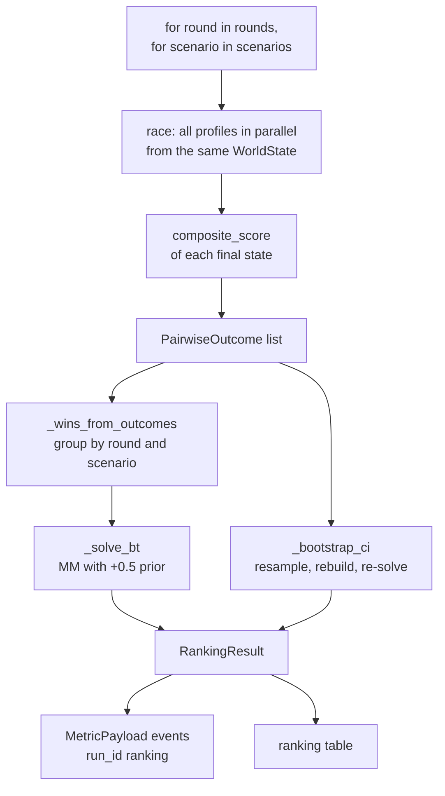

# Ranking pipeline

`aoe2-arena rank` plays a set of prompt and model profiles against each other in the synthetic world and fits a Bradley-Terry rating with a 95% bootstrap confidence interval for each profile. The code is in `apps/arena/src/ranking.py`, with starting positions in `scenarios.py` and the default config in `profiles/ranking-v1.yaml`. The statistics are explained in [Bradley-Terry and bootstrap intervals](../appendix/03-bradley-terry-and-bootstrap.md).

## Running it

```bash
just arena-rank                                   # apps/arena/src/profiles/ranking-v1.yaml
just arena-rank path/to/other-ranking.yaml
just arena-rank-redis                             # same, with ARENA_BROKER_BACKEND=redis
```

`just arena-rank` runs `uv run --package arena aoe2-arena rank <profile>` (`arena.__main__._cmd_rank`). The command:

1. Loads the YAML into a `RankingConfig` and exits if `AOE2_LLM_API_KEY` is unset.
2. Prints the race count and a cost estimate, then asks `Proceed? [y/N]` when stdin is a terminal. Without a terminal it starts straight away.
3. Opens `logs/arena/<YYYY-MM-DD>/rank-<HHMMSS>.duckdb` and runs `rank()` through the broker, so every turn of every race is stored and can be watched live (see [event broker](event-broker.md) and [event log and replay](event-log-and-replay.md)).
4. Prints the ranking table.

The cost estimate (`_estimate_cost`) assumes 215 input and 15 output tokens per turn, priced per profile with `price_for`. Actual spend comes from each response's usage.

`rank_with_mock` runs the same pipeline with `race_with_mock`, a stub that returns no actions, so it needs no key. `tests/test_ranking.py` uses it.

## Configuration

`RankingConfig` in `apps/arena/src/config_profile.py`:

| Field | Default | Meaning |
|---|---|---|
| `turns` | 60 | Synthetic turns per race |
| `profiles` | required, at least 2 | `ConfigProfile` entries |
| `scenarios` | `[]` | Scenario names; empty means all of `DEFAULT_SCENARIOS` |
| `rounds` | 5 | Times each scenario is replayed |
| `bootstrap_samples` | 1000, minimum 100 | Bootstrap resamples |
| `bootstrap_seed` | 42 | Seed for `np.random.default_rng` |

A `ConfigProfile` has `name`, `model` (default `gpt-5.6-luna`), `temperature` (default unset, 0 to 1), `prompt_variant` (`bare` or `strategy`, from `apps/arena/src/prompts.py`), `wire` (default `openai`) and an optional `base_url`. Every profile authenticates with the single `AOE2_LLM_API_KEY`, so all profiles in one run must use the same vendor. Wires are described in [LLM providers](../agent/llm-providers.md).

`ranking-v1.yaml` ranks `bare` against `strategy`, both on `gpt-5.6-luna` at `temperature: 0.5`, for 60 turns and 5 rounds. Both `ConfigProfile` and the agent `Config` record in comments that the gpt-5.6 models reject any temperature other than 1; the arena invoke does not catch that error.

## Scenarios

`DEFAULT_SCENARIOS` in `scenarios.py` holds four Dark Age starts with no buildings, an empty queue and gold and stone at 0. `get_scenario` raises `KeyError` for an unknown name.

| Name | Food | Wood | Population | Pop cap |
|---|---|---|---|---|
| `balanced` | 200 | 150 | 8 | 25 |
| `food-poor` | 80 | 200 | 8 | 25 |
| `wood-poor` | 300 | 40 | 8 | 25 |
| `late-start` | 120 | 120 | 6 | 20 |

## From races to ratings



`_collect_outcomes` loops rounds and scenarios sequentially. Each step calls `race` (`apps/arena/src/race.py`), which starts one `synth_game_loop` per profile with `asyncio.gather`, all from the scenario's `initial_state`. The world they play is described in [world sim](world-sim.md). One race produces one `PairwiseOutcome` per profile: profile name, scenario name, round index and score.

`composite_score` is a lexicographic tuple, compared left to right:

```python
(AGE_SEQUENCE.index(state.age), state.population, state.food + state.wood)
```

Reaching Feudal Age beats any Dark Age state, population breaks an age tie, and food plus wood breaks a population tie. `rank` takes a `score_fn` argument for a different score.

`_wins_from_outcomes` groups outcomes by `(round_idx, scenario_name)`, so profiles are only compared with the others in the same race. Inside a group every ordered pair with a strictly higher score adds one to `wins[i, j]`. Equal scores add nothing to either side. The mock stub produces only ties, which the prior turns into equal ratings.

## Bradley-Terry fit

`_solve_bt` fits strengths with Hunter's Minorization-Maximization update on the win matrix. Before fitting it adds 0.5 to every off-diagonal cell (`_BT_PRIOR`), which keeps an undefeated profile finite and avoids a zero denominator when every race tied. Strengths are renormalised to sum to the number of profiles after each step. The loop stops when no strength moves by more than `1e-6`, and raises `RankingError` after 1000 iterations.

The result is the natural log of each strength, shifted so the ratings average 0. A gap of `d` between two ratings means the model predicts the higher one wins with probability `1 / (1 + exp(-d))`.

## Confidence intervals

`_bootstrap_ci` draws `bootstrap_samples` resamples of the outcome list with replacement, each the size of the list. Resampling works on individual per-profile outcomes, so a resampled race can contain one profile twice or miss one. Each resample is regrouped into a win matrix and solved again; a resample whose fit raises `RankingError` is skipped. The interval is the 2.5th and 97.5th percentile of each profile's log-rating across the resamples. The generator is seeded with `bootstrap_seed`, so the same outcomes give the same bounds.

## Output

`rank` returns a `RankingResult` with `ratings`, `ci_low`, `ci_high` (all keyed by profile name), `pairwise_wins` keyed by `(winner, loser)`, and `n_races`, which counts outcomes (races times profiles).

The CLI prints:

```
Rank  Profile                   Rating  95% CI                Wins/Total
```

Wins is the sum of a profile's pairwise wins. Total is `n_races` divided by the number of profiles, which is the number of races. With more than two profiles a profile meets several opponents per race, so wins can exceed that total.

`_emit_ratings` writes three `MetricPayload` events per profile to the sink, under `run_id="ranking"`, `agent_id=<profile>` and `t=0`: `ranking_rating_<profile>`, `ranking_ci_lo_<profile>` and `ranking_ci_hi_<profile>`. They land in the same DuckDB file as the races. The dashboard's experiment overview hides this run because it has no turns (`apps/dashboard/src/panels/experiment-overview.tsx`). Nothing else reads these events, and each `rank` invocation is independent: no rating carries over between runs.

## Related

- [Arena overview](overview.md)
- [ADR 0004: Bradley-Terry ranking](../adr/0004-bradley-terry-ranking.md)
