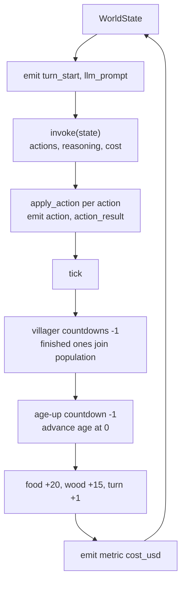

# World sim

`packages/evaluation/src/world_sim.py` is a small model of the AoE2 Dark Age economy. Arena races drive it instead of the real game: a model reads the state, returns actions, the sim applies them and advances one turn. It is coarse on purpose: enough economy to compare prompts and models cheaply and to catch regressions such as stuck loops or a failed age-up.

## State

`WorldState` lives in `packages/core/src/world_state.py` so that producers and consumers can share it without importing the simulator. `world_sim` re-exports it together with `AGE_SEQUENCE` (`Dark Age`, `Feudal Age`, `Castle Age`, `Imperial Age`).

| Field | Type | Notes |
|---|---|---|
| `food`, `wood`, `gold`, `stone` | float | Stockpiles |
| `population` | int | Villagers on the map |
| `pop_cap` | int | Raised by houses |
| `age` | str | One of `AGE_SEQUENCE` |
| `buildings` | list of str | Building names; duplicates allowed |
| `villager_queue` | list of int | Ticks left for each queued villager |
| `age_up_ticks_remaining` | int | 0 when no age-up is running |
| `turn` | int | Incremented by `tick` |

Every function in the module returns a modified copy made with `dataclasses.replace` and leaves its input untouched. The event log stores a Pydantic copy, `WorldStateSnapshot`, on each `turn_start` event, which is what forking restarts from (see [event log and replay](event-log-and-replay.md)).

## One turn

`synth_game_loop` in `apps/agent/src/synth_game_loop.py` runs a fixed number of turns. It is the loop behind `race`, `rank` and `smoke` (see [arena overview](overview.md)).



Actions apply before the tick, so a turn's gather income arrives after that turn's spending. `action_result` carries `state_changed`, which is false for every action the sim ignores or refuses.

## Accepted actions

`apply_action` dispatches on the action's `type` through `_ACTION_HANDLERS`. An unknown type is a no-op, as is any action the state cannot afford.

| Action | Effect | Requirement |
|---|---|---|
| `{"type": "queue_villager"}` | Food -50, appends a 3-tick countdown | Food at least 50 |
| `{"type": "build", "building_key": k}` | Wood minus the cost, appends the building; a house adds 5 to `pop_cap` | Known key, enough wood |
| `{"type": "press", "key": "z"}` | Food -500, starts a 6-tick age-up | Feudal prerequisites, no age-up running |
| `press` with any other key, `click`, `right_click`, `drag`, `wait`, `scroll`, `detect` | None | None |

| Key | Building | Wood |
|---|---|---|
| `q` | house | 25 |
| `w` | mill | 100 |
| `e` | mining_camp | 100 |
| `r` | lumber_camp | 100 |
| `a` | farm | 60 |
| `s` | blacksmith | 150 |
| `t` | dock | 150 |

`_feudal_prereqs_met` requires all of: age is `Dark Age`, food at least 500, population at least 22, and both `mill` and `lumber_camp` built. A `press z` that misses any of them does nothing and reports no error.

## What the model sees

In an arena race the model never sees entities. `build_synth_invoke` in `apps/arena/src/invoke.py` sends the profile's system prompt from `apps/arena/src/prompts.py` and one user line built by `_state_to_prompt`:

```
food=200 wood=150 gold=0 stone=0 pop=8/25 age=Dark Age buildings=[none] queued_villagers=0 age_up=not started
```

The reply is capped at 256 tokens. `_parse_actions` reads the first JSON array in it as the action list; a reply without a valid array becomes an empty list. Both prompt variants list `queue_villager`, builds for `q`, `w`, `r`, `e`, `a`, `s`, and `press z`, and state the gather rates. `strategy` adds the four age-up prerequisites and a rule to stop queueing villagers while food is below 500.

## Perception projection

`render(state, width, height, id_factory, seed)` turns a `WorldState` into the `DetectedEntity` list that YOLO inference produces (`packages/core/src/entity.py`), for code that consumes detections:

- one `town_center` at the screen centre, offset by up to 100 px horizontally and 50 px vertically
- one `villager` per unit of `population`, scattered within 150 by 100 px of the town centre; queued villagers are left out
- one entity per building, on a 4-column grid with 120 px spacing, starting 220 px right of the town centre

Each class has a fixed box size (`_CLASS_BBOX_DIMS_PX`) and every entity has confidence 1.0. The default canvas is 1920 by 1080. The list is sorted by class name.

`packages/detection/src/inference/mock.py` (`mock_detect_from_world`) wraps `render` at a screenshot's dimensions. The arena loop does not call it. `tests/test_detector.py` runs the same schema contract over `mock_detect_from_world` and the fixed `mock_detect` fixture.

## Determinism

The economy has no randomness: the same state and actions always give the same next state. `render` uses a local `random.Random` seeded with `seed`, or with `state.turn` when no seed is given, and never touches the global generator, so the same state, size and seed give identical entities. All run-to-run variation in a race comes from the model. The mock invoke used by `just arena-smoke` and `rank_with_mock` cycles through canned replies and is fully deterministic.

## Differences from the real game

- Gathering is a flat +20 food and +15 wood per turn regardless of villager count or assignment. Gold and stone never change.
- `pop_cap` is never enforced. Villagers train with food alone, so houses have no effect on growth.
- Every queued villager counts down in parallel. The real Town Center trains one at a time.
- Only the Feudal Age is reachable: the age-up check requires `Dark Age`, so `press z` in Feudal does nothing.
- Buildings have no position, build time or builder, and apart from houses, the mill and the lumber camp they do nothing.
- There is no map, no enemy, no military and no way to lose.

## Other helpers

`init_from_fixture`, `state_to_fixture_inputs` and `evaluate_end_state` convert between `WorldState` and a fixture `inputs` block and check end-state assertions (numbers as minimums, strings as exact matches). Their only callers are in `tests/test_world_sim.py`.
