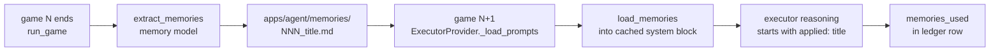

# Prompt mutation and memory

Two pieces of the [autoresearch](overview.md) loop call a model outside the game. `PromptMutator` (`apps/autoresearch/src/prompt_mutator.py`) proposes edits to a system prompt for the tournament. `MemoryChain` (`apps/agent/src/memory_chain.py`) writes rules from a finished game to disk and reads them back into the next game's prompt. Both make one blocking call through a `TextCompleter` on the memory model, `AOE2_MEMORY_MODEL` (see [LLM providers](../agent/llm-providers.md)).

## Prompt mutator

### Proposing edits

`propose_changes(current_prompt, recent_traces, component_breakdown, failure_modes, n)` sends one request with up to 2048 output tokens. The user message contains:

- the full current prompt in a code block
- excerpts of the last two `GameTrace`s from `format_trace_excerpt`: a line with the composite, the components and the end reason, then each turn's reasoning, actions and verification note
- the latest component scores, with the instruction that the lowest is the best opportunity
- the failure hints from the orchestrator
- a request for exactly `n` distinct edits as a JSON array of objects with `description`, `old_text`, `new_text` and `rationale`

The system prompt is `REFLECTIVE_MUTATOR_SYSTEM`: `MUTATOR_SYSTEM` plus an instruction to diagnose turn-by-turn failures from the traces and aim at the weakest component. `MUTATOR_SYSTEM` asks for edits that change at most 5 lines, stay out of `## Output Format` and `## Game State Detection`, give concrete thresholds, and fix one weakness each. To add text, the model repeats an existing line in `old_text` and appends to it in `new_text`.

`MUTATOR_SYSTEM` describes the score as survival 30%, peak population 25%, age 20%, economy 15% and action success 10%. `metrics.compute_score` weights age 0.40, age speed 0.25, economy 0.20, action success 0.10 and survival 0.05, so the mutator is told to optimise a different score from the one that judges it.

`_parse_changes` reads the reply with `core.json_utils.extract_json_array`, which accepts bare JSON, a fenced block or the first balanced array, and keeps only objects that have `description`, `old_text` and `new_text`. Any exception, from the call or the parse, is logged as `prompt_mutator_error` and returns an empty list, which ends the tournament with `no_candidates`.

### What the code enforces

| Check | Where | Effect |
|---|---|---|
| `old_text` is non-empty and appears in the prompt | `Orchestrator._candidate_applies` | Candidate dropped before any game |
| `old_text` appears in the prompt | `apply_change` | Returns False, logs `change_not_applicable` |
| `old_text` starts inside a protected section | `apply_change` | Returns False, logs `change_in_protected_section` |

`PROTECTED_SECTIONS` is `## Output Format` and `## Game State Detection`. A section runs from its heading to the next `\n## `. Only the position of the first occurrence of `old_text` is tested, so an edit that starts before a protected heading and runs into it passes. The five-line limit exists only in the system prompt; no code counts lines. `apply_change` replaces the first occurrence of `old_text` and writes the file.

`Orchestrator._play_candidate` ignores the return value of `apply_change`. A refused edit is still committed as a trial and still costs a game, played on the unchanged prompt.

`revert` runs `git checkout --` on the prompt file. The prompt file path and its effect on the tournament are covered in the warning on the [overview](overview.md#the-tournament).

## Memory chain



### Writing memories

`game_runner.run_game` creates a `MemoryChain` and calls `extract_memories(memory, score, game_id)` after a game whose score is valid and that has at least one turn. Neither `just experiment` nor the tournament passes a game id, so every memory file records `game_id: unknown`. A failed model call is logged as `memory_extraction_failed`, any other error as `memory_extraction_error`, and the run continues either way.

`_build_game_summary` gives the model the end reason, the composite and component scores, duration, turn count, peak population and highest age, followed by the turns in `AgentMemory.working_memory` (the last ten). Each turn has its reasoning cut to 150 characters, up to four actions, and the resources read that turn. With no turns, extraction is skipped.

`EXTRACTION_SYSTEM` asks for zero to three notes, each one rule in the first person ("I should...") with one sentence of evidence, a concrete threshold, and no turn numbers. Each note is a JSON object:

| Field | Values |
|---|---|
| `type` | `strategy`, `economy`, `military`, `detection`, `failure` |
| `title` | short snake_case |
| `content` | the rule |
| `applies_when` | trigger condition in plain English, e.g. `food < 50` |
| `score_impact` | `positive`, `negative`, `neutral` |

`_parse_observations` reads `observations` with `extract_json_object` and drops notes with empty content. The title is lowercased, every character outside `a-z`, `0-9` and `_` becomes `_`, and it is cut to 50 characters. A note whose title already exists on disk (from frontmatter, or from the file name suffix) is skipped. Each remaining note is written to `apps/agent/memories/<NNN>_<title>.md`, numbered after the highest existing prefix:

```markdown
---
type: <type>
title: <title>
game_id: <game_id>
applies_when: <trigger, or any>
score_impact: <impact>
created: <ISO 8601 UTC timestamp>
---

<content>
```

Files are plain Markdown and can be edited or deleted by hand. They are read with `errors="replace"`, so a stray non-UTF-8 byte cannot break loading.

### Reading memories back

`ExecutorProvider._load_prompts` loads the prompt files once per provider and appends `MemoryChain.load_memories(max_tokens=800)` to the cached core system block, so memories cost tokens once per game. Where that block sits in the prompt is covered in [prompts and context](../agent/prompts-and-context.md).

`load_memories` orders notes by `score_impact` (negative, then positive, then neutral) and by `created`, newest first, within each group. It keeps at most 20 and stops adding lines at 3200 characters (four per token), header included. Each line reads `- [title] (when: applies_when) content`; the `(when: ...)` part is left out when the trigger is `any`. The header, `## Notes to Myself from Previous Games`, tells the model to follow a memory over a conflicting rule in `core.md` or the age section, and to prefer the more specific trigger when two memories conflict.

The provider also stores the titles of every memory file with content in `loaded_memory_titles`, which `game_loop` copies to `AgentMemory.memories_loaded`. That list can include titles that did not fit the budget.

### Attribution

When the executor's reasoning starts with `[applied: title_a, title_b]`, `turn_phases._extract_applied_memories` strips the prefix and splits the titles. Titles in `memories_loaded` are counted by `AgentMemory.record_memories_applied`; others are logged as `memories_applied_unknown`. The ledger row stores the number of loaded memories in `memories_loaded` and the total applied count in `memories_used_count`.
