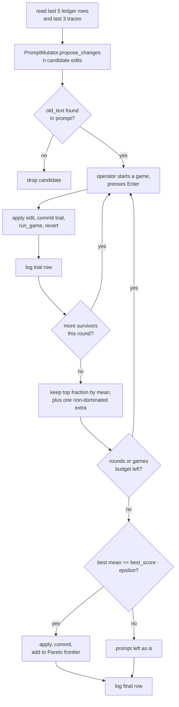

# Autoresearch

`apps/autoresearch` plays real games with the agent, scores each one, and appends the result to an experiment ledger. The same game runner backs a merge gate that requires a scored game at the current commit, and a prompt-evolution tournament: a model proposes small edits to a system prompt, each edit plays real games, and the best edit is committed if it scores within 0.02 of the best accepted result so far.

| Command | Runs | Purpose |
|---|---|---|
| `just experiment "<description>" [args]` | `python -m autoresearch.game_runner` | One game, one ledger row |
| `just experiment-baseline [n] [args]` | `game_runner` n times (default 3) | Baseline rows for the current commit |
| `just experiment-gate [--sha S] [--any]` | `python -m autoresearch.experiment_gate` | Fails without a ledger row at HEAD |
| `just autoresearch [args]` | `aoe2-autoresearch` (`orchestrator:main`) | Prompt tournaments |

Every game is a real AoE2 game that someone has started on the machine the agent controls. Nothing here launches the game.

## Running and scoring one game

`game_runner.run_game` builds an `ExecutorProvider`, a `TypeSafePolicyAdvisor` and an `AgentMemory`, loads the game profile from `AOE2_GAME_PROFILE`, and calls `gameplay_agent.game_loop` with `init_required_detector`. That detector factory fails the run when neither `AOE2_DETECTION_HOST` nor a local model is available, so a scored game never runs on mock detections. The agent itself is described in the [agent overview](../agent/overview.md).

When the loop returns, `AgentMemory.get_metrics_snapshot()` gives the metrics and `metrics.compute_score` turns them into a `GameScore`, each component in 0 to 1:

| Component | Weight | Computed from |
|---|---|---|
| `age` | 0.40 | Highest age: Dark 0, Feudal 0.33, Castle 0.66, Imperial 1.0; a `victory` end counts as 1.0 |
| `age_speed` | 0.25 | `min(1, 600 / feudal_time_s)`; 0 if Feudal was never reached |
| `economy` | 0.20 | Food gathered according to the executor's action ledger, divided by 5000, capped at 1 |
| `action_success` | 0.10 | Confirmed economic operations divided by attempted ones |
| `survival` | 0.05 | Game seconds divided by 1200, capped at 1 |

`composite` is the weighted sum, rounded to four places.

### Runs that cannot be verified

A run is marked `score_valid = False` in two cases:

- The executor's `ActionLedger` still holds uncertain operations. When a game ends, `finalize_unverified` marks every placement, purchase, training order, research, age-up or villager assignment whose effect was not yet observed as uncertain. One such operation invalidates the run.
- `recording_qualification` reports a gap: no profile, or a profile whose `roster_verified`, `hotkeys_verified` or `ownership_verified` is false.

An invalid run is still scored and logged, with `accepted=false` and `(reverted)` in place of the git SHA, so it never satisfies the merge gate. It extracts no memories, and `game_runner` exits with `Run invalid for scoring`. `llm_error_rate` is logged but does not affect validity.

After a valid game with at least one turn, `MemoryChain.extract_memories` writes cross-game memories (see [mutation and memory](mutation-and-memory.md)). Any game with at least one turn also saves a `GameTrace`: the last ten turns' reasoning (150 characters each), up to four actions per turn, the verification note and the component scores, written to `apps/autoresearch/experiments/traces/<game_id or timestamp>.json`.

## The tournament

`Orchestrator.run_tournament` races a few candidate prompt edits with successive halving and keeps at most one.

The mutator gets the last two traces, the latest row's component scores, and failure hints from `_extract_failure_modes`. That function checks the latest row against fixed thresholds (population under 0.2, age 0, economy under 0.1, action success under 0.3, survival under 0.5, a `defeat` end). It parses the `population` column first, and current rows leave that column empty, so the parse fails and it returns only the generic hint `No clear failure patterns`. Each round plays every surviving candidate once, then `_keep_top` keeps the top `keep_fraction` by mean composite. The game budget is checked before every game and ends the tournament early when reached.

The winner is the played candidate with the highest mean. `best_score` is the highest composite among accepted `prompt` rows in the ledger, 0.0 when there are none, so the first tournament always accepts. Every trial row is logged with `accepted=false`; the final row records the decision and the winner's last game. The tournament does not check `score_valid`.

Trial and accept commits are made by `git add` and `git commit` inside `apps/autoresearch`, with messages `[autoresearch] trial: ...`, `[autoresearch] <id>: <description>` and `[autoresearch] revert: prompt change rejected`.

> **Warning:** `PromptMutator.PROMPT_FILE` is `apps/autoresearch/prompts/system.md`, which does not exist in the repository. The agent's prompts are in `apps/agent/src/prompts/` (`core.md`, `hotkeys.md`, `strategist.md`, `ages/`). `read_current_prompt` raises on the missing file, so `just autoresearch` stops before proposing any edit. Separately, the trial revert runs `git checkout --` on the prompt file after the trial commit, which restores the committed trial text, not the baseline.

## Pareto frontier

`pareto.py` compares candidates on the vector `(age, age_speed, economy, action_success, survival)`, each the mean over that candidate's games. One vector dominates another when it is at least as good on every axis and better on one. During halving, `_keep_top` adds at most one candidate outside the top fraction that no other candidate dominates, so an edit that is strong on a single axis survives a round. An accepted winner is merged into `apps/autoresearch/experiments/pareto_frontier.json`: it is skipped if an entry dominates it, and it removes the entries it dominates. Only `_record_frontier` reads that file.

## Experiment ledger

`experiment_log.py` appends one tab-separated row per game to `experiments/results.tsv` at the repository root. `.gitignore` excludes every `experiments/` directory, so the ledger, traces and frontier stay on the machine that plays the games.

Columns include the experiment id (`exp_NNNN`, the data row count plus one), timestamp, loop (`manual` or `prompt`), description, the composite and component scores, end reason, turn count, `accepted`, `git_sha`, memories loaded and applied, the tournament fields (`tournament_id`, `candidate_id`, `round`, `game_in_round`), `llm_error_rate`, turn latencies, `score_version` (3), `age_speed`, `feudal_time_s`, act and perceive latencies, and `loop_arch`. The `population` column is written empty. When `HEADER` gains columns, `_ensure_results_file` rewrites the header line and leaves data rows alone. Rows with different `score_version` values are not comparable.

## Merge gate

`experiment_gate` passes when the ledger has a row whose `git_sha` equals the short SHA of HEAD, or of `--sha`. `--any` only requires a non-empty ledger. It prints `PASS:` or `FAIL:` and exits 0 or 1. Since invalid runs carry `(reverted)`, only a valid game at the current commit satisfies it. The procedure is in [baseline experiments](../runbooks/baseline-experiments.md).

## Configuration

The code reads its settings from CLI flags and module constants. `apps/autoresearch/src/config.yaml` is shipped as package data but no code loads it, and its scoring weights do not match `metrics.py`.

| Flag | Default | Applies to |
|---|---|---|
| `--max-experiments` | unlimited | Tournaments to run |
| `--time-budget` | 1200 s | Each tournament game |
| `--n-candidates` | 3 | Edits proposed per tournament |
| `--halving-rounds` | 2 | Halving rounds |
| `--keep-fraction` | 0.5 | Fraction kept per round |
| `--games-budget` | 6 | Games per tournament |

`EPSILON` (0.02) is a constant in `orchestrator.py`. `game_runner` takes `--time-budget` (default none), `--max-iterations` (perception frames, not turns), `--experiment-id`, `--description` and `--overlay`. The mutator and memory chain use the memory model (`AOE2_MEMORY_MODEL`) through a `TextCompleter` (see [LLM providers](../agent/llm-providers.md)).

## Related

- [Ranking pipeline](../arena/ranking.md) compares fixed profiles in the synthetic world.
