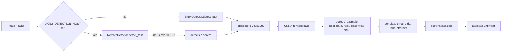

# Entity detector

The detector turns one game frame into a list of `DetectedEntity` boxes (class, box, centre, confidence) from a fine-tuned YOLO26n model. The library is `packages/detection/src/inference/`. The agent uses it in-process or through an HTTP client that calls the [detection server](serving-and-evaluation.md), and both paths share one preprocessing function and one decoder.

## Pipeline



The agent's only call is `detect_fast`, made by `detect_frame` in `apps/agent/src/detection_phase.py`. Before that call the agent may shrink the frame so objects reach the model at the size it trained on (`apps/agent/src/detector_scale.py`, covered in [perception](../agent/perception.md)). Ownership and tracking run on the result afterwards.

## Choosing a detector

`init_detector` and `init_required_detector` in `apps/agent/src/detection_phase.py` build the detector once per game.

| Condition | Detector | On failure |
|---|---|---|
| `AOE2_DETECTION_HOST` unset | `EntityDetector` via `get_detector(use_sahi=False, imgsz=1280, model_name=config.detection_model)` | Interactive: falls back to mock if no weights load. Required: raises `DetectionUnavailableError` if the result is a mock |
| `AOE2_DETECTION_HOST` set, interactive (`init_detector`) | `RemoteDetector` from `get_remote_detector` | A local `EntityDetector` fallback if real weights exist on this machine, otherwise an empty list |
| `AOE2_DETECTION_HOST` set, recorded experiment (`init_required_detector`, used by `apps/autoresearch/src/game_runner.py`) | `RequiredRemoteDetector` | Raises `DetectionUnavailableError` |

`get_detector` keeps a process-wide singleton. `EntityDetector.takes_pixels` is true, so the agent hands it a PIL image built from the capture's pixels; `RemoteDetector` needs an encoded JPEG.

## The served model

| Property | Value | Source |
|---|---|---|
| Name | `aoe2_yolo_v12_nms736` | `config.detection_model`, env `AOE2_DETECTION_MODEL` |
| Base | Ultralytics YOLO26n, fine-tuned at imgsz 1280 | registry `README.md` |
| Classes | 65, names embedded in the ONNX metadata | `inference-contract.json` |
| Input | `images`, `[1, 3, 736, 1280]` float32, static | `inference-contract.json` |
| Output | `output0`, `[1, 69, 19320]`: 4 box rows (cx, cy, w, h) plus 65 class scores per anchor | `inference-contract.json` |
| Head | One-to-many (exported with `end2end=False`), so the host must run NMS | `export_onnx.py` |

`resolve_model_path` looks for `<name>.onnx`, then `<name>.pt`, in `packages/detection/src/inference/models/`. Weights there are gitignored (only v5 is committed), so each host copies them in. If the configured name is missing, `_resolve_or_substitute` logs a warning and uses the highest `aoe2_yolo_v<N>` file with a purely numeric suffix; if there is none, the detector degrades to mock with a warning.

The 736x1280 rectangle gives a 16:9 or wider frame the same scale as the 1280 square the model trained on, with less padding to compute. A static graph accepts only its own shape, so the detector and the server read the input shape from the graph and ignore `detection_imgsz` (1280).

## Backends

`EntityDetector._load_model` picks the backend from the file extension.

| File | Backend | Notes |
|---|---|---|
| `.onnx` | onnxruntime | Providers in order of availability: DirectML, CoreML (`ModelFormat: MLProgram`), CPU. Graph optimisation `ORT_ENABLE_ALL`, up to 8 intra-op threads |
| `.pt` | Ultralytics `YOLO` | If `ultralytics` is not importable, tries the sibling `.onnx` |
| none or load error | mock | `mock_detect`: a town centre, 2 to 4 sheep, 3 villagers and a scout, seeded with `random.seed(42)` |

CoreML must compile to MLProgram. Its default NeuralNetwork format stores integer tensors as floats, which breaks the end-to-end head's top-k selection (`onnx_providers` docstring). The synthetic arena uses `mock_detect_from_world`, which renders a `WorldState` into detections (see [world sim](../arena/world-sim.md)).

Class names come from the model first. `parse_ultralytics_names` reads the `names` metadata that Ultralytics writes into ONNX and CoreML exports, and accepts it only if IDs run `0..n-1`. Without it the detector falls back to `training/config/classes.yaml`.

## Preprocessing

`letterbox` in `preprocess.py` is shared by the detector and the server. It scales the frame by `min(target_w / w, target_h / h)` with `cv2.INTER_AREA`, centres it on a `(114, 114, 114)` canvas, and returns a CHW float32 tensor in `[0, 1]` plus the scale and padding. A 3024x1672 capture scales by 0.423 to 1280x708 and gets 14 px of grey above and below. Boxes map back with `orig = (coord - pad) / scale`.

## Decoding and postprocessing

`decode_example` in `onnx_layout.py` is the one decoder for the local detector, the SAHI tile path and the server. It accepts two layouts per batch entry:

| Layout | Shape | Handling |
|---|---|---|
| End-to-end | `(num_boxes, 6)` as x1, y1, x2, y2, conf, class | Drop rows below the floor |
| One-to-many (served) | `(4 + num_classes, num_anchors)` | Best class per anchor, drop below the floor, xywh to xyxy, class-wise greedy NMS at IoU 0.5 (`RAW_NMS_IOU`) |

Any other shape raises `UnknownOnnxLayoutError`; callers log it and return no detections. The floor passed in is the lowest per-class threshold (0.20).

After decoding, `_onnx_detect` applies each class's threshold, undoes the letterbox, clips to the frame and drops empty boxes. `detect_fast` then runs `postprocess.nms` (IoU 0.5, same class only, so a villager may overlap a house), which returns boxes in descending confidence.

## Confidence thresholds

`thresholds.py` holds the thresholds as a reviewable literal.

| Class | Threshold |
|---|---|
| default (`DEFAULT_CONFIDENCE`) | 0.35 |
| `deer`, `relic`, `sheep` | 0.20 |
| `berry_bush`, `villager` | 0.25 |
| `mill` (`BUILDING_FALSE_POSITIVE_FLOORS`) | 0.55 |

The mill floor exists because a house misread as a mill makes the agent believe its food drop-off is built. `get_threshold` applies it, and the server and release evaluation use `get_threshold`. The in-process `EntityDetector` reads only `CLASS_THRESHOLDS` and its own `confidence_threshold` (0.35), so it does not apply the mill floor.

`sync_thresholds` rewrites the block between the `BEGIN/END GENERATED CLASS_THRESHOLDS` markers from the best-F1 sweep that `packages/detection/src/testing/evaluate_real.py --conf-sweep` writes to `eval_real_summary.json`. Swept classes overwrite their value; others keep theirs. Without `--write` it only prints.

```bash
uv run --package detection python -m detection.inference.sync_thresholds path/to/eval_real_summary.json --write
```

## Remote client

`RemoteDetector` (`remote_detector.py`) is async. `detect_fast` encodes a PIL image as JPEG quality 85 (bytes pass through unchanged), posts it to `/detect?imgsz=<detection_imgsz>` with a 10 s timeout, validates the JSON with Pydantic, assigns `{class}_{n}` IDs and applies the same `nms`. It logs `remote_detection_latency` with round trip, server time and transport overhead.

| Server answer | Client behaviour |
|---|---|
| 200 | Detections returned |
| 503 with `reason: detector_busy` | Raises `DetectionBusyError`; the server stays marked available and the frame is not retried locally |
| Connection error, other HTTP error, invalid JSON | Marks the server unavailable, then uses the fallback (see the table under "Choosing a detector") |
| Any call while unavailable | Returns the fallback result until 30 s pass, then probes `GET /health` and resumes on 200 |

A mock detector is never used as the remote fallback, so a server outage produces no detections instead of invented ones. The agent counts busy frames as discarded (see [perception](../agent/perception.md)).

## Statelessness

Each call is independent. `EntityDetector` resets its per-class counters on every call, so `sheep_0` in one frame and `sheep_0` in the next are unrelated; the server keeps only the loaded model and an inference lock. Identity across frames is the job of the [tracker](../agent/tracking.md).

## Ownership

`ownership.py` labels units and buildings by colour after detection. `summarize_frame` in `detection_phase.py` runs `classify_entities_pixels` in a thread on the capture's RGB pixels, for classes in `THREAT_CLASSES | GATE_BUILDING_CLASSES`. It always runs in the agent process, whichever detector produced the boxes.

`classify_entity` samples two regions: a 14 px strip starting 12 px above the box top (the health bar) and the top 30% of the box. A pixel counts as blue when B > 120 and B is more than 1.5 times both R and G.

1. With a verified game profile (`roster_verified` and `ownership_verified`), it scores seven colour masks. If the top colour covers at least 4% of a region and at least twice the runner-up, the owner is that colour's relationship from the profile, or `UNKNOWN` for a colour not in the roster.
2. Otherwise a blue ratio of at least 0.04 means `OWN`, since player 1 is blue.
3. Anything else is `UNKNOWN`.

`Owner` has `own`, `ally`, `enemy`, `neutral` and `unknown`.

## Tiled and multi-pass inference

The library also has inference modes that no agent path calls. `EntityDetector.detect` tiles frames wider than 640 px into 640x640 tiles with 32 px overlap when `use_sahi` is true (`sahi.py`; ONNX batches the tiles when the graph has a dynamic batch axis). `detect_fast_multi` adds a second pass on the centre half of the frame. `sahi.py` also holds ROI tiling helpers (`compute_sahi_rois`, `sahi_detect_rois`, `merge_detections`). The agent builds every detector with `use_sahi=False` and calls only `detect_fast`. A 640 px tile of a 3024 px capture shows objects at about 2.4 times the scale the model trained on.

## Class taxonomy

`packages/detection/src/training/config/classes.yaml` defines 65 classes, typed by `ClassesYaml` in `packages/detection/src/_classes_schema.py`.

| IDs | Group | Classes |
|---|---|---|
| 0-8 | Resources and nature | tree, gold_mine, stone_mine, berry_bush, relic, deer, boar, wolf, sheep |
| 9-16 | Economy buildings | town_center, house, lumber_camp, mining_camp, mill, market, dock, farm |
| 17-24 | Military buildings | barracks, archery_range, stable, blacksmith, siege_workshop, monastery, castle, university |
| 25-29 | Defensive and special | gate, wall, tower, wonder, krepost |
| 30-32 | Civilian units | villager, trade_cart, fishing_ship |
| 33-43 | Cavalry, archers, infantry | scout_line, knight_line, camel_line, battle_elephant, archer_line, skirmisher_line, cavalry_archer, hand_cannoneer, militia_line, spearman_line, eagle_line |
| 44-49 | Siege, monk, king | ram, mangonel_line, scorpion, trebuchet, monk, king |
| 50-54 | Unique units | unique_archer, unique_cavalry, unique_infantry, unique_siege, unique_ship |
| 55-58 | Naval and siege tower | fish, galley, fire_galley, siege_tower |
| 59-64 | Animals | goose, goat, cow, buffalo, horse, rhinoceros |

A `_line` class covers a unit's upgrade path (`militia_line` is Militia through Champion). `unique_*` classes group civilisation units by type and carry `examples` lists used for open-vocabulary prompts. `label_aliases` lets reviewers label `ibex` and `elephant`, which train as `deer` and `boar`.

The detection server bundles its own `apps/detection-server/src/classes.yaml` with the first 60 names. It is a fallback for models without embedded names; the served model carries all 65.

## Related

- [YOLO and object detection](../appendix/01-yolo-and-object-detection.md)
- [Training](training.md) and [labeling](labeling.md)
- [Sprite extraction](sprite-extraction.md)
