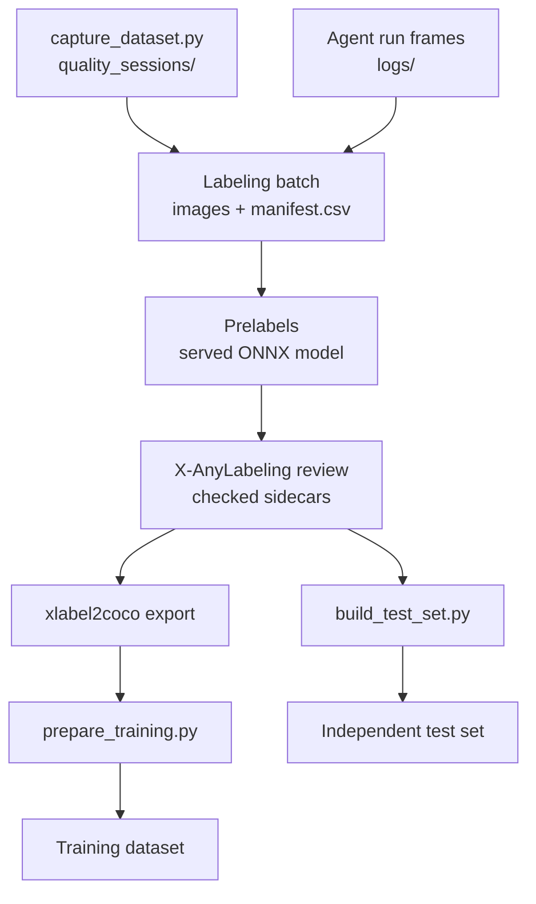

# Real-screenshot labeling

Real game frames get labels in three steps: a model proposes boxes, a person corrects every box in X-AnyLabeling, and a converter turns the reviewed export into training or test data. Every frame carries a source session from capture to dataset, so frames from one match never land on both sides of a split.

## Workflow



Development batches go to `prepare_training`; a batch whose manifest marks every row `test` can only go through `build_test_set`.

## Capture

`apps/agent/src/capture_dataset.py` saves lossless PNGs of the exact game window on the Windows VM or the Mac. It runs as its own process and fails if it cannot find the game window; it never falls back to grabbing the whole display.

```bash
uv run --no-sync python -m gameplay_agent.capture_dataset \
  --session-id dev_20261005_match01 --split development --source replay \
  --map Highland --civilization Magyars --game-version "<build>" \
  --graphics-preset high --ui-scale 100% --game-stage dark_age --zoom default \
  --count 20 --interval 15
```

One session is one match. The split (`development` or `final_test`) is fixed at capture; `final_test` refuses `--source scenario`. `--append` adds frames to the same session and fails if the split, source, map, civilization, build, graphics preset, UI scale or window size changed. Each session directory under `packages/detection/src/real_screenshots/quality_sessions/` (override with `--root`) holds `images/frame_*.png` and `capture.json` with per-frame timestamp, stage, zoom and SHA-256 (`detection.labeling.session_dataset.CaptureSession`).

The other real-frame source is game-window JPEGs from agent run sessions under `logs/<session>/images/`. The independent test set is built from those.

## Labeling batches

Reviewers work on a curated batch folder under `packages/detection/src/real_screenshots/`, for example `labeling_batch_20261011_development/` or `labeling_batch_20261029_independent_test/`.

| File | Content |
|---|---|
| `images/` | Byte copies of the selected frames, named `<session>__<frame>` |
| `manifest.csv` | `image`, `source_path`, `source_session`, `split`, `width`, `height`, `sha256` per frame |
| `classes.txt` | Annotation labels: the 65 classes in ID order, then the aliases (`get_annotation_labels`) |
| `prelabels.coco.json` | Model suggestions in COCO form |
| `images/*.json` | X-AnyLabeling sidecars, one per image, with a `checked` flag |
| `README.md` | Selection rules, review command, build command |

## Prelabeling

The suggestions come from the served ONNX model through the detection server's own decoder and thresholds (`detection_server.evaluate.predict`):

```bash
uv run --no-sync python -m detection_server.session_tools \
  prelabel-batch --manifest <batch>/manifest.csv \
  --model packages/detection/src/inference/models/aoe2_yolo_v12_nms736.onnx \
  --output <batch>/prelabels.coco.json
```

`prelabel-batch` verifies each image hash against the manifest; `prelabel --session-id` writes the same suggestions into one capture session. Both refuse any frame that is not `development`, so final-test frames are never anchored on one model's output. The 40-frame independent test batch uses a different rule: its `build_test_batch.py` takes the union of v9, v10 and v11 predictions, merges duplicates (same class at IoU 0.5, different classes at IoU 0.7), and strips the model name and score from every box so no candidate gets an advantage in review.

`detection.labeling.prelabel` is an Ultralytics prelabeler for a folder of screenshots. It defaults to `inference/models/aoe2_yolo_v6.pt` on `real_screenshots/raw/`, writes YOLO labels, `classes.txt` and preview images to `labeling/output/prelabeled/`, and supports `--sahi` tiling and `--skip-labeled`. `detection.labeling.export_coco` converts that output to COCO (`instances_default.json`).

With `--open-vocab yoloe` or `--open-vocab dinox`, `prelabel` asks an open-vocabulary detector instead (`labeling/open_vocab.py`). `YoloeBackend` runs `yoloe-11l-seg.pt` locally; `DinoXBackend` calls the hosted DINO-X API and needs `DINOX_API_KEY`. Both need the `autolabel` extra. `open_vocab_mapping.build_class_prompts` turns each class into prompts (the class name without `_line`, plus the `examples` listed in `classes.yaml`), and `map_open_vocab_label` maps a returned phrase back to a class ID.

## Review in X-AnyLabeling

```bash
xanylabeling --filename <batch>/images --labels <batch>/classes.txt \
  --work-dir <batch> --no-auto-update-check --nodata
```

The reviewer labels every visible, identifiable instance of a supported class, fixes classes and box extents, deletes false positives, and adds every miss (prelabels omit whatever the model missed). Boxes are tight around the visible artwork, cover only the visible part of an occluded object, and exclude shadows, health bars and selection circles. An image is marked checked only after the whole image has been reviewed; the converters treat that flag as review evidence.

After review, export COCO to a directory that does not exist yet:

```bash
xanylabeling convert --task xlabel2coco --mode detect \
  --images <batch>/images --labels <batch>/images \
  --output <batch>/export_<name> --classes <batch>/classes.txt
```

Corrections to an existing batch are tracked in the batch: `relabel_review/RELABEL.md` lists each box to change with a numbered sheet, and the pre-edit sidecars are kept in `sidecars_before_relabel_<date>/`.

## Label aliases and class mapping

Reviewers label finer than the model trains ("label fine, train coarse"). `classes.yaml` has a `label_aliases` list:

| Label | Trains as | Why |
|---|---|---|
| `ibex` | `deer` | Hunted like deer and runs away |
| `elephant` | `boar` | Fights back like boar |

`class_mapping.py` is the one place class names are read:

| Function | Returns |
|---|---|
| `load_classes_yaml` | Class ID to name |
| `get_classes_for_cvat` | Class names ordered by ID |
| `load_label_aliases` | Alias to class name; raises if an alias reuses a class name or targets an unknown class |
| `get_annotation_labels` | Class names, then aliases (the reviewer's label list) |
| `model_classes_match_schema_prefix` | Whether a model's class list is an unchanged prefix of the schema |

Converters map by class name, never by numeric ID. `prepare_training` and `build_test_set` apply the aliases; `build_test_set` also keeps each box's fine label in `test/fine_labels/` so the evaluator can report ibex recall separately.

## Converting to a training dataset

`detection.labeling.prepare_training` reads the COCO export (or a YOLO export), the images directory with its sidecars, and one or more batch manifests. It accepts only `development` rows, checks hashes, dimensions, classes and boxes, and splits by session. A COCO export from another tool such as CVAT works too; without checked sidecars, the caller asserts review with `--reviewed-export`. Its full behaviour and dataset layout are in [training](training.md#building-the-dataset).

## Session tools

`apps/detection-server/src/session_tools.py` also supports a per-session flow for capture sessions, run as `python -m detection_server.session_tools --root <quality_sessions> <command>`:

| Command | Effect |
|---|---|
| `prelabel --session-id` | Writes `prelabels.coco.json` in a `development` session |
| `import-coco --session-id --coco` | Converts a corrected COCO export into YOLO labels for the session; rejects missing images, unknown classes and boxes outside the image. `--replace-unsealed` moves earlier labels to `annotation_history/` |
| `seal --session-id --reviewer` | Records label hashes, reviewer and time in `reviewed_annotations.json`; sealed labels cannot be replaced |
| `audit --output` | Per-split sessions, frames, class support, coverage, unreviewed sessions and duplicate pairs across splits |
| `qa-gallery --output-dir` | Label overlay sheets for visual QA |

`python -m detection_server.evaluate_sessions --split development` scores sealed sessions. `--split final_test` also requires `--attest-isolated-final-test`.

## Independent test set

`detection.labeling.build_test_set` is the only path from a test batch to YOLO labels:

```bash
uv run --no-sync python -m detection.labeling.build_test_set \
  --batch packages/detection/src/real_screenshots/labeling_batch_20261029_independent_test \
  --training-manifest packages/detection/src/training_data_reviewed_20261018/dataset_manifest.json \
  --output tmp/test_data_independent_20261030
```

It refuses a row whose split is not `test`, a session listed in any `--training-manifest` (train or validation sessions), a changed image, an unchecked sidecar and any non-rectangle shape. Output is `test/{images,labels,fine_labels}/` plus `dataset_manifest.json` with the batch manifest hash, the excluded training manifests and the test sessions. `prepare_training` refuses the same frames, because their manifest split is `test`.

The current set is 40 frames at 3024×1672, four per session from ten agent run sessions, all early Dark Age. Its batch README lists the sessions.

## Active learning and hard negatives

`detection.labeling.active_learning` ranks unlabeled images for labeling with an Ultralytics `.pt` model (default `aoe2_yolo_v6.pt`) over `real_screenshots/raw/`:

| Subcommand | Effect |
|---|---|
| `triage` | Runs at confidence 0.05 and scores each image: +3 per detection below 0.15, +2 per detection from 0.15 to 0.7, +5 if it has fewer than 5 detections, 15 if it has none. Writes `triage_results.json` |
| `prepare --batch-size 20` | Copies the top images, their YOLO prelabels (confidence 0.25) and `classes.txt` into `labeling/output/active_learning/batch_<timestamp>/` |
| `integrate --cvat-export` | Copies a YOLO export's images and labels into `training_data/train/` as `real_NNNNN` |

`integrate` writes no source session or manifest, and `prepare_training` requires both for every reviewed frame.

`detection.labeling.hard_negatives --max-conf 0.5` reuses `triage` and lists detections of the confusable cavalry classes (`scout_line`, `knight_line`, `camel_line`, `battle_elephant`, `cavalry_archer`) below the confidence ceiling, least confident first, grouped by image.
