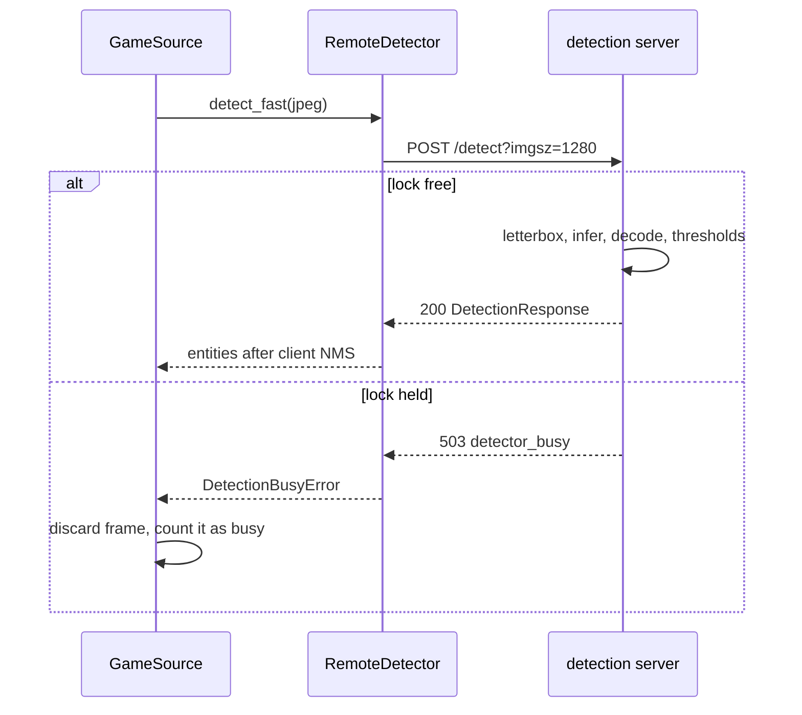

# Detection server, registry and evaluation

The detection server is a FastAPI app in `apps/detection-server/` that loads one detector model and answers single-frame requests over HTTP. It runs on the macOS host so inference can use CoreML, and the agent reaches it through `AOE2_DETECTION_HOST`. The same package holds the release evaluation and latency tools, and `packages/detection/registry/aoe2-entity-detector/` holds the published model card and its evaluation.

## Running the server

```bash
just server --model packages/detection/src/inference/models/aoe2_yolo_v12_nms736.onnx
```

`just server` runs the `aoe2-server` entry point (`detection_server.app:main`). Flags are `--model` (required), `--host` (default `0.0.0.0`) and `--port` (default `8420`). Model weights are gitignored, so copy them onto the host first.

The server chooses its model from `--model` alone. The agent's `AOE2_DETECTION_MODEL` names the model for the in-process detector and its fallback, so set both to the same file.

`_load_model` picks the backend:

| Model file | Backend reported | Runtime |
|---|---|---|
| `.mlpackage`, `.mlmodel` or a directory | `coreml` | `coremltools`, `ComputeUnit.CPU_AND_NE`. Needs the `coreml` extra of `detection`. On load failure it tries the `.onnx` sibling |
| `.onnx`, CoreML provider available | `onnx_coreml` | onnxruntime with `CoreMLExecutionProvider` (`ModelFormat: MLProgram`), then CPU |
| `.onnx`, no CoreML provider | `onnx_cpu` | onnxruntime CPU |

For an ONNX model the server reads a static input shape from the graph (`_static_input_hw`) and uses it for every request. Class names come from the model's embedded `names`; the bundled `apps/detection-server/src/classes.yaml` (60 names) is the fallback, and a mismatch logs a warning.

## Endpoints

| Method and path | Parameters | Returns |
|---|---|---|
| `GET /health` | none | `{status, model_path, backend, num_classes}` |
| `POST /detect` | multipart `file`; query `imgsz` 320 to 1920, default 640 | One letterboxed pass. A static ONNX graph overrides `imgsz`. On the `coreml` backend, an `imgsz` above the model's input size switches to tiling |
| `POST /detect/sahi` | multipart `file`; `tile_size` 320 to 1280 (default 640); `overlap` 0 to 128 (default 32) | Square tiles, edge tiles padded grey, batched in one ONNX call or run one by one on CoreML |

Both detection endpoints return `DetectionResponse`: `detections` (each `class_name`, `bbox` as x1, y1, x2, y2 in original pixels, `center`, `confidence`, `area`), `inference_ms`, `tile_count` and `image_size` as width, height. Detections carry no IDs; the client assigns them. Thresholds come from `get_threshold`, so the 0.55 mill floor applies here (see [thresholds](detector.md#confidence-thresholds)).

`/detect/sahi` feeds tiles at `tile_size`, which a static 736x1280 graph does not accept. The agent only calls `/detect`.

## One inference at a time

`create_app` owns one `threading.Lock`. Each request runs `_run_if_free` in a worker thread, which takes the lock without blocking. If another inference holds it, the request returns immediately:

```http
HTTP/1.1 503 Service Unavailable
Retry-After: 1

{"reason": "detector_busy", "retry_after_ms": 200}
```

The lock is released in a `finally`, so an inference whose client has disconnected still frees the slot when it finishes. Nothing queues: a frame that waits behind another inference would be stale by the time it ran.



A connection error or any other failure takes a different path: the client marks the server unavailable and uses its fallback, described in [remote client](detector.md#remote-client).

## Connecting the agent

Set `AOE2_DETECTION_HOST` to the server's base URL, for example `http://192.168.64.1:8420` from a VM on the Mac's bridge network. With it unset the agent runs the detector in-process. The agent sends `imgsz=config.detection_imgsz` (1280), which the served static graph ignores. Host networking for the VM is in [Windows VM agent bring-up](../runbooks/windows-vm-agent-bringup.md) and [deployment](../runbooks/deployment.md).

## Exporting a model

| Recipe | Runs | Defaults |
|---|---|---|
| `just export-onnx <model.pt> [ARGS]` | `detection.training.export_onnx` | Static `[1, 3, 1280, 1280]`, end-to-end head. `--imgsz H W`, `--dynamic`, `--no-end2end` |
| `just export-coreml [model]` | `detection.training.export_coreml` | imgsz 640, `nms=False`. The recipe's default path is `detection/inference/models/aoe2_yolo_v5.pt` and it passes no `--imgsz` |

The ONNX file is written next to the checkpoint with the same stem, so the served export starts by copying the checkpoint to the served name:

```bash
cp packages/detection/src/inference/models/aoe2_yolo_v12.pt \
   packages/detection/src/inference/models/aoe2_yolo_v12_nms736.pt
just export-onnx packages/detection/src/inference/models/aoe2_yolo_v12_nms736.pt --imgsz 736 1280 --no-end2end
```

Keep exports static. The onnxruntime CoreML provider cannot build a plan for a dynamic graph at 1280 (`export_onnx.py` docstring). `--no-end2end` keeps the one-to-many head, which the decoder deduplicates with its own NMS.

## Model registry

`packages/detection/registry/aoe2-entity-detector/` holds the model card and evaluation files of the Hugging Face model repository `martondobos/aoe2-entity-detector`. Each release is a tagged commit, and consumers pin a tag or commit (the served release is `v12`). The published repository also carries `model.onnx`, `model.pt`, `classes.yaml` and the license, which are not in this directory.

| File | Holds |
|---|---|
| `README.md` | Model card: front-matter metrics, intended use, training recipe, inference contract in prose, limitations, AGPL-3.0 terms, provenance hashes |
| `inference-contract.json` | Machine-readable contract: input name, shape and normalisation, output layout, class thresholds, NMS rule, SHA-256 of model, checkpoint and class schema, source revision |
| `EVALUATION.md` | Test-set protocol, per-class results, reproduction command |
| `evaluation.json` | Output of `detection_server.evaluate`: counts, per-class metrics, thresholds used, runtime versions, hashes of model, dataset manifest, evaluator, server source and thresholds source |

The registered `model.onnx` is the local `aoe2_yolo_v12_nms736.onnx` (same SHA-256, `838c1a10…`). Verify the ONNX and class-schema hashes before serving a downloaded model.

## Release accuracy

From `evaluation.json` (release v12): 40 real 3024x1672 screenshots from 10 capture sessions that no training or validation manifest used, 1,248 labelled boxes, IoU 0.5, deployed thresholds, ONNX CPU provider.

| Images | Labels | TP | FP | FN | Precision | Recall | F1 |
|---:|---:|---:|---:|---:|---:|---:|---:|
| 40 | 1,248 | 1,027 | 77 | 221 | 0.930 | 0.823 | 0.873 |

Per class, for classes with at least 9 test boxes (`EVALUATION.md`):

| Class | Boxes | Precision | Recall | F1 |
|---|---:|---:|---:|---:|
| tree | 405 | 0.978 | 0.877 | 0.924 |
| villager | 335 | 0.854 | 0.800 | 0.826 |
| house | 101 | 1.000 | 0.970 | 0.985 |
| gold_mine | 71 | 1.000 | 0.761 | 0.864 |
| sheep | 66 | 0.929 | 0.591 | 0.722 |
| deer (incl. ibex) | 62 | 0.857 | 0.581 | 0.692 |
| boar | 55 | 0.898 | 0.964 | 0.930 |
| stone_mine | 49 | 0.971 | 0.673 | 0.795 |
| berry_bush | 40 | 0.938 | 0.750 | 0.833 |
| town_center | 39 | 1.000 | 1.000 | 1.000 |
| mill | 9 | 0.900 | 1.000 | 0.947 |
| scout_line | 9 | 1.000 | 0.667 | 0.800 |

`EVALUATION.md` lists the limits. Every test frame is early Dark Age, so armies, castles and walls are untested. Rare classes have too few boxes to score. The labels omit occluded units drawn as outlines, which understates villager precision. The score is per still frame and says nothing about game outcomes.

The registry `README.md` gives the forward pass as about 10 ms on an Apple M2 Pro through the CoreML provider in MLProgram format. No latency report is committed.

## Evaluation tools

All three tools run `evaluate.predict`: the server's own `_detect_single` at imgsz 1280 on the ONNX CPU provider, then the client's NMS at IoU 0.5. Matching is greedy one-to-one per image and class at IoU 0.5, reported as micro precision, recall and F1, not mAP. The two scorers first check that the model's class names are a prefix of `classes.yaml`.

| Module | Input | Purpose |
|---|---|---|
| `detection_server.evaluate` | `--model`, `--data` (a YOLO dataset dir), `--split val` or `test`, `--output` | Writes the release `evaluation.json`. Scores `real_*` images only; `test` sets come from `detection.labeling.build_test_set` |
| `detection_server.evaluate_sessions` | `--model`, `--root`, `--split development` or `final_test`, `--output` | Scores sealed, reviewed capture sessions. `final_test` refuses to run without `--attest-isolated-final-test` |
| `detection_server.benchmark_latency` | `--model`, `--data`, `--output` | Times decoded image to post-processed boxes on CPU over the `val` split, after 3 warm-up calls; writes median and p95 with machine and library versions |

The release command, from `EVALUATION.md`:

```bash
uv run --package detection-server python -m detection_server.evaluate \
  --model packages/detection/src/inference/models/aoe2_yolo_v12_nms736.onnx \
  --data tmp/test_data_independent_20261030 --split test \
  --output packages/detection/registry/aoe2-entity-detector/evaluation.json
```

`detection_server.session_tools` prepares the session labels these scorers read. Its subcommands are `prelabel`, `prelabel-batch`, `import-coco`, `seal`, `audit` and `qa-gallery`, and it refuses to prelabel final-test frames, which must be labelled blind. The workflow is in [labeling](labeling.md); retraining and promotion are in [retrain detector](../runbooks/retrain-detector.md).
