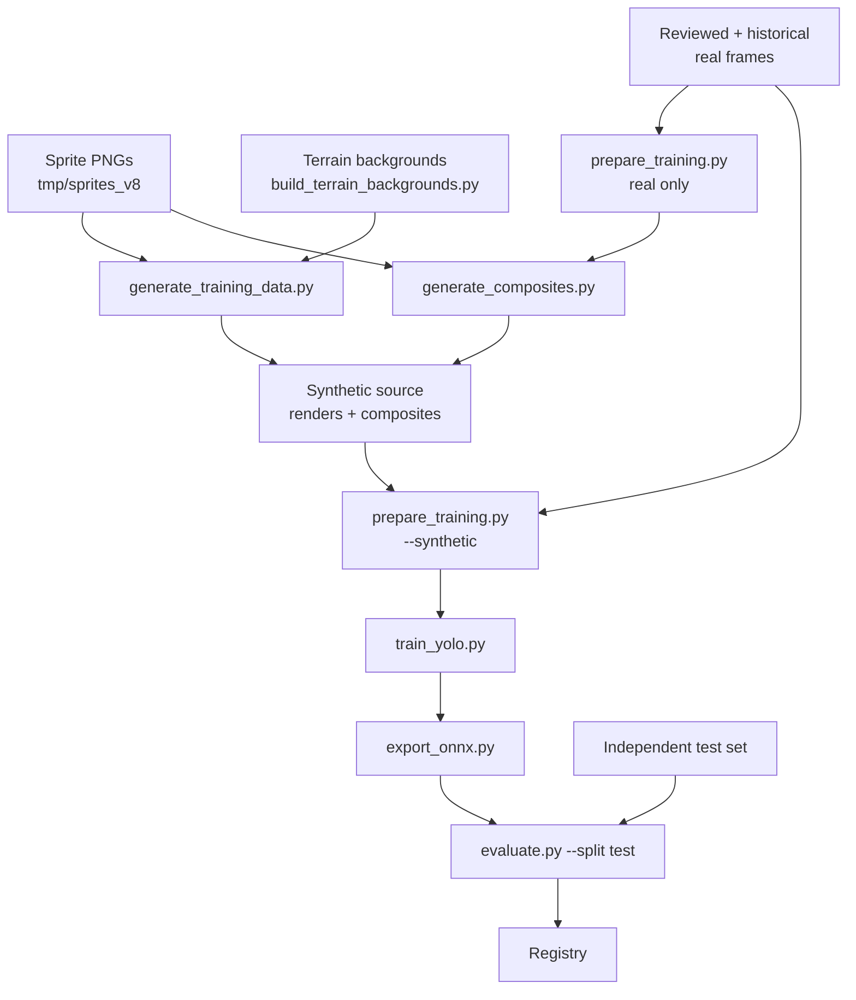

# Detector training

The entity detector is a YOLO26n model fine-tuned on a mix of reviewed real screenshots, synthetic scenes rendered from game sprites, and copy-paste composites that put sprites onto real frames at the game's own scale. All training code is in `packages/detection/src/training/` and `packages/detection/src/labeling/`; the model it produces is described in [the detector](detector.md).

## Data flow



`prepare_training.py` runs twice: once without synthetic data to give the composite generator a set of real training frames as backgrounds, and once more to build the final dataset. Sprites come from [sprite extraction](sprite-extraction.md); real labels come from the [labeling workflow](labeling.md).

## Training data sources

The served v12 model was trained on `packages/detection/src/training_data_exp_d_combined_20261030/`. Its `merge_summary.json` gives the composition:

| Source | Directory | Made by | Train images in v12 data |
|---|---|---|---|
| Reviewed real frames | `real_screenshots/labeling_batch_20261011_xanylabeling_review/` | X-AnyLabeling review, see [labeling](labeling.md) | 45 unique |
| Historical real frames | `training_data_v9_slim/` (`real_*` images) | Older labeled set, imported as training only | 219 unique |
| Synthetic renders | `training_data_v9_synth/` | `generate_training_data.py` | 2,400 |
| Copy-paste composites | `training_data_composite_ibex_20261030/` | `generate_composites.py` | 1,000 |

The 264 unique real images are repeated 4 times (`--oversample-real 4`), giving 1,056 real files on disk and 4,456 training images in total. Validation is 8 real frames from whole held-out sessions. The 700 synthetic validation images go to a separate `synthetic_val/` split that the trainer never sees. Eleven of the 65 classes have no real box anywhere in the dataset (listed in `zero_real_classes`).

The historical frames are 1280×831 JPEGs cut from macOS screenshots of the VM window, so they include menu bar, window title and dock. `prepare_training` drops their old train/validation assignment and uses all of them for training, because old train and validation frames are near duplicates of each other. Every directory above lives under `packages/detection/src/` and is gitignored.

## Synthetic renders

`generate_training_data.py` (`TrainingDataGenerator`) pastes extracted sprites onto a background and writes YOLO labels from the paste positions. Defaults: 1280×720 images, 80/20 train/val split, seed 42, sprites from `tmp/sprites_v6` at the repo root (pass `--sprites` for another set).

| Feature | Setting |
|---|---|
| Backgrounds | `--backgrounds` (terrain PNGs), `--real-screenshots` with `--real-bg-ratio` (default 0.5), or procedural biome colours |
| Water scenes | `--water-backgrounds` with `--water-fraction` (default 0.15); boats and fish are placed only on water |
| Class rebalancing | `_OVERSAMPLE_WEIGHTS` multiplies per-image counts for rare military classes (2.0 to 2.5) |
| Distant units | `_DISTANT_FRACTION` 0.25 of unit instances drawn at 0.18 to 0.30 scale |
| UI overlays | Selection outline (0.15 of units), health bar (0.20), garrison badge (0.12 of buildings); boxes unchanged |
| Basic augmentation | Brightness, contrast, saturation, slight blur |
| Enhanced augmentation | Fog patches, minimap/resource bar/command panel occluders, JPEG artefacts, colour temperature, vignette; disable with `--no-enhanced-aug` |
| Occlusion | `_filter_occluded_labels` drops a label when more than 50% of its box is under fog or UI |
| Scale zoom | 30% of images scaled 0.7 to 1.3 with labels transformed |

`build_terrain_backgrounds.py` crops, jitters and blends the game's DDS ground textures into 1280×720 PNGs for `--backgrounds`, skipping void, placeholder and (unless `--include-water`) water tiles.

A render places sprites at about native size on a 1280×720 canvas, so objects are 2 to 3 times larger relative to the frame than in a 3024×1672 capture, with no real HUD or fog. The composites cover that gap.

## Scale-matched composites

`generate_composites.py` uses real training frames as canvases. It reads `dataset_manifest.json` from a prepared real dataset, keeps distinct `train` frames whose size is a known capture layout (3024×1672 native, 1280×831 macOS VM screenshot), and keeps every reviewed label already in the frame.

- Sprites are scaled by `frame width / 3024 × zoom`, with zoom 1.0 jittered by 0.92 to 1.08. Real building labels match native sprite sizes at zoom 1.0.
- Unit and animal boxes are padded 4.5% per side to match how reviewers draw them.
- A placement must stay out of the HUD regions in `HUD_REGIONS`, sit on ground with mean luminance of at least 60 and at most 10% dark pixels, and overlap no existing label beyond `_MAX_OVERLAP_EXISTING`.
- `plan_groups` builds each scene from villager work groups, a livestock herd, wildlife, an optional army and one or two buildings. Resources are never pasted, since one sprite cannot reproduce a labeled group of trees or mines.
- Sprites are pasted in isometric draw order (lowest box last), and half get a 0.6 px alpha blur so the detector cannot learn to spot paste seams.
- Sprites load under their fine label (`ibex`, `elephant`) and the label file gets the class the alias maps to.

Output is `train/` and `val/` plus `composite_manifest.json`, which records the source manifest hash, sprite counts, seed, zoom and, per image, the background hash and pasted counts. The output directory must not exist.

## Building the dataset

`detection.labeling.prepare_training` assembles every training dataset. It takes one or more COCO or YOLO annotation exports (`--cvat-export`), the original images, and the source-session CSV manifests, then:

1. Accepts only frames whose manifest split is `development`, and checks every image hash and size against its manifest.
2. Requires review evidence: a checked X-AnyLabeling sidecar per image, or `--reviewed-export` for exports without sidecars.
3. Maps class names (not IDs) through `classes.yaml`, applying `label_aliases`, and validates every box.
4. Splits real frames into train and validation by whole session (`--val-split` 0.15, `--seed` 42); it needs at least two sessions.
5. Adds `--historical-real` frames as training only, `--synthetic` train frames to training and synthetic val frames to `synthetic_val/`.
6. Refuses identical image bytes in training and validation, then writes the dataset atomically to an `--output` that must not exist.

`--dry-run` prints the summary without writing.

```
training_data_<name>/
├── dataset.yaml            # train/images, val/images, names from classes.yaml
├── dataset_manifest.json   # schema hash, input file hashes, sessions per split, every image
├── merge_summary.json      # counts per source and class
├── train/{images,labels}/  # real_*, historical_*, synth_*
├── val/{images,labels}/    # real frames from validation sessions
└── synthetic_val/          # diagnostics only
```

The class list is `packages/detection/src/training/config/classes.yaml` (65 classes plus the `ibex` and `elephant` aliases); see [the detector](detector.md) for the schema.

For v12, the synthetic source `training_data_synth_merged_20261030/` is a directory of symlinks that joins the 2,400/600 renders (`render_*`) with the 1,000/100 composites (`comp_*`). No script in the repo builds it.

## Training entry point

```bash
just train yolo26n.pt --data packages/detection/src/<dataset>/dataset.yaml --name aoe2_yolo_vN
```

The recipe runs `python -m detection.training.train_yolo --model <model>`. The first positional argument is the base model, so pass it before the flags. `--data` and `--name` are required; `--data` resolves against `packages/detection/src` first, then the working directory.

| Flag | Default | Notes |
|---|---|---|
| `--model` | `yolo26n.pt` | Ultralytics base weights |
| `--epochs` | 150 | |
| `--batch` | 16 | |
| `--imgsz` | 1280 | Train size; inference must letterbox at the same scale |
| `--optimizer` | `MuSGD` | Never `auto`, which picks AdamW at lr 0.000145 below 10,000 iterations |
| `--lr0` | 0.01 | |
| `--momentum` | 0.9 | |
| `--warmup-bias-lr` | 0.0 | |
| `--seed` | 0 | Training also sets `deterministic=True` |
| `--patience` | 0 | No early stop; 8 validation frames cannot pick a checkpoint |
| `--cache` | `none` | `ram` or `disk` skip image decode after epoch 1 |
| `--device`, `--workers` | 0, 8 | `--device` is a CUDA index |
| `--save-period` | -1 | 1 keeps every epoch, for checkpoint averaging |
| `--cls-gain`, `--box-gain`, `--dfl-gain` | unset | Loss-gain overrides |
| `--resume` | off | Continues `runs/<name>/weights/last.pt` with `resume=True` |
| `--export-onnx` | off | Static square ONNX at `--imgsz` after training |

The registry README records why MuSGD is the default: in a 2×2 experiment with two seeds per cell, AdamW at lr 0.000145 reached mean F1 0.840 on the independent test set against 0.861 for MuSGD at lr 0.01 on the same data.

Augmentation passed to Ultralytics: `hsv_h` 0.015, `hsv_s` 0.7, `hsv_v` 0.4, `degrees` 10, `translate` 0.1, `scale` 0.5, `flipud` 0.0 (isometric view), `fliplr` 0.5, `mosaic` 1.0, `mixup` 0.1.

The model of record is the final epoch, `runs/<name>/weights/last.pt`, never `best.pt`. With `--export-onnx` and a local `packages/detection/src/inference/models/` directory, the script copies `last.pt` and the ONNX file there as `<name>.pt` and `<name>.onnx`.

## Where training runs

`--device` goes to Ultralytics as a CUDA device index, so training needs an NVIDIA GPU. `train_yolo.py` also runs on its own: on a host without the `detection` package it imports `YOLO` straight from `ultralytics` and, without a models directory, prints the paths to download instead of copying.

| Tool | Purpose |
|---|---|
| `scripts/pack_dataset_for_runpod.py --src <dataset> --out <dataset>_slim` | Re-encodes `train` and `val` images as JPEG (long side 1280, quality 90) and copies labels and `dataset.yaml`, for a faster upload |
| `tmp/r1_optimizer_2x2/launch3.sh <pod> <hours>` | Creates a RunPod RTX 4090 Secure pod with `runpodctl` and a terminate-after time, aborts above $0.90/h, uploads `train_yolo.py`, a `run_<pod>.sh` and dataset tars, checks their SHA-256, installs `ultralytics==8.4.54` and starts the run |
| `tmp/r1_optimizer_2x2/run_<pod>.sh` | Runs `train_yolo.py` once per line of its run list with explicit optimizer, seed and `--export-onnx`, then writes `done.flag` |
| `tmp/r1_optimizer_2x2/wait3.sh <pod>` | Polls every 10 minutes, downloads `last.pt`, `last.onnx`, `results.csv`, `args.yaml` and the log with a hash check into `tmp/runs/<name>/`, deletes the pod after `done.flag` |

`tmp/` is gitignored, so the RunPod scripts exist only in the local checkout. They hard-code the datasets and hashes of the optimizer experiment and need editing for another run.

## Export

The served graph is not what `--export-onnx` writes. Export the checkpoint at 736×1280 with the one-to-many head; the ONNX lands beside the `.pt` with the same stem:

```bash
cp aoe2_yolo_vN.pt aoe2_yolo_vN_nms736.pt
just export-onnx packages/detection/src/inference/models/aoe2_yolo_vN_nms736.pt --imgsz 736 1280 --no-end2end
```

`export_onnx.py` exports a static graph by default, because the ONNX Runtime CoreML provider cannot plan a dynamic graph at 1280. A 3024×1672 frame letterboxes to the same scale at 736×1280 as at 1280×1280, with 42% fewer pixels to compute. `--no-end2end` keeps the one-to-many head, so the server and the local decoder run a class-wise NMS.

## Evaluation and promotion

A candidate is compared with the served model on the independent test set: 40 real frames from 10 sessions that no training or validation manifest uses, built by `build_test_set` (see [labeling](labeling.md#independent-test-set)). `python -m detection_server.evaluate --split test` scores the exact ONNX file through the server's decoder and thresholds. The 8-frame validation split and the synthetic validation mAP are not used to choose a model.

Scoring rules, threshold tuning, the registry under `packages/detection/registry/aoe2-entity-detector/` and how the server and agent pick a model are in [serving and evaluation](serving-and-evaluation.md). The step-by-step procedure is in [retrain the detector](../runbooks/retrain-detector.md).
