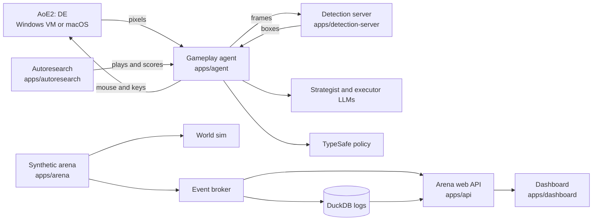

# AoE2 LLM Arena

An agent that plays Age of Empires II: Definitive Edition from screen pixels, plus the tools around it: a detection model and server, a synthetic arena for comparing prompts and models, a web viewer for arena runs, and an autoresearch loop that scores real games. Code paths in this wiki are relative to the `agent/` repo root.

The gameplay agent and the arena share no runtime. The arena drives a text model against a simulated economy; the agent plays the real game.

## Gameplay agent

| Page | Covers |
|---|---|
| [Overview](agent/overview.md) | What the agent is, the three loops, deployment topologies, repo layout, configuration |
| [Perception](agent/perception.md) | Window capture on Windows and macOS, the capture, detection and HUD lanes, OCR, ownership, how a `Perception` frame is versioned and published |
| [Tracking](agent/tracking.md) | Stable track IDs and smoothed labels, the screentrack Rust tracker, camera-motion resets, the tracker benchmark |
| [Decision loops](agent/decision-loops.md) | TypeSafe policy, strategist and executor on the perceive, act and deliberate clocks; the feasible catalog, revalidation, fallback, goals, alarms and recovery |
| [Actions and execution](agent/actions-and-execution.md) | The action model, executor tools, spend checks, target resolution, input on Windows and macOS, the action ledger, the offline scenario runner |
| [LLM providers](agent/llm-providers.md) | `ChatWire` adapters, wire selection, model defaults, the TypeSafe client, cost accounting, the text completer |
| [Prompts and context](agent/prompts-and-context.md) | Prompt files, what each role reads per turn, cross-game memories |
| [Game knowledge](agent/game-knowledge.md) | The `packages/data` reference database and where the agent's runtime game facts actually live |

## Detection

| Page | Covers |
|---|---|
| [Entity detector](detection/detector.md) | The inference library, the served YOLO26n model, pre and postprocessing, thresholds, ownership, the 65-class taxonomy |
| [Serving and evaluation](detection/serving-and-evaluation.md) | The detection server, the one-inference-at-a-time rule, model export, the model registry, release evaluation |
| [Training](detection/training.md) | Real, synthetic and composite training data, `train_yolo.py` settings, local and cloud runs, promotion |
| [Labeling](detection/labeling.md) | Capture sessions, prelabels, X-AnyLabeling review, label aliases, the independent test set |
| [Sprite extraction](detection/sprite-extraction.md) | Decoding `.sld` sprites into PNGs for the synthetic generators |

## Synthetic arena

| Page | Covers |
|---|---|
| [Overview](arena/overview.md) | The `aoe2-arena` CLI, profiles, how a variant is invoked, the infra stack |
| [World sim](arena/world-sim.md) | The AoE2-lite economy model and what the arena model sees |
| [Ranking](arena/ranking.md) | Round-robin play over scenarios, Bradley-Terry ratings, bootstrap intervals |
| [Event broker](arena/event-broker.md) | The `EventBroker` protocol, in-process and Redis Streams backends, backpressure |
| [Event log and replay](arena/event-log-and-replay.md) | Event types, the DuckDB persister and reader, the fork primitive |

## Arena web

| Page | Covers |
|---|---|
| [Architecture](web/architecture.md) | FastAPI endpoints, live versus cold event streams, forks, the reaper, the dashboard routes |
| [Run viewer](web/run-viewer.md) | The run page: timeline, World, Trace, Diff and Operator panels, forking from the UI |
| [Running locally](web/running-locally.md) | `just` recipes, the Vite proxy, environment variables, deployment modes |

## Autoresearch

| Page | Covers |
|---|---|
| [Overview](autoresearch/overview.md) | Playing and scoring real games, the experiment ledger and merge gate, the prompt tournament |
| [Mutation and memory](autoresearch/mutation-and-memory.md) | `PromptMutator` and `MemoryChain` |

## Runbooks

- [Deployment](runbooks/deployment.md): first-time setup on a Windows VM or native macOS.
- [Windows VM agent bring-up](runbooks/windows-vm-agent-bringup.md): starting the agent on a prepared VM, with a symptom table.
- [Retrain the detector](runbooks/retrain-detector.md): from captured frames to a deployed model.
- [Baseline experiments](runbooks/baseline-experiments.md): recording scored games into the ledger.
- [Redis broker operations](runbooks/redis-broker-ops.md) and [switching the broker backend](runbooks/switching-broker-backend.md).
- [Debugging a stuck fork](runbooks/debug-stuck-fork.md).

## Decisions

- [0001 Broker-first event architecture](adr/0001-broker-first-architecture.md)
- [0002 Redis Streams for cross-process events](adr/0002-redis-streams-for-cross-process.md)
- [0003 basedpyright](adr/0003-basedpyright.md)
- [0004 Bradley-Terry ranking](adr/0004-bradley-terry-ranking.md)
- [0005 Arena UI stack](adr/0005-arena-ui-stack.md)

## Background

- [YOLO and object detection](appendix/01-yolo-and-object-detection.md)
- [Event brokers and Redis Streams](appendix/02-event-brokers-and-redis-streams.md)
- [Bradley-Terry and the bootstrap](appendix/03-bradley-terry-and-bootstrap.md)
- [Glossary](glossary.md)
