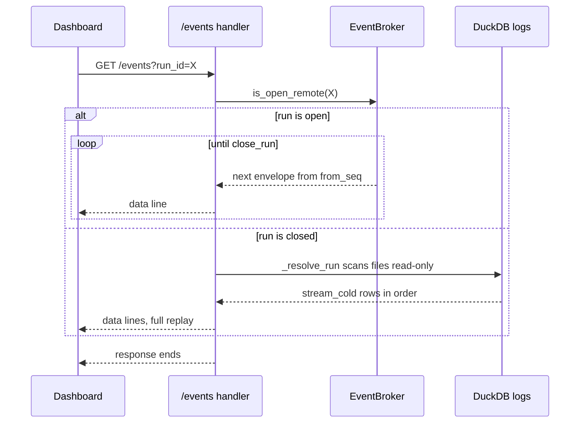
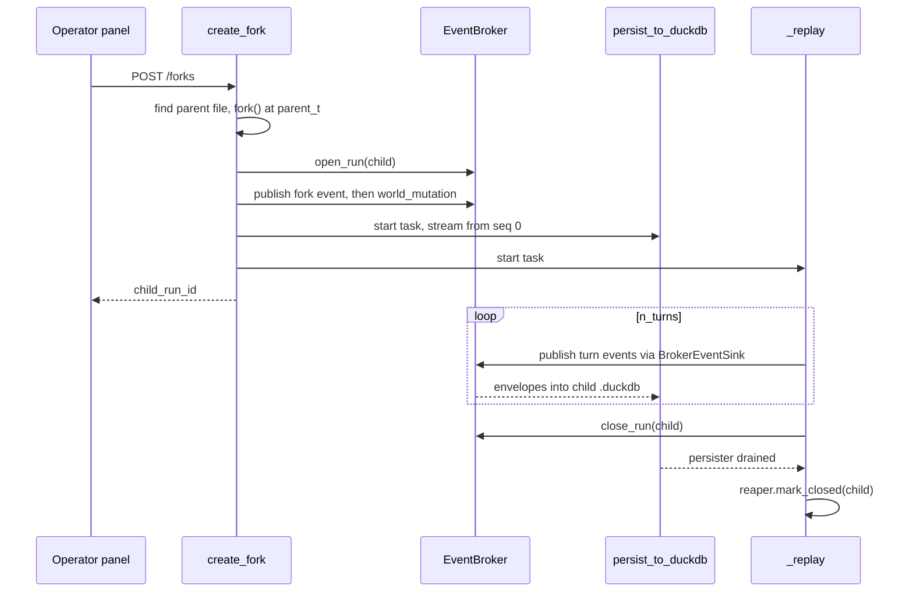

# Arena web architecture

The arena web stack lets an operator browse arena runs, watch a live run turn by turn, and fork a run from any turn with a mutated world state. It has a FastAPI backend in `apps/api` (package `arena-web`) and a React single-page app in `apps/dashboard`. Neither is needed to run the agent or the arena CLIs; both sit on top of the [event broker](../arena/event-broker.md) and the [DuckDB event log](../arena/event-log-and-replay.md).

## Backend process

`apps/api/src/__main__.py` (`main`) parses `--host` (default `127.0.0.1`) and `--port` (default `8000`) and runs `arena_web.server:app` under uvicorn. The console script is `aoe2-arena-web`.

`lifespan` in `apps/api/src/server.py` builds the process-wide state on startup:

| `app.state` slot | Built by | Holds |
|---|---|---|
| `broker` | `make_broker()` | `InProcessEventBroker` or `RedisStreamsBroker`, chosen by `ARENA_BROKER_BACKEND` |
| `reaper` | `_ReaperRegistry()` | Close times of fork runs, for delayed buffer cleanup |
| `fork_tasks` | `set()` | Strong references to running persister and replay tasks |

It also starts `_reaper_loop` as a background task. On shutdown it cancels the reaper first, then cancels every task in `fork_tasks` and gathers them, so the reaper cannot drop a buffer while a replay is being torn down. Handlers reach the three slots through the dependencies `get_broker`, `get_reaper` and `get_fork_tasks`.

CORS allows `GET` and `POST` from `ARENA_WEB_CORS_ORIGINS` (comma-separated), which defaults to `http://localhost:5173` and `http://localhost:8000`. The list is read once, when `server.py` is imported. There is no authentication and no static file serving.

## Endpoints

| Method | Path | Purpose |
|---|---|---|
| `GET` | `/health` | Returns `{"status": "ok"}`. |
| `GET` | `/runs` | Every run as a `RunSummary`: live runs from `broker.live_runs()` (`status: "running"`, empty `db_path`) first, then finalized runs from the DuckDB files (`status: "complete"`). A live row hides a cold row with the same `run_id`. |
| `GET` | `/runs/summaries` | One `RunMetrics` per finalized run: `profile_name`, total LLM cost, turn count, final age (and its index in `AGE_SEQUENCE`), population and economy (food plus wood). |
| `GET` | `/runs/series?db_path=X` | One `RunSeries` per run in a single log file: per-turn food, wood, gold, stone and population read from `turn_start` snapshots. `db_path` must resolve to an existing file under the logs root, otherwise 404. |
| `GET` | `/events?run_id=X&from_seq=N` | Server-Sent Events stream of the run's event payloads. Live or cold, see below. |
| `POST` | `/forks` | Snapshot a parent run at a turn, optionally mutate the state, and start an N-turn replay as a child run. Returns `child_run_id`, `db_path`, `profile_used`. |
| `GET` | `/metrics` | Broker counters: `events_published`, `events_streamed`, `streams_dropped`, `runs_open`. 503 when the broker type has no metrics. |

The logs root is `ARENA_LOGS_ROOT`, or `logs/arena` relative to the working directory. Every reader globs `*/*.duckdb` under it (one date directory deep), newest modification time first. A run's label is the file name up to the first `-`, so `rank-142233.duckdb` gives `rank`. `_connect_read_only` returns `None` for a file another process holds open for writing; `/runs`, `/runs/summaries` and `/runs/series` skip such files, so a CLI run that is still writing its log shows up only through the broker.

## Event stream

`events` in `server.py` asks the broker `is_open_remote(run_id)`. That call answers for runs opened by any process when the broker is Redis, and for runs opened in this process when the broker is in-process.

Each message is `data: <payload_json>\n\n`, where the JSON is `payload.model_dump_json()` and carries a `kind` discriminator. Both paths serialise the same way; `test_payload_roundtrip_is_byte_stable` guards that. Messages carry no `id:` field.

The live path honours `from_seq` and ends when the producer closes the run. If the consumer falls behind the broker's buffer, `_stream_from_broker` catches `BrokerOverflowError`, sends one `event: overflow` message with `{"available_from": N}`, and ends the response; a client that wants the rest reconnects with `from_seq=N` and accepts the gap. The cold path ignores `from_seq` and always replays from the start. `_resolve_run` returns 404 when no readable file holds the run and 503 when some file was skipped because a writer holds it, since that file might contain the run once it is released.

The dashboard does not use `from_seq` and has no listener for `overflow` (see [frontend data flow](#frontend-data-flow)).

## Forks

`post_forks` hands the request to `create_fork` in `apps/api/src/forks.py`. A `ForkRequest` has `parent_run_id`, `parent_t` (0 or more), `mutation`, `n_turns` (default 10, range 0 to 200) and `reason`. `MutationPatch` accepts only `food`, `wood`, `gold`, `stone`, `population`, `pop_cap` and `age` (one of the four age names) and rejects unknown fields.

`_resolve_parent_db` finds the parent's file. `evaluation.fork.fork` reads the parent's `turn_start` at `parent_t`, applies the patch, emits a `fork` event and returns a child run id (a UUID hex) with the forked state. A `world_mutation` event with before and after summaries and the operator's `reason` follows only when the patch sets at least one field. The child log is `<logs root>/<UTC date>/fork-<HHMMSSffffff>.duckdb`.

`_replay` drives `synth_game_loop` with `build_synth_invoke(DEFAULT_FORK_PROFILE)`: wire `openai`, model `gpt-5.6-luna`, prompt variant `strategy`, no temperature. Every turn is a real model call, so forks need `AOE2_LLM_API_KEY`. The tail order is fixed in the code: drain the pending publishes, `close_run`, await the persister so the file is complete before a cold read, then notify the reaper. Errors map to 404 (parent not found), 422 (`ForkError`, such as no `turn_start` at `parent_t`, or request validation) and 500 for anything else.

The broker opens fork runs without `RunMeta`, so while a fork is live `/runs` lists it with label `?` and an empty `first_ts`. Once finalized it reads from its file with label `fork`.

## Reaper

The broker keeps a closed run's buffer until something calls `reap`. `_ReaperRegistry` records when each fork run closed, and `_reaper_loop` wakes every half grace period (grace is 30 minutes, so every 15 minutes) and reaps runs closed longer than the grace. Only forks created by this server are registered; runs produced by the arena CLIs are not reaped here.

## Dashboard

`apps/dashboard` (package `arena-web-ui`) is a Vite 6 build of React 19 with Tailwind CSS 4 through `@tailwindcss/vite`. Routing is TanStack Router with file-based routes and `autoCodeSplitting`; server state is TanStack Query 5. UI primitives are React Aria Components wrapped as local shadcn components (style `aria-nova`) under `src/components/ui/`. Charts use Recharts and icons use lucide-react. The React Compiler Babel plugin memoises components, so panels carry little hand-written `useMemo`. The reasons for this stack are in [ADR 0005](../adr/0005-arena-ui-stack.md).

`src/main.tsx` creates one `QueryClient`, passes it to the router as context, and sets `defaultPreloadStaleTime: 0` so Query alone decides freshness. The router plugin generates `src/routeTree.gen.ts` from `src/routes/`; the file is committed because `bun run build` runs `tsc -b` before Vite.

| Route file | URL | Renders |
|---|---|---|
| `__root.tsx` | | `Outlet`, with `queryClient` in router context |
| `index.tsx` | `/` | Redirect to `/runs` |
| `_arena.tsx` | (pathless) | `ArenaLayout`: run sidebar plus outlet; loader primes `/runs` |
| `_arena.runs.index.tsx` | `/runs` | "No run selected" empty state |
| `_arena.runs.$runId.tsx` | `/runs/<runId>?turn=&tab=` | Run viewer: header, sibling strip, four tabs, timeline |
| `_arena.experiments.$key.tsx` | `/experiments/<key>` | Experiment overview for one run group; loader primes `/runs` and `/runs/summaries` |

The sidebar (`components/run-list.tsx`) groups runs by `groupKey` in `lib/run-grouping.ts`: finalized runs by `db_path` (one file per `race` or `rank` operation), live runs by `label:first_ts`. A single-run group renders as a plain run card; a larger group gets a header that opens its experiment overview. Live runs and groups show a pulsing dot. The run viewer and the overview are described in [run viewer](run-viewer.md).

## Frontend data flow

The app keeps state in three places.

| State | Lives in | Examples |
|---|---|---|
| View state | URL search params, validated by `validateSearch` | `?turn=`, `?tab=` on the run page |
| Server reads | TanStack Query cache, factories in `lib/queries.ts` | `["runs"]`, `["runs","summaries"]`, `["runs","series",dbPath]`, `["events",runId]` |
| Drafts | Component state | Operator form, Trace kind filter |

Query keys nest, so invalidating `["runs"]` also refreshes summaries and series. `runSeriesQueryOptions("")` is disabled, which is the case for live groups that have no file yet. `/runs` has no polling interval; it refetches under Query's defaults (remount, window focus) and after a fork.

`hooks/use-events.ts` turns an `EventSource` on `/events?run_id=X` into an async generator and feeds it to Query's `experimental_streamedQuery`, which appends each parsed event to the cached array. The query has `staleTime: 0` and `gcTime: 0`, so opening a run always starts a fresh stream. `EventSource` reports both a finished response and a failed connection through `onerror`; the hook treats an error after the socket opened as a normal end and one before it opened as a failure, and closes the source either way, so the browser never auto-reconnects. `useEvents` maps the query state to `idle`, `connecting`, `open`, `closed` or `error`, which `StatusBadge` shows as Idle, Connecting, Streaming, Complete or Error. An `overflow` message is a named event and never reaches `onmessage`, so after an overflow the stream ends and the badge reads Complete with the events received so far.

`lib/api.ts` prefixes every request with `VITE_API_BASE_URL` (empty by default, meaning same origin). Dev proxy and deployment options are in [running locally](running-locally.md).

## Landing site

`apps/landing` is a separate Astro 5 static site with React islands, MDX and Pagefind search. Its content collection loads every Markdown file under the agent repo's `docs/` directory and renders Mermaid at build time. `scripts/capture-arena-screenshots.ts` drives the dashboard with Playwright to produce the screenshots on its home page. It does not talk to the arena API at runtime.

## Related

- [Arena overview](../arena/overview.md)
- [Debugging a stuck fork](../runbooks/debug-stuck-fork.md)
- [Switching the broker backend](../runbooks/switching-broker-backend.md)
