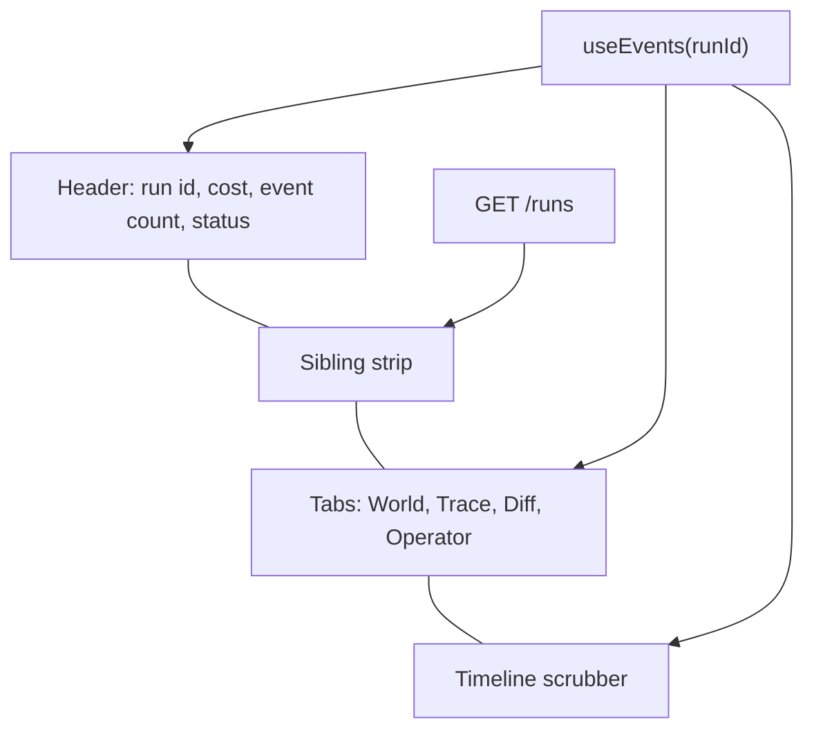

# Run viewer

The run viewer is the dashboard page at `/runs/<runId>` (`apps/dashboard/src/routes/_arena.runs.$runId.tsx`, component `RunDetail`). It replays or live-tails one run's event stream, lets the operator scrub through its turns, and is where forks are created and compared. All four panels read from the same stream: one `useEvents(runId)` subscription to `GET /events?run_id=<runId>`.

## Layout

The header shows the run id, the summed `cost_usd` of all `llm_response` events (hidden while zero), the event count, and the stream status badge (Connecting, Streaming, Complete or Error). The sibling strip appears when the run belongs to a multi-run `race` or `rank` operation and lists every run of that operation as a chip for one-click switching. The timeline sits outside the tabs, so the selected turn survives a tab switch.

## Turn selection

The URL carries the view state: `?turn=<n>` and `?tab=<world|trace|diff|operator>`. `validateSearch` drops a non-numeric or non-positive `turn` and an unknown `tab`; the tab defaults to `world` at read time and is never written back into the URL.

`selectedTurn = turn ?? maxTurn`, where `maxTurn` is the highest `turn_num` among the `turn_start` events received so far (`lastTurn` in `lib/event-utils.ts`). With no `turn` in the URL the view follows the stream and moves forward as turns arrive; dragging the scrubber writes `turn` and pins the view there. Switching runs navigates with empty search params, which unpins it.

`components/timeline.tsx` (`Timeline`) is a React Aria slider from 1 to `maxTurn` with at most about nine tick labels and a `turn N / max` readout. Each change navigates with `replace: true`, so a drag does not fill the browser history. Before the first `turn_start` it shows a placeholder.

## Panels

| Tab | Component | Shows | Data |
|---|---|---|---|
| World | `panels/world.tsx` (`WorldPanel`) | Resource chart across turns; population against cap with a progress bar, villager queue length and a population line chart; current age, or ticks left in an age-up; building counts | `turn_start` snapshots indexed by `statesByTurn` |
| Trace | `panels/trace.tsx` (`TracePanel`) | Every event, grouped by turn, as collapsible rows that expand to the full JSON payload | The whole stream, grouped by `eventsByTurn` |
| Diff | `panels/diff.tsx` (`DiffPanel`) | Fork lineage of the current run and its state against the parent's | `fork` events in the stream, plus a second stream for the parent |
| Operator | `panels/operator.tsx` (`OperatorPanel`) | Form that creates a fork of the current run | `POST /forks` |

The World and Trace panels follow `selectedTurn`. The World panel charts mark the selected turn and show an empty state when that turn has no snapshot. In the Trace panel, events before the first `turn_start` (for a fork, its `fork` and `world_mutation` events) fall into turn 0. A filter bar toggles each of the nine event kinds and shows how many of each arrived; it doubles as the colour legend. When the selected turn changes, the list scrolls that turn's group into view after a 150 ms debounce; incoming events do not scroll it.

## Forking from the Operator panel

The form maps one-to-one onto `ForkRequest`:

| Field | Default | Sent as |
|---|---|---|
| Fork at turn | The selected turn, or 1 | `parent_t` |
| Replay N turns | 10, limited to 0 to 200 | `n_turns` |
| Reason | empty | `reason`, stored on the `world_mutation` event |
| food, wood, gold, stone, population, pop_cap | blank | `mutation`, only fields that have a value |
| Age | blank | `mutation.age`, one of the four ages |

A mutation summary card previews the patch. The form resets whenever the run or the selected turn changes, so moving the scrubber after filling it in clears it.

Submitting runs a TanStack Query `useMutation` around `createFork` in `lib/api.ts`. On success it invalidates `["runs"]` and then navigates to `/runs/<child_run_id>`, so the child is already in the refreshed sidebar list when its page opens. The child page streams live from the broker while the replay runs: first the `fork` event, then the `world_mutation` event if the patch set anything, then `turn_start` from turn 1 onward. A failed request shows the server's `detail` message (for example the 404 or 422 text) in a red badge next to the button. What happens on the server is in [arena web architecture](architecture.md#forks).

## Comparing a fork with its parent

`forksIn` collects the run's `fork` events. A run without one shows an empty state on the Diff tab. With more than one, buttons pick which fork to inspect.

For the selected fork the panel shows the parent run id and turn, the `mutation_summary` from the `fork` event (a "no mutation, clean clone" note when empty), and an Open parent run button. `ForkComparison` (`panels/fork-comparison.tsx`) calls `useEvents(parent_run_id)`, which opens a second SSE connection, and renders two `StateSummary` cards: the parent's state at `parent_t` and the child's state at its lowest recorded turn. A badge shows the parent stream's status. Open parent run navigates to the parent, where the Diff tab shows the parent's own lineage, if any.

## Experiment overview

`/experiments/<key>` (`panels/experiment-overview.tsx`, `ExperimentOverview`) compares the runs of one operation. It opens from a group header in the sidebar.

| Section | Contents | Data |
|---|---|---|
| Leaderboard | Runs sorted by final age, then population, then economy (the same order as `composite_score` in `apps/arena/src/ranking.py`), winner highlighted; clicking a row opens that run | `/runs` and `/runs/summaries` |
| Comparison bars | Final population (winner highlighted) and total LLM cost (cheapest highlighted) | `/runs/summaries` |
| Resources over time | Food, wood, gold and stone, one line per profile, averaged per turn across that profile's runs | `/runs/series?db_path=<group file>` |

Metrics come only from finalized files, so a running operation shows "No finalized metrics yet". Chart labels use the profile name when it is unique within the operation, otherwise a short run id. Ranking across operations is covered in [ranking](../arena/ranking.md).
